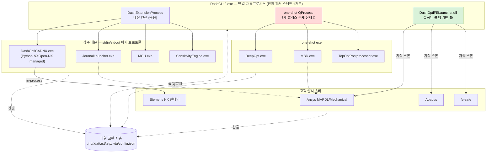
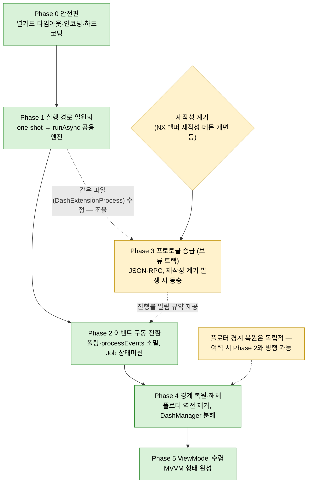

# DashGUI2 개선 로드맵 — 외부 연동 · 동기/비동기 · 통신 · 모듈화 통합 진단과 실행 순서

> 원본: 사전조사 Issue #198 — 본문을 이 페이지로 이관한 뒤 Issue 삭제 (2026-08-24). **본 페이지가 정본**
> 이관 주석: 아래 머리글의 `상태:` (Wiki 미연동·원격 미생성) 는 이관 전 시점 표기
> 미이관 참조: `cadnx-integration-architecture` · `cadnx-cpp-port-analysis` — 위키 미이관(Obsidian 로컬). 본문에서 백틱 표기로 남김

> 상태: 로컬 초안 (GitHub Issue / Wiki 미연동 — wiki 원격 미생성 상태)\
> 기반 문서: [192-1-architecture-analysis-mvc-mvvm](192-1-architecture-analysis-mvc-mvvm.md) · `cadnx-integration-architecture` · [199-1-jsonrpc2-protocol-introduction-example-cadnx](199-1-jsonrpc2-protocol-introduction-example-cadnx.md) · `cadnx-cpp-port-analysis`\
> 파생 문서: [202-1-view-qt-designer-vs-code-cleanup](202-1-view-qt-designer-vs-code-cleanup.md) — view 정리 전략 (Qt Designer 도입 확정 — 백로그 개정 5, 2026-07-12)\
> 파생 문서: [200-3-prioritized-backlog](200-3-prioritized-backlog.md) — 사용성·유지보수 신규 진단을 병합한 ROI 순 통합 작업 백로그 (본 문서 Phase 0\~5를 티어로 재배열 — **실행 순서·착수 창의 정본**, 그 1-1절 차트 참조)\
> 분석 시점: 2026-07-02, 브랜치 `dev` — 약 97k LOC / 229 소스파일 (controller 13,177 / model 31,623 / view 52,379)\
> 개정 1: 2026-07-14 — 백로그 동기화: ① Phase 3 착수 조건 변경 — NX C++ 포팅이 작업 범위에서 제외되며(백로그 개정 2) 포팅 게이트 삭제, "프로토콜 코드를 재작성하는 계기 발생 시 동승"으로 전환(백로그 원칙 6·보류 ④), ② 재검증 실측 보정 — `runAsync` 호출자 0건→1건(MCU encode), `waitForStarted()` 무한→기본 30초 블로킹 (여타 수치 갱신은 [195-1-backlog-code-evidence](195-1-backlog-code-evidence.md) 3절 — 판정 변경 없음), ③ Qt Designer 도입 확정 표기\
> 개정 2: 2026-07-14 — 백로그 개정 17·19 동기화: 실행 정본이 백로그 v2(R1\~R24)로 이동한 사실과 백로그 절 번호 재부여(5-1절→1-1절)를 파생 문서 참조에 반영\
> 개정 3: 2026-07-14 — 백로그 개정 22 동기화: v2 제거·v1 재흡수(단일 정본 복귀)에 따라 파생 문서 참조 원복\
> 개정 4: 2026-07-21 — CI 미진행 결정(백로그 개정 29) 동기화: 6절 운영 단계·7절 병행 규칙의 grep 게이트 CI 봉인을 **선택**으로 완화 (grep DoD는 수동 검증으로 존치, 자동 CI 정적 검사는 CI 착수 시)\
> 라인 앵커는 분석 시점 워킹트리 기준 (유효기간 있음)

---

## 0. 전제와 결론

### 0-1. 이 문서가 서 있는 자리

- 전제 인지:
    - 본 코드베이스 = 제품 개발 과정에서 급박하게 작성된 **초기 스켈레톤**. 크래시·오작동 존재.
    - 지향점 = **Model / View / ViewModel** 구성.
- 이 문서의 역할 (기존 4개 문서와의 분담):
    - 기존 문서가 다룬 것 — 전체 아키텍처 판정([192-1-architecture-analysis-mvc-mvvm](192-1-architecture-analysis-mvc-mvvm.md)), NX CAD 연동 심층(`cadnx-integration-architecture`), 프로토콜 승급안([199-1-jsonrpc2-protocol-introduction-example-cadnx](199-1-jsonrpc2-protocol-introduction-example-cadnx.md)), C++ 포팅(`cadnx-cpp-port-analysis`).
    - 이 문서가 새로 다루는 것 — ① NX 하나가 아닌 **외부 의존성 전체 지도**, ② 4개 관점(연동/비동기/통신/모듈화) **통합 진단**, ③ 문서들에 흩어진 개선 항목의 **단일 실행 순서**.

### 0-2. 결론 먼저 — 3줄 요약

1. **어디부터**: 크래시를 만드는 것은 구조(MVC/MVVM)가 아니라 **실행 모델**이다 — GUI 스레드 동기 실행 + `processEvents` 펌핑 + 타임아웃 없는 대기. 여기부터 고친다.
2. **어떻게**: 새 발명이 필요 없다. 코드 안에 이미 올바른 선례가 있다 — `DashModelRunner`(이벤트 구동), `DashAnalysisLauncher`(워커 스레드), `DashExtensionProcess::runAsync`(호출자 1건뿐 — 개정 1 재검증). **나쁜 경로를 좋은 선례로 수렴**시키는 작업이다.
3. **MVVM은**: 목적지가 아니라 **결과물**. 실행 모델 안정화 → 실행 경로 일원화 → 경계 복원을 거치면 ViewModel이 들어갈 자리가 생긴다. 전면 재작성은 비권장(기존 문서 판정 계승) — Phase 5에서 모듈 단위로 형태를 수렴시킨다.

### 0-3. 실행 순서 한눈 요약

```
[Phase 0] 안전핀 — 널 가드·타임아웃·인코딩·하드코딩 (수일)
   ▼

[Phase 1] 실행 경로 일원화 — 산재한 one-shot QProcess → 공용 엔진 (1~2주)
   ▼

[Phase 2] 이벤트 구동 전환 — 폴링·processEvents 제거, Job 상태머신 (파일럿 후 확산)
   ▼

[Phase 4] 경계 복원·God-object 해체 — 모델→뷰 역전 제거, DashManager 분해
   ▼

[Phase 5] ViewModel 수렴 — 표현 상태 이관, MVVM 형태 완성
       Phase 3(프로토콜 JSON-RPC 승급)은 보류 트랙 — 재작성 계기 발생 시 동승 (개정 1)
```

---

## 1. 진단 ① — 외부 실행파일 의존성 지도

### 1-1. 인벤토리 (전수)

GUI가 구동·연동하는 외부 실행 단위는 **데몬 4종 + one-shot exe 3종 + 링크 DLL 2계열**로 전부다.

| # | 대상 | 형태 | 실행 모드 | 통신 | 기동/수명 관리 | 소유 |
|---|---|---|---|---|---|---|
| 1 | `DashOptiCADNX.exe` (NX CAD) | exe (Python+NXOpen) | 상주 데몬 | stdin/stdout 마커 | `killOrphans`+atexit, **기동 블로킹 최대 120s** | `DashManager.cpp:98` |
| 2 | `DashOptiJournalLauncher.exe` (Ansys 저널) | exe | 상주 데몬 | stdin/stdout 마커 | 동상 (15s) | `DashManager.cpp:100` |
| 3 | `DashOptiMCU.exe` (대리모델) | exe | 상주 데몬 | stdin/stdout 마커 | 동상 | `DashManager.cpp:111` |
| 4 | `DashOptiSensitivityEngine.exe` (morris/sobol/shap) | exe | 상주 데몬 | stdin/stdout 마커 | 동상 | `DashManager.cpp:114` |
| 5 | `DashOptiDeepOpt.exe` (학습/예측/최적화) | exe | one-shot | argv + stdout 파싱 + config.json 폴링 | **클래스별 수제 관리 (6곳 산재)** | ModelBuilder/Optimizer/ModelRunner/OptimizerWidget |
| 6 | `DashOptiMBD.exe` (motion) | exe | one-shot | argv + stdout 자유 텍스트 | writer=블로킹 5분, launcher=`waitForStarted()` 기본 30s(개정 1 보정) | `DashJobRunner.cpp:666,736` |
| 7 | `DashOptiTopOptPostprocessor.exe` | exe | one-shot | argv(JSON 통째) + `[PROGRESS]` | 다이얼로그 수제 | `TopOptPostprocessDialog.cpp:1736` |
| 8 | `DashOptiFELauncher` → Ansys MAPDL / Abaqus / fe-safe | **dll** (C API `DashFL_*`) | 링크 로드, 자식 스폰은 DLL 내부 | 완료 콜백 1회 (Queued 마샬링) | 소멸자/`cancelAllRuns` 정리 **(양호)**, 타임아웃 없음 | `DashJobRunner.cpp:28` |
| 9 | SDK DLL 군 (ReaderWriter/DOE/Morphing/Preprocessor/VTK/OCCT/Qt) | dll | 링크 로드 (in-process) | C++ API 직접 호출 | OS 로더 | CMake |

- 원시 Win32 호출(`CreateProcess`/`ShellExecute`/`system`) **0건**, 명시적 `LoadLibrary`/`QLibrary` **0건** — 프로세스 실행은 전부 QProcess, DLL은 전부 import-lib 링크. 표면은 이미 단정하다.
- `.NET(managed)`의 위치: DashGUI2 자체는 CLR을 호스팅하지 않는다. NX의 managed 어셈블리는 **`DashOptiCADNX.exe` 프로세스 안**에서 로드되며, GUI는 `PATH`/`PYTHONPATH`에 `NXBIN/.../managed` 경로를 주입할 뿐이다 (`DashSolverNxCad.cpp:69-96`). 즉 exe/dll/net 세 형태 중 net 리스크는 헬퍼 프로세스에 격리되어 있음 — **프로세스 분리 구조 자체는 올바른 선택** (`cadnx-cpp-port-analysis` 7절: in-process 불가 근거).

### 1-2. 토폴로지 도식



### 1-3. 연동 취약점 (파일:라인 근거)

**A. 기동·수명 (가장 시급)**

- 데몬 기동이 **호출(GUI) 스레드를 블로킹** — `[READY]` 수신까지 `waitForReadyRead(300)` 루프 (`DashExtensionProcess.cpp:153-159`, 재진입 시 `:100-107`). NX는 타임아웃 120초 (`DashSolverNxCad.cpp:16`) → **최대 2분 UI 프리즈**. 호출처 전부 GUI 스레드 (`DashMainWindow.cpp:2131`, `DashModelRunnerWidget.cpp:244`, `DashModelBuilderMCUWidget.cpp:193`).
- `killOrphans` = `taskkill /F /IM <exe이름>` — **시스템 전역 강제 종료** (`DashExtensionProcess.cpp:60`). 같은 exe를 쓰는 별도 인스턴스·타 세션까지 죽임. 매 기동마다 실행 (`:114`) + `waitForFinished(3000)` 블로킹.
- **앱 종료 시 one-shot 자식 미정리** — `main.cpp:74`의 `DashMainWindow`가 `new` 후 delete되지 않음 (closeEvent/aboutToQuit 정리 없음). `atexit(Destroy)`(`DashManager.cpp:215`)는 **데몬 4종만** `stopDaemon()` — 실행 중이던 DeepOpt/MBD/솔버 자식은 고아로 잔존.
- 데몬 `QProcess::Crashed`를 무시하고 `commandFailed` 미방출 (`DashExtensionProcess.cpp:327`) → **무음 실패**, UI는 영원히 대기 상태로 보임.

**B. 실행 경로 산재**

- 공용 엔진(`DashExtensionProcess`)이 있는데도 one-shot 실행은 **6개 클래스가 수제 QProcess** — `DashModelBuilder.cpp:564`, `DashOptimizer.cpp:210`, `DashModelRunner.cpp:913,1795,1888`, `DashOptimizerWidget.cpp:2396`(뷰에서 직접!), `TopOptPostprocessDialog.cpp:1736`, `DashJobRunner.cpp:666,736`.
- 그 결과 클래스마다 품질이 다름:
    - exe 존재 미검증 후 start — `DashModelRunner.cpp:1826,1919`
    - 경로를 카탈로그(`DashExtensionProcess.h:19-25`) 우회해 문자열 concat — `DashModelRunner.cpp:1795,1888`, `DashOptimizerWidget.cpp:2396-2397`
    - `waitForStarted()` 타임아웃 인자 없음 → Qt 기본 30초 GUI 스레드 블로킹 (개정 1 보정 — 무한은 아니나 타임아웃 명시·비동기화 필요성 동일) — `DashJobRunner.cpp:848`
    - 중복 실행 가드가 산발적 — `DashModelRunner.cpp:1750,1843`, `DashOptimizerWidget.cpp:2388`
- 정작 베이스의 `runBlocking`/`runAsync`(`DashExtensionProcess.cpp:335,370`)는 **호출자 1건**(`model/DashModelBuilderMCU.cpp:361` MCU encode — 개정 1 재검증에서 첫 사용자 확인, 긍정 신호) — 좋은 자리가 사실상 비어 있다.

**C. 잔재 (혼동 유발)**

- 미사용 `#include <QLibrary>` — `DashAnalysisModelContext.cpp:19`, `DashAnalysisLauncher.cpp:17` / 미사용 `#include <QProcess>` — `DashDataProcessor.cpp:43`.
- 개발자 절대경로 하드코딩 (출하 시 기능 무력화) — `TopOptPostprocessDialog.cpp:2140` (`C:\Users\MIIIING\...`), `DashAIGeometryGenerationWidget.cpp:129`.

---

## 2. 진단 ② — 동기/비동기 실행

### 2-1. 실측 수치

| 항목 | 값 | 의미 |
|---|---|---|
| 진짜 워커 스레드 | **1곳** (`QtConcurrent::run`, `DashAnalysisLauncher.cpp:233`) | 동시성 전략 사실상 부재 |
| `moveToThread` / `std::thread` / `QThreadPool` | **0건** | — |
| `processEvents` | **59회 / 10파일** — 모델 계층 41회 (`DashJobRunner` 19, `DashDataProcessor` 14, `DashResultProcessor` 8) | 모델이 UI 이벤트 루프에 직접 결합 |
| `QThread::msleep` (GUI 스레드 동결) | 5곳 — `DashJobRunner.cpp:605,629,650,1576,2361` | 폴링 루프의 심장 |
| 블로킹/펌프 표면 (`waitFor*`+`processEvents`+`msleep`) | **87회 / 12파일** | 제거 대상 총량 |

### 2-2. 왜 크래시로 이어지나 — 인과 사슬

```
[원인] 긴 작업(FE 해석·모핑·DOE·CAD 변환)을 GUI 스레드에서 동기 실행
   │   1. UI가 굳으므로 processEvents() 펌핑으로 억지로 살림
   │      (model 계층에만 41곳 — waitForFile 폴링: DashJobRunner.cpp:2351-2364)
   │   2. 펌핑 중 사용자 입력(취소·창 닫기·다른 실행)이 처리됨 = 재진입
   ▼

[발화] 재진입 슬롯이 진행 중 루프가 참조하는 객체를 해제/변경
   │   1. 루프 복귀 시 dangling pointer 역참조 → 크래시
   │   2. 열린 다이얼로그 위에서 다른 모듈 조작 → 상태 불일치 크래시
   │   ※ Issue #64의 두 크래시(파라미터 창 + import / gizmo 중 타 클릭)가
   │      정확히 이 계열 — 개별 패치가 아니라 실행 모델의 문제
   ▼

[결론] 크래시의 최대 계급은 코드 실수가 아니라 실행 모델
       processEvents 를 없애야 이 크래시 '종(class)' 자체가 소멸
```

### 2-3. 코드 안의 올바른 선례 — 로드맵의 실행 가능성 근거

같은 문제를 이미 올바르게 푼 코드가 **같은 저장소 안에** 있다. 개선 = 발명이 아니라 수렴.

| 선례 | 위치 | 무엇이 옳은가 |
|---|---|---|
| `DashModelRunner` | `model/DashModelRunner.cpp` | QProcess 16회 사용, `waitFor*`/`processEvents`/`msleep` **0회** — 완전 시그널 구동. 같은 목적(솔버 실행)의 `DashJobRunner`(폴링+펌핑)와 정반대 |
| `DashAnalysisLauncher` DOE 샘플링 | `DashAnalysisLauncher.cpp:233,64` | 유일한 진짜 워커. 계산은 워커, `QFutureWatcher::finished` → 메인 스레드 슬롯에서 UI 접근 — 교과서적 |
| `DashExtensionProcess::runAsync` | `DashExtensionProcess.cpp:370` | one-shot 비동기 공용 경로가 이미 정의돼 있음 (호출자 1건 — MCU encode, 개정 1) |
| FELauncher 콜백 마샬링 | `DashJobRunner.cpp:333,1796,2211` | 워커 콜백 → `QMetaObject::invokeMethod(Qt::QueuedConnection)` — 스레드 경계 처리 올바름 |

- 반례 (수렴 대상): `runDoeAsync()`는 이름과 달리 GUI 스레드 동기 실행 (`DashAnalysisLauncher.cpp:1044`) → `DashJobRunner`의 `msleep`+`processEvents` 폴링으로 위임.
- 주의: 워커에서 비스레드-안전 싱글톤 최초 생성 가능 — `DashAnalysisLauncher.cpp:287`에서 `DashProjectManager::Instance()` 호출, 싱글톤은 락 없는 lazy-init (`DashProjectManager.cpp:13-18`). 워커 확대 전 선결 항목.

---

## 3. 진단 ③ — 통신 형태

### 3-1. 채널 전수 (6종)

소켓·공유메모리·네트워크 **0건**. JSON-RPC는 아직 제안 단계([199-1-jsonrpc2-protocol-introduction-example-cadnx](199-1-jsonrpc2-protocol-introduction-example-cadnx.md))이며 현행 구현은 전부 아래 6종.

| 채널 | 상대 | 방식 | 견고성 판정 |
|---|---|---|---|
| A. stdin/stdout 라인 데몬 프로토콜 | 데몬 4종 | 명령 1줄 ↔ `[READY]/[FINISHED]/[ERROR]` 마커, 명령 큐 직렬화 | 부분수신 조립 양호, **마커 오탐·타임아웃 부재** |
| B. one-shot stdout 파싱 | DeepOpt/MBD/TopOpt | `[GUI]` 로그 + exit code (+`[PROGRESS]`) | **인코딩 불일치·자유 텍스트 판정** |
| C. FELauncher C API | Ansys/Abaqus/fe-safe | 완료 콜백 1회 | 마샬링 양호, **진행률·타임아웃 API 자체가 없음** |
| D. 파일 교환 + 폴링/워처 | 전 솔버 | `.stp/.rst/.vtu/config.json` + `QFileSystemWatcher`/`QTimer`/busy-poll | **flush 레이스, GUI 스레드 busy-poll** |
| E. argv/env 파라미터 | 전부 | `--config-json` 인라인, `PYTHON*`/`UGII_BASE_DIR` 주입 | JSON을 argv 한 개로 전달 (32KB 한계 위험, `TopOptPostprocessDialog.cpp:1740`) |
| F. exit code | 전부 | 0/비0 | 로그 미파싱 — exit 0이면 결과가 쓰레기여도 Done |

### 3-2. 프로토콜 취약점 (개조식)

- **판정 오류 계열**
    - `[ERROR]`를 `.contains()`로 판정 — 정상 출력에 문자열이 섞이면 성공 명령이 실패 처리 (`DashExtensionProcess.cpp:280` 부근, [192-1-architecture-analysis-mvc-mvvm](192-1-architecture-analysis-mvc-mvvm.md) 4절 ①).
    - MBD 완료 판정 = stdout에서 `SUCCESS`/`FAILED`/`ABORT` **부분 문자열 매칭** (`DashJobRunner.cpp:900-928`) — "no errors found" 류 오탐 가능.
    - 완료를 **파일 존재**로 판정 → flush 레이스 오탐 (`DashSolverNxCad.cpp:188`, RST `DashJobRunner.cpp:2428-2439`, VTU `:615`).
- **정지 계열**
    - **명령 단위 타임아웃 없음** — `[FINISHED]`가 안 오면 `m_waitingFinished` 영구 true, **큐 전체 무한 정지** (`DashExtensionProcess.cpp:206-211,269-289`). 해제 조건은 프로세스 사망뿐.
    - FELauncher도 타임아웃 전무 — 행 걸린 솔버는 사용자 수동 취소 외 방법 없음.
- **데이터 손상 계열**
    - stdout을 `fromLocal8Bit`로 디코드하는데 자식은 `PYTHONIOENCODING=utf-8`로 실행 — **한글 로그 깨짐** (18곳/5파일: `DashJobRunner` 8, `DashModelBuilder` 3, `DashModelRunner` 3, `DashOptimizer` 3, `TopOptPostprocessDialog` 1). 데몬 경로는 `fromUtf8`로 올바름 — 반쪽 통일 상태.
    - NaN/Infinity를 정규식으로 `null` 치환 — 문자열 값 내부의 "NaN"도 오염 가능 (`DashModelBuilder.cpp:921-923,1050-1052`, `DashModelBuilderMCU.cpp:230-231`).
    - MCU 결과 JSON을 "한 줄" 가정 파싱 (`DashModelBuilderMCU.cpp:195-204`), NX는 누적하되 2MB 초과 시 조용히 폐기 (`DashSolverNxCad.cpp:243-245`).
    - 휴면 버그: 베이스의 one-shot 수신부가 잔여 버퍼 없이 `split('\n')` (`DashExtensionProcess.cpp:415`) — `runAsync` 재활성화(Phase 1) 전 수리 필수.
- **관측성 계열**
    - 진행률 표현이 **5종 혼재**: `[PROGRESS] N%`(TopOpt만) / `[GUI]` 로그 / config.json 1초 폴링(ModelBuilder) / 파일 크기 안정화(VTU) / 없음(FELauncher). "행"과 "느린 정상 실행"을 구분할 하트비트 규약 부재.
    - 핸드셰이크 = `[READY]` 한 번, **버전 협상 없음** — GUI/확장 exe 버전 불일치 시 조용히 어긋남.

### 3-3. 고도화 방향 — 2단 접근

- **지금 (프로토콜 변경 없이, additive)**: 명령 단위 타임아웃 워치독 + `[ERROR]`/`[FINISHED]` 정확 매칭 + Crashed 통지 + 인코딩 통일 → Phase 0.
- **승급 (계약 변경)**: JSON-RPC 2.0 over JSON Lines — 설계·비용·이관표는 [199-1-jsonrpc2-protocol-introduction-example-cadnx](199-1-jsonrpc2-protocol-introduction-example-cadnx.md)와 `cadnx-integration-architecture` 7절에 완결. **적용 시점은 프로토콜 코드를 어차피 재작성하는 계기 발생 시 동승** (개정 1 — 당초 그 계기로 본 NX C++ 포팅이 백로그 개정 2에서 작업 범위 제외됨에 따라 특정 게이트 없이 계기 대기). NX에서 검증 후 MCU/Sensitivity/Journal로 확산 → Phase 3 (보류 트랙).

---

## 4. 진단 ④ — 로직 분해/모듈화

### 4-1. 결합 실측

| 지표 | 값 | 비고 |
|---|---|---|
| 싱글톤 직접 호출 합계 | **549회** — `DashManager::Mgr()` 339회/28파일 + `DashProjectManager::Instance()` 177회/33파일 + `ContextRegistry` 33회/16파일 | 전 계층이 전역 상태에 직접 도달 |
| view : model 규모 비 | 52,379 : 31,623 = **1.66배** | 로직이 위젯으로 흘러든 정황 |
| God 파일 Top 5 | `DashDataProcessor.cpp` 4,667 / `DashResultsAnalyzerWidget.cpp` 3,972 / `DashMainWindow.cpp` 3,630 / `DashGeometryParameterWidget.cpp` 3,267 / `DashHandlePickingInteraction.cpp` 2,845 | |
| QProcess 사용 | **123회 / 18파일** (view 포함) | 공용 엔진 존재에도 불구 |
| 고객 분기 `#ifdef DASH_BUILD_*` | 52회 / 10파일 | `extensions/enterprise/` rule 클래스가 있는데도 산재 |
| catch 분포 | 120개 / 21파일 — 단일 파일(`DashDataProcessor`)에 36개, `catch(...)` 삼킴 20곳/6파일 | 뷰·컨트롤러 대다수는 예외 처리 전무 |

### 4-2. 레이어 역전 — 기존 판정의 보정

[192-1-architecture-analysis-mvc-mvvm](192-1-architecture-analysis-mvc-mvvm.md) 1절의 "뷰→외부 SDK 직접 호출 0건 = 경계 규율 양호"는 **뷰→모델 방향에서만 유효**. 반대 방향에서 역전이 확인됨:

- **모델 → 뷰 (24개 include 지점, 신규 발견)**
    - analyzer 플로터 **16종 전량**이 뷰 위젯을 `new`해서 `QWidget*` 반환 — 예: `model/analyzer/DashBoxPlotter.cpp:169-171`. Convergence/Morris/Parallel/Pareto/Scatter2D/3D/Pearson/Shap/Sobol… 동일 골격 반복.
    - `model/DashDataProcessor.h:130` — 모델이 `plotWindowReady(QWidget*)` 시그널로 **위젯을 방출**.
    - `model/DashModelRunner.cpp:2` — 모델이 `view/DashMainWindow.h` include.
- **컨트롤러 → 뷰**
    - `DashManager.h:105,107,113` — 싱글톤이 뷰 위젯 포인터 3종 보유 (`GeometryParameterWidget` 등).
    - `DashHandlePickingInteraction.cpp:407,1664,2001,2152` — 컨트롤러가 위젯 직접 조작.
- **뷰가 프로세스/도메인 로직 직접 실행**
    - `DashOptimizerWidget.cpp` QProcess 8회, `TopOptPostprocessDialog.cpp` 7회.
    - `DashGeometryParameterWidget.cpp:1500-1565` — 위젯 안에서 모핑 루프 + `processEvents` (`:1523,1563`).
    - `overlay/DashMorphingSettings.cpp` — 오버레이 UI가 `Mgr()` 비즈니스 API 39회 호출.

→ ViewModel 도입(Phase 5)의 **선결 조건**: 모델이 위젯을 만들고 컨트롤러가 위젯을 쥐고 있는 한, 표현 상태를 모을 자리가 생기지 않는다.

### 4-3. 중복 (수렴 대상)

- MCU / 비-MCU **쌍둥이 계층**: `DashModelBuilderWidget`(2,506) ↔ `DashModelBuilderMCUWidget`(2,514), Runner도 동일 — 모델·뷰 각각 병렬 복제.
- analyzer 16+16: `model/analyzer` 플로터와 `view/analyzer` 위젯이 1:1 동일 골격 (`loadData`/`setVars`/`plot()`).
- 경로 조립 `Instance()->GetIOController()->getXxxPath()` 177회 반복.

### 4-4. 크래시 방어 부재 (Phase 0 널 가드 목록의 원천)

- 미가드 위젯 체인: `DashMorphingSettings.cpp:1198,1207,1364,1373` — `Mgr()->GetGeometryParameterWidget()->...` 널/댕글링 체크 없음 (대조: `DashHandlePickingInteraction.cpp:1664`는 방어 — 일관성 없음).
- 미검증 Qt accessor: `item()/currentItem()/itemAt()/horizontalHeaderItem()` 역참조 — `DashOptimizerWidget.cpp:1719`, `DashDataProcessorWidget.cpp:1147-1150,1188-1193,1414,1427`, `DashModelRunnerValidator.cpp:240`, `DashModelBuilderWidget.cpp:378,446-447,962,973,1398`, `DashModelRunnerMCUWidget.cpp:776,815,902`, `DashDataProcessorWidget.cpp:544,672`.
- 빈 컨테이너 `.first()/.last()`: `DashModelRunnerWidget.cpp:1490`, `DashMorphingDoeExecutor.cpp:415`, `DashAnalysisLauncherWidget.cpp:525`.
- [의심 — 재현 검증 필요] 프로젝트 재로드 시 모델 재생성(`DashProject.cpp:1089-1355`) 후 위젯 보유 raw 포인터 재주입 누락 가능성 → use-after-free.

---

## 5. 왜 이 순서인가 — 우선순위 원칙과 의존 그래프

### 5-1. 원칙 4가지

1. **크래시 계급 > 구조 계급**: 사용자 체감(크래시·프리즈)을 만드는 것은 실행 모델이다. 구조 리팩토링(God-object 해체, MVVM)은 그 자체로 크래시를 없애지 못하고 회귀 위험만 크다. → 안정화(Phase 0\~2)가 구조(Phase 4\~5)보다 먼저.
2. **이벤트 구동 전환 > 워커 스레드 전면 도입**: QProcess는 본래 비동기다 — 블로킹은 `waitFor*`/폴링으로 자초한 것. 외부 프로세스 조율은 **스레드 없이** 시그널 구동만으로 해결되며(내부 선례 `DashModelRunner`), 싱글톤 thread-safety 선결 조건도 우회한다. 워커 스레드는 in-process CPU 연산(파싱·VTK 그리드 생성)에만, 싱글톤 안전화 후 투입.
3. **경로를 하나로 모은 뒤 고친다**: 산재한 6곳을 각각 고치면 6번 고치고 6번 회귀 테스트한다. 공용 엔진(`runAsync`)으로 먼저 수렴시키면 타임아웃·인코딩·수명 관리를 **한 곳에서** 고친다. → Phase 1이 Phase 2보다 먼저.
4. **계약 변경은 재작성 기회에 동승**: JSON-RPC 승급은 동작 이득 없이 단독 착수하면 순수 리스크. 당초 NX C++ 포팅을 그 유일한 재작성 시점으로 봤으나(`cadnx-integration-architecture` 7-6) 포팅이 작업 범위에서 제외되어(백로그 개정 2) 게이트도 해제 — 재작성 계기(NX 헬퍼 재작성·데몬 개편 등) 발생 시 동승. → Phase 3은 보류 트랙 (개정 1).

### 5-2. 의존 그래프



- 그래프가 말하는 것:
    - **주 경로**는 P0→P1→P2→P4→P5 직렬. 각 단계가 다음 단계의 리스크를 줄인다.
    - P3은 보류 트랙 (개정 1) — 당초 조건이던 포팅 게이트(`cadnx-cpp-port-analysis` Phase 0)는 포팅의 작업 범위 제외(백로그 개정 2)와 함께 해제. 프로토콜 코드를 재작성하는 계기 발생 시 동승 착수. P1과 같은 파일을 만지므로 브랜치 조율만 필요.
    - Phase 4 중 "플로터 데이터 반환화"는 실행 모델과 무관 — 인력 여유 시 조기 병행 가능.

---

## 6. 실행 로드맵

### Phase 0 — 안전핀 (규모: 수일, 회귀 위험: 최소)

```
[Phase 0] 안전핀 — 크래시·정지·데이터 손상의 즉효 차단
   │   1. 하드코딩 개발자 경로 2곳 제거
   │      (TopOptPostprocessDialog.cpp:2140 / DashAIGeometryGenerationWidget.cpp:129)
   │   2. Qt accessor 널 가드 일괄 도입 — 4-4절 목록 전 지점
   │      (item/currentItem/itemAt/horizontalHeaderItem + first/last 가드,
   │       위젯 보유 포인터는 QPointer 로)
   │   3. stdout 디코딩 fromLocal8Bit → fromUtf8 통일 (18곳/5파일)
   │   4. waitForStarted() 타임아웃 부여 (DashJobRunner.cpp:848)
   │   5. 데몬 Crashed 무음 실패 수정 — commandFailed 방출
   │      (DashExtensionProcess.cpp:327)
   │   6. [ERROR]/[FINISHED] contains → 라인 정확 매칭
   │   7. 데몬 명령 단위 타임아웃 워치독 (QTimer, 초과 시 실패 처리 + 큐 해제)
   │   8. 종료 훅 — aboutToQuit 에서 실행 중 자식 프로세스 정리
   │      (main.cpp:74 메인윈도우 수명 포함)
   │   ※ 전부 additive/국소 수정 — 프로토콜·구조 불변
   ▼
```

| 완료 기준 (DoD) | 해소되는 위험 |
|---|---|
| #64 계열 널 역참조 지점 재현 시나리오 통과, 한글 로그 정상 표시, 데몬 무응답 시 N초 내 실패 통지 | 널 크래시 다수 / 큐 영구 정지 / 무음 실패 / 로그 깨짐 / 고아 프로세스 일부 |

### Phase 1 — 실행 경로 일원화 (규모: 1\~2주)

```
[Phase 1] one-shot 실행을 공용 엔진으로 수렴
   │   1. 휴면 경로 정비 — runAsync 부분 수신 버그 수정
   │      (DashExtensionProcess.cpp:415 잔여 버퍼 조립)
   │   2. 베이스에 공통 책임 흡수
   │      exe 존재 검증 · env 주입 · UTF-8 디코딩 · 라인 조립 ·
   │      중복 실행 가드 · 취소 · 종료 시 자식 정리
   │   3. 수제 QProcess 6개 클래스 → runAsync 호출로 치환
   │      (ModelBuilder / Optimizer / ModelRunner ×3 / OptimizerWidget /
   │       TopOptPostprocessDialog / JobRunner-MBD)
   │   4. killOrphans 광역 taskkill → 자기가 띄운 PID 추적 kill 로 축소
   │   5. exe 경로 문자열 concat → 카탈로그(DashExtensionProcess.h) 일원화
   │   ※ 시그널 표면(각 클래스의 완료/로그 시그널)은 유지 — 소비자 무수정
   ▼
```

| 완료 기준 (DoD) | 해소되는 위험 |
|---|---|
| `grep QProcess` 가 `DashExtensionProcess.cpp` 외 0건 (view 포함), 각 모듈 실행/취소/실패 시나리오 통과 | 클래스별 품질 편차 / 타 인스턴스 오살 / 경로 concat 오류 / 뷰의 프로세스 실행 |

### Phase 2 — 이벤트 구동 전환 (규모: 2\~4주, 파일럿 → 확산)

```
[Phase 2] 폴링·펌핑 소멸 — Job 을 일급 객체로
   │   1. 경량 Job 상태머신 도입
   │      Pending → Running → Succeeded/Failed(reason)/Cancelled,
   │      상태는 도메인 enum + 시그널 (문자열 "Running" 방출 대체 시작)
   │   2. 파일 대기 폴링 → QFileSystemWatcher/QTimer 콜백 전환
   │      (waitForFile :2351 / waitForVtuFileComplete :604 / msleep 5곳)
   │   3. model 계층 processEvents 41곳 제거
   │      (JobRunner 19 → 상태머신, DataProcessor 14 · ResultProcessor 8 →
   │       분할 처리 또는 워커)
   │   4. 데몬 기동 비동기화 — startDaemon 블로킹 루프 → ready 시그널
   │      (NX 120s 프리즈 소멸, 기동 중 상태를 UI 에 표시)
   │   5. 싱글톤 안전화 — 메인 스레드 선-초기화 보장 + 초기화 락
   │      (DashProjectManager.cpp:13, 워커 확대 대비)
   │   6. in-process 장시간 연산(파싱·VTK 생성)만 선별해 워커 스레드로
   │      (QtConcurrent — DashAnalysisLauncher.cpp:233 선례 패턴)
   │   ※ 파일럿 = DOE 배치 경로 (JobRunner) — 크래시 밀도 최고 지점.
   │      검증 후 DataProcessor/ResultProcessor 로 확산
   ▼
```

| 완료 기준 (DoD) | 해소되는 위험 |
|---|---|
| `model/` 에서 `processEvents` 0건, GUI 스레드 `waitFor*`/`msleep` 0건, 해석 실행 중 창 이동·리사이즈·취소 정상 동작 | **재진입 크래시 계급 전체** / UI 프리즈(120s 포함) / "async" 위장 |

### Phase 3 — 통신 계약 승급 (보류 트랙 — 재작성 계기 발생 시 동승, 개정 1)

```
[Phase 3] 마커 프로토콜 → JSON-RPC 2.0 over JSON Lines
   │   1. 착수 조건 = 프로토콜 코드를 어차피 재작성하는 계기 발생
   │      (NX 헬퍼 재작성·데몬 개편 등 — 백로그 보류 ④ 판정 계승.
   │       당초 조건이던 NX C++ 포팅 게이트는 포팅의 작업 범위
   │       제외와 함께 해제 — 백로그 개정 2)
   │   2. NX 먼저 — DashExtensionProcess 에 additive 로 JSON-RPC 경로 신설
   │      (기존 마커 경로 보존: 타 데몬 무영향이 검증 기준, guidebook 7-5)
   │   3. 채널 분리 — NX 만 MergedChannels → SeparateChannels
   │   4. 검증 후 MCU / Sensitivity / Journal 데몬 확산
   │   5. 진행률·하트비트 규약 통일 — 5종 혼재 → progress 알림 1종
   │      (행/느린 실행 구분 가능해짐, 취소·파이프라이닝 확장 여지)
   │   ※ 상세 설계·에러 코드·이관표는 기존 문서에 완결 —
   │      [199-1-jsonrpc2-protocol-introduction-example-cadnx](199-1-jsonrpc2-protocol-introduction-example-cadnx.md) / `cadnx-integration-architecture` 7절
   ▼
```

| 완료 기준 (DoD) | 해소되는 위험 |
|---|---|
| id 짝짓기 계약 테스트 통과, `[ERROR]` 문자열 오탐 재현 케이스 소멸, 이스케이프 계층 1개 (수제 quote 함수 삭제) | 마커 오판정 / 프레이밍 깨짐 / 이중 이스케이프 / 진행 관측 불가 |

### Phase 4 — 경계 복원 + God-object 해체 (점진, 모듈 단위)

```
[Phase 4] 레이어 역전 제거 → 책임 분해
   │   1. analyzer 플로터 16종 — 데이터(시리즈/통계)만 반환하도록 전환,
   │      위젯 생성은 view 팩토리로 이관 (plotWindowReady(QWidget*) 폐기)
   │   2. DashDataProcessor 분해 — IO / 파싱 / KPI 규칙 / 플롯 오케스트레이션
   │      (고객 #ifdef 52곳 → extensions/enterprise rule 클래스로 흡수)
   │   3. DashManager 해체 (점진) —
   │      뷰 위젯 포인터 3종 제거(시그널로 대체) → 데몬 소유를
   │      ExtensionService 로 분리 → 렌더링/모핑/경로 서비스 분리
   │   4. MCU/비-MCU 쌍둥이 공통 베이스 추출
   │   5. 모델 소유·수명 계약 명문화 — 프로젝트 재로드 시 재주입 검증
   │      (4-4절 use-after-free 의심 해소)
   │   ※ 순서 원칙: "동작이 안정된 상태에서 구조를 옮긴다" —
   │      각 이동은 모듈 1개 단위 + 스모크 테스트
   ▼
```

| 완료 기준 (DoD) | 해소되는 위험 |
|---|---|
| `model/` → `view/` include 0건, `Mgr()` 호출 수 추이 감소(549 기준 대비), 신규 코드의 싱글톤 직접 호출 금지 규칙 | 테스트 불가 결합 / 쌍둥이 중복 유지비 / 재로드 크래시 의심 |

### Phase 5 — ViewModel 수렴 (모듈 단위 상시)

```
[Phase 5] MVVM 형태 완성 — 표현 상태의 거처 마련
   │   1. 상태 문자열 방출 → 도메인 enum 완전 대체
   │      (Phase 2 의 Job 상태 enum 을 전 모듈로)
   │   2. 모듈당 ViewModel(Presenter) 도입 — statusText/색/진행률 등
   │      표현 가공을 위젯에서 VM 으로 이관, VM 단위 테스트 작성
   │   3. Fat Widget 로직 추출 — GeometryParameterWidget 모핑 루프,
   │      OptimizerWidget/TopOptDialog 잔여 도메인 로직 → model/VM
   │   4. 신규 화면은 View(껍데기)+VM 기본 골격으로 시작
   │   ※ Qt Widgets 는 자동 바인딩이 없으므로 "얇은 Presenter" 수준이 현실적
   │      — 전면 QML 전환·빅뱅 재작성 비권장 (기존 문서 부록 D 판정 계승)
   ▼

[운영 단계] 회귀 가드로 상태 고정
       grep 게이트로 상태 고정 (수동·로컬 훅; 자동 CI 정적 검사는 선택) — model/ 의 processEvents · QProcess 직접 사용 ·
       model→view include · 신규 싱글톤 호출을 정적 검사로 차단.
       이후 개선은 모듈 단위 반복 (파일럿 → 확산 리듬 유지)
```

| 완료 기준 (DoD) | 해소되는 위험 |
|---|---|
| 파일럿 모듈 1개의 위젯이 표현 전용(도메인 로직 0), 해당 VM 단위 테스트 존재, 이후 모듈 반복 적용 | 표현 상태 누수 / Fat View 유지비 / 테스트 부재 |

---

## 7. 병행 규칙 (전 Phase 공통)

- **빅뱅 금지** — 모든 Phase는 모듈 1개 파일럿 → 검증 → 확산. 전면 중단 없는 이행 (기존 문서 E-8: 현행 자산은 재배치로 목표 도달 가능).
- **시그널 표면 보존** — 각 단계에서 소비자(위젯) 쪽 시그니처를 유지해 파급을 차단 (guidebook 7-5의 원칙을 전 Phase로 일반화).
- **grep 게이트** — 각 Phase의 DoD를 grep 가능한 형태로 정의했으므로, 달성 즉시 grep으로 수동 검증 (선택적으로 로컬 훅·CI 정적 검사로 봉인 — CI 착수 시, 역행 방지).
- **라인 앵커 주의** — 본 문서의 파일:라인은 분석 시점 기준. 착수 시점에 재확인.

---

## 8. 기존 문서와의 역할 분담

| 문서 | 역할 | 이 로드맵과의 관계 |
|---|---|---|
| 본 문서 | 4관점 통합 진단 + **실행 순서** | 진입점 |
| [192-1-architecture-analysis-mvc-mvvm](192-1-architecture-analysis-mvc-mvvm.md) | 아키텍처 판정 + 목표 구조(Hexagonal·Job·EventBus, 부록 E) | Phase 2·4·5의 목표 상(像). 단 1절 "경계 규율 양호" 판정은 본 문서 4-2절(모델→뷰 역전)로 보정 |
| `cadnx-integration-architecture` | NX 연동 현행 상세 + 프로토콜 개선 제안(7절) | Phase 3의 설계 원천 |
| [199-1-jsonrpc2-protocol-introduction-example-cadnx](199-1-jsonrpc2-protocol-introduction-example-cadnx.md) | JSON-RPC 2.0 구체 가이드 | Phase 3의 구현 레퍼런스 |
| `cadnx-cpp-port-analysis` | NX 헬퍼 C++ 포팅 분석 | Phase 3의 당초 착수 게이트 원천 — 포팅의 작업 범위 제외(백로그 개정 2)로 게이트 해제, 포팅 재론 시 참고 (개정 1) |

---

## 부록 A. 진단 근거 좌표 총람 (선별)

| 주제 | 파일:라인 |
|---|---|
| 데몬 기동 블로킹 루프 | `controller/DashExtensionProcess.cpp:100-107,153-159` |
| NX ready 타임아웃 120s | `controller/DashSolverNxCad.cpp:16` |
| killOrphans 광역 taskkill | `controller/DashExtensionProcess.cpp:52-69` (호출 `:114`) |
| 명령 큐 영구 정지 구조 | `controller/DashExtensionProcess.cpp:206-211,269-289` |
| Crashed 무음 실패 | `controller/DashExtensionProcess.cpp:327` |
| 미활용 runBlocking/runAsync | `controller/DashExtensionProcess.cpp:335,370` (외부 호출 1건 — `model/DashModelBuilderMCU.cpp:361`, 개정 1) |
| one-shot 부분 수신 (휴면) | `controller/DashExtensionProcess.cpp:415` |
| 메인윈도우 미삭제 | `main.cpp:74` |
| atexit 데몬 정리 (one-shot 제외) | `controller/DashManager.cpp:215`, 소멸자 `:120-137` |
| 폴링 3종 | `model/DashJobRunner.cpp:604-611,2351-2364,684-711` |
| msleep 전수 | `model/DashJobRunner.cpp:605,629,650,1576,2361` |
| processEvents 분포 | 59회/10파일 — model 41회 (JobRunner 19 / DataProcessor 14 / ResultProcessor 8) |
| 유일한 워커 (선례) | `model/DashAnalysisLauncher.cpp:233,64` (싱글톤 레이스 `:287`) |
| 이벤트 구동 선례 | `model/DashModelRunner.cpp` (QProcess 16회, 블로킹 0) |
| runDoeAsync 위장 동기 | `model/DashAnalysisLauncher.cpp:1044` |
| fromLocal8Bit 18곳 | JobRunner 8 / ModelBuilder 3 / ModelRunner 3 / Optimizer 3 / TopOptDialog 1 |
| NaN 정규식 치환 | `model/DashModelBuilder.cpp:921-923,1050-1052`, `model/DashModelBuilderMCU.cpp:230-231` |
| 자유 텍스트 완료 판정 | `model/DashJobRunner.cpp:805-813,900-928` |
| 파일 존재=완료 레이스 | `controller/DashSolverNxCad.cpp:188`, `model/DashJobRunner.cpp:615,2428-2439` |
| JSON argv 통째 전달 | `view/dialog/TopOptPostprocessDialog.cpp:1740` |
| 플로터 레이어 역전 예 | `model/analyzer/DashBoxPlotter.cpp:169-171`, `model/DashDataProcessor.h:130` |
| 모델→메인윈도우 include | `model/DashModelRunner.cpp:2` |
| 싱글톤의 뷰 포인터 | `controller/DashManager.h:105,107,113` |
| 싱글톤 비스레드-안전 init | `controller/DashProjectManager.cpp:13-18` |
| 널 가드 부재 목록 | 본문 4-4절 |
| 하드코딩 dev 경로 | `view/dialog/TopOptPostprocessDialog.cpp:2140`, `view/DashAIGeometryGenerationWidget.cpp:129` |
