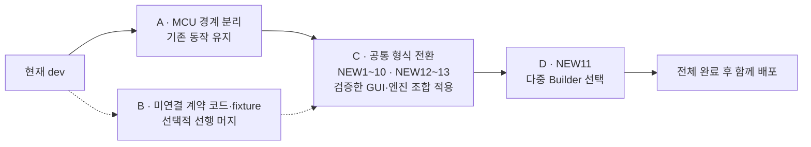
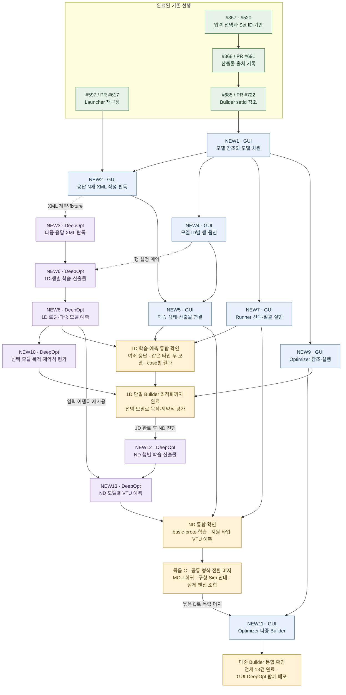

# 다중 응답 다중 모델 파이프라인 범위 축소안 v8

> 이전 계획: [v7](Multi-Response-Multi-Model-Pipeline-Plan_v7.md). 개정일: 2026-10-12.
> 선행: #722의 Builder setId 참조 구조. 구현 위치는 v7의 코드 조사 기준이며 착수 시 재확인한다.
> 범위: Sim 1D와 ND의 다중 응답 데이터셋, 모델별 학습 산출물, Runner와 Optimizer의 명시적 모델 선택. MCU는 기존 계약을 유지하고 Optimizer는 Sim 1D만 지원한다.

하나의 XML에서 여러 응답을 학습하고, 같은 타입의 모델을 여러 개 보관하며, 선택한 모델을 예측과 최적화에 정확히 사용하는 것이 목표다. 형식 전환과 독립적인 기존 이슈 해결을 완료 조건이나 선행 조건으로 묶지 않는다. v7의 이슈 초안 22건을 13건으로 줄이고, 공용 실행 수명·저장 시점·심볼 정책·결과 복구 개선은 별도 작업으로 돌린다.

공통 JSON 계약은 최초 명시 버전인 `schema_version: 1`로 시작한다. 기존 무버전 Sim 형식과 구분해 호환되지 않는 설정·산출물을 실행 전에 거부하기 위한 값이며, Builder·Runner·Optimizer Set과 manifest·모델 메타에 동일하게 적용한다. 문서 개정 번호 v8과는 별개다.

모델별 `model.json`은 현재 편집 설정과 마지막 학습 결과를 분리한다. 여러 하위 모델과 DeepOpt 학습 모듈이 공통 `model_info.json`을 갱신할 때 필요한 모델별 병합·덮어쓰기 규칙을 줄이기 위해, 공통 파일에는 데이터셋 메타만 두고 모델별 상태·학습 메타는 해당 폴더에서 공통 writer로 기록한다. GUI의 실행 전 초기화와 DeepOpt의 종료 상태 기록 책임은 아래 규칙을 따른다.

**검토 범위:** 공통 자료구조·호출 경로·작업 의존성뿐 아니라 DeepOpt 작업 NEW3·NEW6·NEW8·NEW10·NEW12·NEW13의 정의가 충분한지도 확인한다. 각 작업의 수정 대상 모듈, 입출력 계약, 공통 판독·writer·로더·입력 어댑터의 구현 및 재사용 책임, 실패 처리와 완료 조건이 구현에 착수할 만큼 구체적인지 검토한다.

## 1 이번에 남길 기능과 분리할 작업

완료 기준은 다음 네 가지다.

1. Launcher의 한 번의 Preprocess가 응답 N개를 담은 XML 하나를 만든다.
2. Builder가 응답·타입·옵션을 가진 모델 행을 여러 개 저장하고 ID별로 학습·표시·삭제한다.
3. Runner가 선택한 모델 전부를 실행하고 case와 모델별 결과를 구분한다.
4. Optimizer가 하나 또는 여러 Sim 1D Builder에서 선택한 모델로 목적·제약식을 평가한다.

### v7 결정의 처리

| 항목 | v8에서 다룰 범위 |
|---|---|
| 종료 보정 | GUI의 종료 후 파일 보정과 취소 사유 영속을 제외한다. 남은 `In Progress`는 실행 중인 Job이 없으면 미완료로 표시한다 |
| DeepOpt 디렉터리 정리 | 해당 행의 재학습 직전에 이전 산출물만 지운다. GUI가 초기화한 `model.json`은 유지한다. CLI 시작 시 실행 행 전체를 비우는 규칙은 뺀다 |
| 폴링 | 이번 실행 행의 `model.json`을 읽는 데 필요한 변경만 한다. 파일 누락을 무조건 진행 중으로 해석하거나 종료 시 복구하는 규칙은 뺀다 |
| `ProcessJob` 취소 | 공용 종료 계약 변경을 별도 작업으로 분리한다. 이 파이프라인의 선행 조건으로 두지 않는다 |
| 소비 측 저장 | `{set, model_id}` 전환과 실행 직전 `path` 해석만 포함한다. 기존 저장 시점을 유지하고 체크 즉시 저장·미실행 선택 복원은 #724에 남긴다 |
| 실제 타입과 입력 순서 | 엔진이 모델의 `model.json`에서 읽는다. GUI 설정에 복제하지 않는다 |
| DV 재배열 | 모델마다 다른 학습 순서를 지원하기 위해 엔진 어댑터 한 곳에서 처리한다. 프로젝트 전반의 DV 검증 정비는 제외한다 |
| ND 예측 대조 | 기존 ND 로더가 요구하는 설정은 유지한다. `config.yaml`과 `model.json`의 모든 중복 필드를 대조하는 추가 무결성 검증은 제외한다 |
| 행 `response` | 생성 시 고정한다. 같은 ID가 다른 응답을 뜻하지 않도록 하는 최소 식별 규칙이다 |
| Optimizer 실행 검증 | Sim·1D·v1, 모델 ID, `Done`, 모델 파일을 확인한다. 표시용 `response`를 별도의 실행 기준으로 검증하지 않는다 |
| 심볼 | 선택 모델과 저장된 `symbol`의 연결은 유지한다. `symbolSeq`, 삭제 번호 영구 미재사용, 미정의 심볼 사전 검증은 별도 작업이다 |
| 데이터셋 교체 | manifest 생성 뒤 다른 데이터셋은 새 Builder로 만드는 제약을 유지한다. 공통 manifest와 미실행 모델의 출처가 섞이는 것을 막기 위한 제한이며 교체·복구 기능은 만들지 않는다 |
| DeepOpt 공통 기반 | XML 판독과 첫 학습 작업에 필요한 판독·writer·fixture만 둔다. 독립적인 테스트 기반 구축 이슈는 만들지 않는다 |
| Builder GUI | 모델 행 편집과 모델별 학습 결과 연결로 나눈다. 공용 실행 수명 재설계는 제외한다 |
| DeepOpt 1D 학습 | 행별 학습과 산출물 배치를 한 작업으로 유지한다 |
| 구현 순서 | 1D 학습 → 예측 → 최적화를 검증한 뒤 ND를 연결한다. GUI와 DeepOpt의 형식 전환은 함께 배포한다 |

### 기존 이슈와의 경계

| 기존 작업 또는 독립 과제 | 이번 계획과의 관계 |
|---|---|
| #722 Builder setId 참조 | 기존 참조 구조를 사용한다. `{set, model_id}`의 출발점이다 |
| #643 XML 저장 개선 | 별개 작업으로 진행한다. Set당 XML 하나에 응답 N개를 쓰는 기능은 NEW2가 담당한다. #643에는 중복 저장 축소·이어쓰기·덮어쓰기 정책·HDF5 검토 등을 남기며 이 계획의 선행이나 순서도에 넣지 않는다 |
| #724 Runner 선택 영속 | 체크 즉시 저장과 Run 없이 재열기하는 동작은 이 이슈에 남긴다. 차원별 이중 실행 제거는 본 계획에서 자연스럽게 사라지지만 #724 전체를 닫는 근거로 삼지 않는다 |
| #725와 #726 설정 쓰기 및 적재 정리 | 같은 함수의 변경 충돌만 조율한다. 캐시·중복 적재·비동기 선택 복원을 본 계획의 완료 조건으로 넣지 않는다 |
| #650 데이터 최신성, #684 DOE 리샘플링 참조 | 기존 범위를 유지한다. 모델 참조 형식을 사용할 접점만 있다 |
| 공용 프로세스 취소와 종료 처리 | 실제 종료 신호, 버튼 해제 시점, 소멸자, 앱 종료 훅, 늦은 쓰기 방지를 별도 과제로 둔다 |
| 상태 복구와 취소 사유 영속 | 취소·기동 실패 뒤 모든 행을 `Failed`로 저장하는 보정과 보정 실패 시 재실행 차단을 별도 과제로 둔다 |
| 심볼 관리 | 번호 영구 미재사용, 삭제 시 수식 보호, 미정의 심볼 검증을 별도 과제로 둔다 |
| 결과 파일과 실패 처리의 전면 정비 | 이전 결과 정리, 재시도·부분 실패 복구, Optimizer 수렴 그림 경로 수정, CLI 전체의 실패 코드 통일을 별도 과제로 둔다 |
| 기타 기존 결함 | Launcher 응답 표의 Config 이관·재열기 복원, reduction 표기 불일치, transformation 복원·계산 개선은 별도 과제로 둔다 |

별도 과제는 이 Epic의 필수 선행이 아니다. 새 다중 모델 루프에서 발생한 실패를 정상 완료로 반환하지 않는 것과 새 결과 경로를 GUI에 연결하는 것은 해당 기능 작업에 포함한다. 기존 이슈 전체를 흡수하거나 닫지는 않는다.

## 2 최소 공통 규격

### 데이터셋과 모델 차원

- Launcher Set의 Preprocess 한 번은 `{LauncherSet}.xml` 하나를 쓴다. 각 샘플은 요청한 응답 N개를 담고, 하나라도 없으면 해당 샘플을 제외한다.
- 응답 키는 `sanitizeString(name)`이며 `selected_responses[]`의 항목은 `{key, component, load_step, substep, name, file_name}`이다. 키 중복·입력 및 예약 키 충돌·다른 component 혼합은 거부한다. 요청별 시점은 해당 카탈로그에서 읽는다.
- Sim의 XML 작성·GUI 판독·DeepOpt 판독을 배열 규격으로 함께 바꾼다. 같은 XML을 1D·ND Builder가 각각 사용하고 모델 행은 응답 키 하나를 고른다. KPI 등 Sim XML 메타를 쓰는 호출부도 배열로 맞추되 별도 XML의 통합은 하지 않는다.
- Sim Builder Set은 생성 시 `modelDimension: 1D` 또는 `ND`를 정하고 유지한다. Runner는 참조 Builder의 차원으로 CLI를 정하며 Optimizer는 1D만 허용한다. 1D 응답은 reduction 뒤 스칼라 하나, ND는 reduction `None`인 해당 필드다. 응답 개수나 `(Field)` 표시로 차원을 추정하지 않는다.
- MCU가 공유하는 설정·XML·상태 함수는 Sim 전환에 필요한 진입점만 기존 전용 경로로 분리한다. MCU의 파일 형식과 동작은 유지한다.
- manifest가 생긴 Builder는 데이터셋 선택을 잠근다. 학습 시 manifest와 현재 XML의 출처가 다르면 새 Builder 생성을 안내한다. 같은 XML 내용의 변경 감지는 #650에 남긴다.

### 모델 식별과 설정

참조는 `{set: Builder setId, model_id}`다. `model_id`는 Builder의 `modelSeq`를 증가시켜 발급하는 `model{N}`이며 삭제 뒤 재사용하지 않는다. 이는 이전 참조가 새 모델로 연결되는 것을 막는 식별 규칙이다.

```json
{
  "schema_version": 1,
  "setId": "<Builder setId>",
  "variant": "Sim",
  "modelDimension": "1D",
  "modelSeq": 2,
  "Data Label": {
    "Launcher": {"set": "<Launcher setId>", "name": "<표시명>"},
    "Dataset": "<abs xml>",
    "Input": {"dv1": {"reduction": "None"}, "dv2": {"reduction": "None"}},
    "Output": {"stress": {"reduction": "Max", "transformation": "None"}}
  },
  "Configuration": [
    {"id": "model1", "response": "stress", "type": "RF", "options": {}, "run": true},
    {"id": "model2", "response": "stress", "type": "RF", "options": {}, "run": false}
  ]
}
```

- 1D·ND 모두 Configuration 배열과 ID별 옵션 페이지를 쓴다. 같은 타입 여러 행을 허용하고 타입 변경은 해당 행의 옵션만 초기화한다.
- `response`는 행 생성 시 고정한다. 다른 응답은 새 행이다. reduction·transformation은 기존 `Data Label.Output`에 두며 계산 기능을 추가하지 않는다.
- Set JSON에는 상태·오차를 쓰지 않는다. 현재 설정과 마지막 학습 산출물의 메타를 구분한다.

### 산출물과 상태

```text
ModelBuilder_{Set}/
├─ model_info.json       데이터셋 메타와 출처
├─ model1/
│  ├─ model.json         모델 상태와 마지막 학습 메타
│  ├─ model.pt
│  └─ 타입별 부속 파일
└─ model2/ …
```

```json
{
  "schema_version": 1,
  "modelDimension": "1D",
  "response": "stress",
  "type": "Smart",
  "trained_type": "RF",
  "input_order": ["dv1", "dv2"],
  "reduction": "Max",
  "transformation": "None",
  "status": "Done",
  "errors": {"R2": 0.98},
  "message": ""
}
```

`model_info.json`에는 `schema_version: 1`, `parameter`, `originRecord`, `selected_responses`만 둔다. GUI가 학습 시작 때 쓴다. 모델 목록은 Configuration의 ID에서 만들고 상태·오차는 각 `model.json`에서 읽는다.

- 사용 가능한 모델은 유효한 `model.json`의 `status == Done`이고 `model.pt`가 있는 모델이다. `Done`에는 실제 `trained_type`과 `input_order`가 필요하다. `In Progress`·`Failed`에는 실행 필드가 없어도 된다.
- 1D의 기존 pickle·전용 로더·scaler와 ND의 `config.yaml`·체크포인트·전처리 메타는 보존한다. `.pt`는 고정 파일명이며 내부 모델 형식을 통일한다는 뜻은 아니다.
- Smart는 `{id}/candidates/{type}/`에서 학습하고 우승 모델과 부속 파일·`Model_Error.csv`를 `{id}/`에 둔다. `trained_type`은 우승 타입이다.
- ND의 basic·proto 모두 모델별 폴더에 체크포인트·설정·평가 CSV·렌더링·로그를 둔다. 기존 정규화·역변환을 유지한다.
- 모델 삭제는 Configuration 행과 해당 ID의 디렉터리를 대상으로 한다. ID를 검증하며, 행이 없는 잔여 디렉터리를 모델 목록으로 되살리지 않는다. 삭제 실패 복구는 추가하지 않는다.

### 학습 상태의 최소 처리

1. GUI는 실행 행과 설정을 검증하고 manifest를 쓴다. 실행 행의 `model.json`을 `In Progress`로 초기화해 이전 `Done`·오차·실행 메타를 지운 뒤 CLI를 기동한다. 하나라도 쓰기에 실패하면 기동하지 않는다. 미실행 행은 바꾸지 않는다.
2. DeepOpt는 설정·데이터셋을 확인하고 행을 순차 실행한다. 각 행의 학습 직전에 `model.json`을 제외한 이전 산출물을 정리한다. 정리 실패는 그 행의 실패이며 이전 모델을 성공 결과로 사용하지 않는다.
3. DeepOpt는 행별 성공 시 실제 타입·입력 순서·오차와 `Done`, 처리 가능한 실패 시 `Failed`와 사유를 쓴다. 한 행이 실패해도 다음 행을 처리하되 해당 다중 모델 명령은 최종 실패를 반환한다.
4. GUI는 이번 실행 행의 파일을 읽어 표시한다. 실행 중 아직 읽을 수 없는 파일은 직전 표시를 유지한다. 종료 뒤 파일을 보정하지 않는다. 파일이 없으면 미학습, 실행 중인 Job 없이 남은 `In Progress`는 미완료로 표시하고 모델 선택에서 제외한다.

상태 파일은 GUI 초기화와 DeepOpt 행 종료의 두 단계에서만 쓴다. 파일 전체 교체에는 GUI의 `QSaveFile`, DeepOpt의 임시 파일과 `os.replace`를 사용한다. GUI의 `finalizeStaleStatuses`에 해당하는 Sim 파일 보정은 새 형식에 옮기지 않는다.

취소·기동 실패 메시지는 기존 실행 UI로 알린다. 초기화 일부 실패나 강제 종료로 남은 `In Progress`도 미완료로 취급하고 다음 학습에서 초기화한다. 재열기 뒤 취소 사유 보존, 실제 프로세스 종료 확인, 종료 전 재실행·삭제 경합 해결은 이번 완료 기준이 아니다. `ProcessJob`의 현재 계약과 MCU의 상태 처리는 바꾸지 않는다.

### Runner와 Optimizer의 모델 소비

| 위치 | 저장 항목 |
|---|---|
| Sim Runner·Optimizer Set | `schema_version: 1` |
| Runner `Model upload.modelBuilder` | Builder 하나의 `{set, name}` |
| Runner `Model upload.Output Response[]` | `{set, model_id, response, model}` |
| Optimizer `Optimization.modelBuilder` | DV·Preview의 기본 Builder `{set, name}` |
| Optimizer `Optimization.trained_surrogate_model[]` | `{set, model_id, response, model, symbol}`. 모델별 `set`이 달라도 된다 |

- 참조의 정본은 `{set, model_id}`다. `set`은 실행 때도 setId로 유지한다. `response`·`model`은 마지막 학습 산출물의 응답과 실제 타입을 표시하며 실행 의미는 산출물에서 읽는다. GUI는 기존 저장 동작에서 새 항목 형식을 사용하고 실행 직전 항목별 `path: <Builder>/<model_id>`를 해석해 저장한다. 저장된 `path`는 복원 근거로 쓰지 않고 실행마다 다시 계산한다. 체크 즉시 저장은 요구하지 않는다.
- GUI는 실행 전에 참조 Builder의 Sim·차원·v1, 행 존재, 상태 `Done`, `model.pt`를 확인한다. Optimizer는 Sim 1D만 허용한다. 타입·응답·입력 순서는 엔진이 `path`의 `model.json`에서 읽고, GUI는 `trained_type`·`input_order`를 복제하지 않는다.
- 엔진 로더는 지정한 `model.pt`를 읽는다. 응답·타입 폴더 탐색, 최저 오차 모델 자동 선택, 첫 체크포인트로의 대체를 제거한다. 필요한 부속 파일은 기존 타입별 로더가 읽는다.
- GUI는 case의 DV label/value를 전달한다. 엔진 입력 어댑터가 `input_order`에 맞추고 필요한 라벨 누락·중복이나 입력 길이 불일치는 거부한다. GUI의 별도 재배열은 두지 않는다.
- Runner 한 실행은 Builder의 차원 하나이며 선택 모델 전부를 한 번의 CLI 호출로 실행한다. 1D CSV 이름은 `{Runner JSON의 확장자를 뺀 파일명}_test_results.csv`다. active case당 한 행, `{response} [{model_id}]`별 열을 쓴다. 정확한 열 순서와 case 번호는 아래 전달 규격을 따른다.
- ND는 실행 설정의 전체 case 배열에서 1부터 센 순번과 모델 ID로 `case{N}/{model_id}/prediction.vtu`를 쓴다. inactive case를 빼고 다시 번호를 매기지 않는다. 같은 표시명·입력 파일을 가진 case도 결과가 겹치지 않으며 원본 VTU를 수정하지 않는다. GUI는 이 결과 경로를 case·모델 선택과 연결한다.
- 새 예측 루프의 로딩·예측·저장 실패는 호출자에 전달하고 실패 실행을 전체 정상 완료로 표시하지 않는다. 성공한 실행의 정해진 결과 경로를 연다. 이전 결과 사전 삭제와 공용 결과 복구 정책은 추가하지 않는다.
- Optimizer는 저장된 `symbol`과 모델 참조의 연결을 보존한다. 새 항목은 현재 항목과 겹치지 않는 번호를 받는다. 삭제된 번호의 영구 미재사용과 수식 토큰 사전 검증은 별도다. 일반 응답·`std_pred` 모두 같은 로더·입력 어댑터를 사용한다.
- 여러 Builder를 참조할 때 DV 라벨 집합은 같아야 한다. 순서는 엔진이 모델별로 맞춘다. 기본 Builder가 DV·Preview 출처이며 Geometry Set id가 다르면 Preview·Morphing을 비활성화한다.
- 최적화 CLI는 `run-optimization <OptSet.json> --output-dir <dir>`다. Builder 디렉터리 인자를 제거하고 항목별 `path`를 사용한다.

### 기존 데이터의 처리

Sim의 구형 설정·단수 응답 XML·학습 결과는 자동 변환하지 않는다. 새 Set 구성, XML 재생성, 재학습과 모델 재선택을 요구한다. 차원·ID·타입을 추정하거나 열기만으로 기존 파일을 덮어쓰지 않는다. MCU의 기존 파일과 프로젝트의 다른 모듈은 유지한다.

### 공통 계약의 작성 주체와 소비 위치

아래는 NEW1~NEW13의 구현 기준이다. 자료 구조·소유권·호출 순서를 이 문서에서 정하고, 실제 양쪽 구현이 같은 fixture와 산출물을 주고받는 검증은 각 작업의 완료 조건으로 둔다. 문서 정리가 곧 구현·실행 검증 완료를 뜻하지는 않는다.

| 자료와 위치 | 작성 주체·시점 | 읽는 주체·용도 | 담당 |
|---|---|---|---|
| Launcher XML의 샘플과 `model_info.selected_responses` | GUI Launcher의 Preprocess | GUI의 응답 선택·메타 판독, DeepOpt의 행별 학습 데이터 구성 | NEW2 → NEW1·NEW5·NEW3 |
| Builder Set JSON의 차원·`modelSeq`·`Configuration[]` | GUI 생성·편집·기존 저장 시점 | GUI 행 복원, DeepOpt의 차원 확인·실행 행 순회. 엔진은 Set JSON을 수정하지 않는다 | NEW1·NEW4 → NEW5·NEW6·NEW12 |
| Builder `model_info.json` | GUI가 출처 확인 뒤 학습 시작 시 작성 | GUI 참조 해석·DV·Preview, 엔진의 데이터셋 메타 확인. 모델 상태를 담지 않는다 | NEW5 → NEW1·NEW6·NEW7·NEW9·NEW11·NEW12 |
| `{model_id}/model.json`의 초기 상태 | GUI가 CLI 기동 전 실행 행만 `In Progress`로 전체 교체 | DeepOpt가 같은 행의 종료 상태로 교체, GUI가 폴링 | NEW5 → NEW6·NEW12 |
| 같은 파일의 `Done`·`Failed`와 학습 메타 | DeepOpt가 각 행의 산출물 저장을 마친 뒤 작성 | GUI의 상태·모델 선택, 엔진 로더의 타입·차원·입력 순서 판독 | NEW6·NEW12 → NEW1·NEW5·NEW8·NEW10·NEW13 |
| `{model_id}/model.pt`와 타입별 부속 파일 | DeepOpt trainer·Smart·ResultSaver | GUI 결과 표시, DeepOpt의 지정 모델 재로딩 | NEW6·NEW12 → NEW5·NEW8·NEW10·NEW13 |
| Runner·Optimizer JSON의 모델 참조와 실행 `path` | GUI가 기존 저장 시점에 참조 저장, 실행 직전 모든 `path` 갱신 | GUI는 ID로 복원, 엔진은 `path`로 실행. 엔진이 경로를 역추정하지 않는다 | NEW7·NEW9·NEW11 → NEW8·NEW10·NEW13 |
| Runner CSV·VTU, Optimizer 기존 결과 파일 | DeepOpt 실행 결과 | GUI가 이번 정상 실행의 정해진 결과 경로를 연다 | NEW8·NEW10·NEW13 → NEW7·NEW9 |

- `parameter`는 기존 라벨별 `{source, meta, ...}` 객체를 보존한다. `Data Label.Launcher`는 `{set, name}`, `Dataset`은 XML 절대 경로다. manifest의 `originRecord`는 기존 `{producer: {set, name}, dataset: {file, originRecord}}`이며 XML 출처 전체를 `dataset.originRecord`에 보존한다. `dataset.file`은 XML 파일명이다.
- `modelSeq`는 0에서 시작해 Builder 내 발급 최댓값을 저장하는 정수다. 새 행은 1을 더한 `model{N}`을 받고 `Configuration` 내 ID는 유일해야 한다. ID는 `^model[1-9][0-9]*$`에 맞아야 하며 경로를 직접 받을 수 없다. 서로 다른 Builder의 `model1`은 다른 모델이다. `run`은 boolean, `options`는 해당 타입의 기존 옵션 객체다.
- `model.json`의 공통 필수 필드는 `schema_version`, `modelDimension`, `response`, 요청 `type`, `reduction`, `transformation`, `status`, `errors`, `message`다. 초기 상태와 실패의 `errors`는 `{}`, 초기 `message`는 빈 문자열이며 실패에는 사유를 쓴다. `Done`은 여기에 실제 `trained_type`과 중복 없는 DV 라벨 배열 `input_order`를 필수로 갖는다. 새 초기 상태·실패에 이전 실행 필드를 남기지 않는다.
- `modelDimension`은 Builder의 고정 차원을 복사한다. 엔진은 CLI의 차원과 이를 대조하며 Optimizer는 `1D`만 받는다. `input_order`는 실제 학습 행렬·전처리 결과의 순서를 trainer가 반환한 값이다. JSON 객체 정렬이나 GUI 표시 순서로 추정하지 않으며 ND의 `node_location`·`connectivity`는 DV 순서에 넣지 않는다.

GUI의 저장·실행 검증과 DeepOpt의 설정 판독은 같은 필수 조건을 적용한다. `schema_version`은 1이고, 행 ID는 유일하며, 각 `response`는 XML의 `selected_responses[].key`와 `Data Label.Output`에 존재해야 한다. 요청 타입·옵션은 Builder 차원의 기존 허용 목록을 따른다. 학습에는 `run:true`인 행이 하나 이상 필요하다. GUI 검증을 거쳤다는 이유로 CLI 판독 검증을 생략하지 않는다.

### XML·Runner·Optimizer 전달 규격

**XML:** 기존 루트의 첫 자식인 샘플 `dict`와 뒤쪽 형제인 `dict_item key="model_info"` 위치를 유지한다. `model_info` 안의 `selected_responses`는 `<dict_item key="selected_responses"><list><dict>…</dict></list></dict_item>`으로 쓴다. 각 `dict`는 `key`, `component`, `load_step`, `substep`, `name`, `file_name`을 `dict_item`과 `string` 값으로 담는다. `load_step`·`substep`도 카탈로그 식별 문자열로 보존한다. 샘플의 응답 텐서 키는 항목의 `key`와 같고 기존 텐서 인코딩·형상·`parameter`·출처 형식은 유지한다. NEW2·NEW3이 이 배열 인코딩을 함께 구현하며, dict로 바꾸기 전에 중복 키를 검출한다. 단수 `selected_response`로 대체 판독하지 않는다.

**Runner:** 루트 `schema_version: 1` 아래 `Model upload`에 다음 필드를 둔다. 기존 Morphing·입력 범위 등 다른 필드는 유지한다.

| 필드 | 형식·실행 의미 |
|---|---|
| `modelBuilder` | `{set, name}`. 이 Runner가 사용하는 Builder 하나 |
| `Output Response[]` | `{set, model_id, response, model, path}`. `path`만 실행 직전 필수인 절대 모델 디렉터리다. 같은 참조를 중복 선택하지 않으며 선택 배열 순서를 결과 모델 열 순서로 쓴다 |
| `Input Design Variables` | 기존 `{label: string[], value: number[], min: number[], max: number[]}`. `label`이 모든 case의 `values`에 대응한다 |
| `Prediction Cases[]` | `{name: string, file: string, active: boolean, values: number[]}`. GUI가 실행 전 배열을 완성한다. 1D에서 파일 없는 기본값 예측은 `file: ""`인 단일 active case로 기록한다. ND의 `file`은 기존 준비·변환 경로가 만든 입력 VTU의 절대 경로다 |

case 번호는 전체 배열 인덱스 + 1이다. 예를 들어 첫 case가 inactive이면 첫 출력은 `case2`다. active case나 선택 모델이 없으면 실행하지 않는다. 1D CSV는 `Case, File Name, <label 순서의 DV 열>, <선택 순서의 모델 열>`이며 `Case`는 `caseN`, `File Name`은 입력 `file`의 파일명(없는 경우 빈 값)이다. DV 열에는 모델별 재배열 전의 case 값을 쓴다. 예를 들어 `ModelRunner_Set1.json`의 결과는 Runner 출력 폴더의 `ModelRunner_Set1_test_results.csv`다. ND 결과는 같은 출력 폴더의 `caseN/model_id/prediction.vtu`다. GUI도 이 규칙으로 결과를 찾으며 표시명으로 경로를 추정하지 않는다.

**Optimizer:** 루트 `schema_version: 1` 아래 `Optimization.modelBuilder`와 `Optimization.trained_surrogate_model[]`을 사용한다. 배열 항목은 `{set, model_id, response, model, symbol, path}`이고 `path`의 작성 규칙은 Runner와 같다. `Optimization.design_variables[]`의 기존 `{symbol, parameter, value, min, max, mean, std, optimize, ...}`와 `optimization_settings`·`sampling_mode`·목적·제약식 형식은 유지한다. 엔진은 `parameter` 배열을 DV 라벨로 사용하고, 고정 변수를 포함하도록 복원한 후보 벡터를 모델별 입력 어댑터에 전달한다. 모델 `symbol`은 해당 항목의 로더에 연결하며 `std_pred`도 같은 연결을 쓴다. NEW10부터 여러 `path`를 읽을 수 있게 하고, NEW11은 GUI의 Builder 선택 범위만 넓힌다.

### 실행 순서와 호출 배선

| 실행 | GUI의 기동 전 처리 | CLI 인자 순서 | 엔진 처리와 GUI 결과 연결 |
|---|---|---|---|
| 1D 학습 | 설정·XML·출처 확인 → 저장 → manifest → 실행 행 상태 초기화 | `train-model-1d <BuilderJSON> --output-dir <BuilderDir>` | NEW3 판독 → NEW6 행별 정리·학습·저장·종료 상태 → NEW5 폴링·결과 |
| ND 학습 | 위와 같고 고정 차원은 ND | `train-model-nd <BuilderJSON> --output-dir <BuilderDir>` | NEW3 판독 → NEW12 basic·proto 학습·저장·공통 writer → NEW5 |
| 1D 예측 | 모든 모델 참조·case 확인 → 모든 `path`와 case를 한 번 저장 | `test-model-1d <RunnerJSON> <RunnerDir>` | NEW8 지정 모델 로딩·입력 재배열·전체 active case 예측·CSV → NEW7 |
| ND 예측 | 위와 같고 기존 입력 VTU 준비 경로를 먼저 완료 | `test-model-nd <RunnerJSON> <RunnerDir>` | NEW13 지정 모델 로딩·입력 재배열·case×모델 VTU 저장 → NEW7 |
| 최적화 | Sim 1D 참조·DV 확인 → 모든 `path` 저장 | `run-optimization <OptJSON> --output-dir <OptDir>` | NEW10 symbol→로더 연결·후보별 재배열·목적/제약 평가 → NEW9. NEW11도 같은 호출 |

경로 인자는 GUI가 절대 경로로 해석해 기존 프로세스 API의 인자 배열로 전달한다. GUI의 Builder·Runner·Optimizer 실행 진입점과 DeepOpt `main.py`의 해당 명령을 위 인자 규격으로 함께 연결한다. 표의 순서를 구현하는 담당은 각각 NEW5↔NEW6·NEW12, NEW7↔NEW8·NEW13, NEW9↔NEW10이다.

1. 학습은 `Configuration` 배열 순서대로 `run:true`인 행만 처리한다. 명령 시작의 설정·XML 검증 실패는 비정상 종료하며 개별 행 상태를 보정하지 않는다. 처리 가능한 행 실패는 `Failed` 기록 후 다음 행을 계속하고, 하나라도 실패하면 최종 종료 코드는 0이 아니다. 결과 파일 저장 완료 후에만 `Done`을 쓴다.
2. NEW6이 만드는 공통 writer의 입력은 모델 디렉터리와 완성된 상태 객체다. trainer는 실제 `trained_type`, `input_order`, 기존 평가 지표 `errors`를 반환한다. NEW12는 같은 writer를 사용하고 자기 trainer·ResultSaver의 저장 위치만 모델 디렉터리로 연결한다. 타입별 부속 파일 규격을 별도 공통 포맷으로 바꾸지 않는다.
3. NEW8의 로더는 모델 디렉터리에서 유효한 v1 `Done` 메타·`model.pt`를 읽고 `trained_type`별 기존 로더를 선택한다. NEW10은 이를 재사용하고 NEW13은 ND 로더에 같은 지정 경로 규칙을 적용한다. 입력 어댑터의 공통 입출력은 `(labels, values, input_order) → 학습 순서의 values`다. 라벨 중복·길이 불일치·필수 라벨 누락을 거부하며 여분 라벨은 모델 입력에서 제외한다. 이후 정규화·역변환은 기존 타입별 구현이 담당한다.
4. 예측은 선택 모델과 active case의 전체 조합을 실행한다. 새 루프에서 로딩·예측·저장이 실패하면 0이 아닌 종료 코드를 반환하고 GUI는 해당 실행의 정상 결과로 이전 파일을 열지 않는다. 공용 Job·취소·결과 복구 체계는 확장하지 않는다.
5. NEW13의 직접 VTU 예측 범위는 현재 실행 분기가 있는 `StableNet`, `Proto-DW`, `Proto-SH`다. 다른 ND 타입의 학습·결과 표시 보존과 직접 VTU 예측 지원은 구분한다. 지원하지 않는 모델을 포함하면 실행 전에 안내·거부하며, 엔진도 거부한다. 이 세 타입의 실제 체크포인트 재로딩은 NEW12·NEW13에서 검증한다.

각 경계의 소유자는 위 NEW 번호로 정한다. 두 저장소의 `tests/fixtures/multi_model_v1/`에는 같은 XML·Builder/Runner/Optimizer JSON·상태·예상 CSV/VTU 경로를 두고 상대편 판독까지 확인한다. GUI가 쓴 실제 XML과 학습 CLI가 만든 실제 모델을 사용하는 통합 확인도 필요하다. 공통 계약 변경은 생산자와 소비자의 fixture·기대값을 같이 고치며 신규 기반 이슈를 추가하지 않는다.

## 3 이슈 초안

각 항목은 저장소별 작업 단위다. 최소 공통 규격을 공유하며 기존 이슈의 독립 개선을 선행으로 추가하지 않는다.

### GUI 모델 참조와 모델 차원

**현상·현재 구조:** #722의 Builder setId 참조만으로는 같은 응답·타입의 여러 모델을 구분할 수 없다. Sim과 MCU가 일부 판독 경로를 공유한다.

**범위·변경:** `DashModelBuilderArtifact`, `DashModelBuilderReference`, 공통 모델 정보에 `{set, model_id}`와 v1 manifest·상태 판독을 둔다. ID 발급·고정 경로·사용 가능 판정을 제공한다. Sim Builder Set 생성 시 차원을 기록하고 공유 진입점의 MCU 처리를 보존한다.

**기대:** 1D·ND의 같은 타입 모델 두 개가 구별된다. 구형 Sim·잘못된 ID·깨진 모델 상태를 거부하고 MCU 판독은 유지된다.

**Related:** 선행 #722. 후속은 Builder 행, Runner, Optimizer다. MCU 경계는 공유 호출부를 바꾸기 전에 적용한다.

### GUI 응답 N개를 담은 XML 작성과 판독

**현상·현재 구조:** Launcher는 응답별 XML을 쓰고 Sim 메타 작성·판독은 단수 응답을 전제한다.

**범위·변경:** `processResults`, `processSamples`, XML writer와 Sim parser를 함께 전환한다. 샘플에 응답 N개를 기록하고 메타를 `selected_responses[]`로 쓴다. 꼬리 파싱·학습 메타 복사·KPI 등 공유 호출부를 맞춘다. 파일 읽기·저장의 추가 최적화와 Launcher Config 이관은 포함하지 않는다.

**기대:** 한 XML에서 여러 응답과 시점 메타를 읽는다. 키 충돌과 component 혼합은 쓰기 전에 거부하고 응답 누락 샘플은 제외한다. MCU XML 판독은 유지된다.

**Related:** MCU XML 경계를 먼저 분리한다. Set당 다중 응답 XML은 NEW2가 담당하며 #643과 독립적으로 진행한다.

### DeepOpt 다중 응답 XML 판독

**현상·현재 구조:** 현재 XML parser는 루트의 첫 샘플 dict를 읽고 뒤쪽 `model_info`를 학습 계약으로 검증하지 않는다. 배열 메타 판독도 없다.

**범위·변경:** `xml_parser.py`, `XMLTrainingDataBuilder`에서 배열 메타와 `row.response` 선택을 지원한다. 중복 키와 단수 Sim XML은 거부한다. GUI와 같은 XML fixture를 사용한다.

**기대:** 하나의 XML에서 지정한 응답만 선택하며 1D 스칼라 처리와 ND 필드 처리를 구분한다.

**Related:** GUI XML 계약을 공유한다. 후속은 1D·ND 학습이다.

### GUI 모델 ID별 행과 옵션

**현상·현재 구조:** 타입별 Configuration dict와 옵션 페이지는 같은 타입 두 모델을 표현하지 못한다.

**범위·변경:** Configuration을 `{id, response, type, options, run}` 배열로 저장하고 옵션을 ID별로 소유한다. 응답은 행 생성 시 고정하고 차원별 타입 목록을 적용한다. 상태·오차는 설정에서 뺀다.

**기대:** 같은 타입 두 행의 ID·서로 다른 옵션·run이 저장 후 유지된다. 한 행의 타입 변경이 다른 행을 바꾸지 않는다.

**Related:** GUI 모델 참조와 모델 차원 뒤. 후속은 모델별 학습 상태와 산출물 연결이다.

### GUI 모델별 학습 상태와 산출물 연결

**현상·현재 구조:** 상태는 Set JSON, 오차와 결과는 응답·타입 경로를 사용한다.

**범위·변경:** Sim 학습 시작의 manifest·`In Progress` 초기화, 폴링, 오차·렌더링 표시, 목록·삭제를 모델 ID 기준으로 바꾼다. manifest 이후 데이터셋 선택을 잠근다. 종료 후 파일 보정은 제거하고 남은 상태를 미완료로 표시한다. 공용 Job·버튼·소멸자 계약은 바꾸지 않는다.

**기대:** 실행 행만 초기화되고 미실행 모델은 유지된다. 모델별 상태·오차·삭제가 대응하며 미완료 모델은 선택할 수 없다. 중지와 기동 실패의 UI 알림은 유지된다.

**Related:** GUI 모델 행과 XML 판독 뒤. 새 상태 fixture로 구현하고 두 학습 CLI와 연결한다. `ProcessJob` 개선을 선행으로 두지 않는다.

### DeepOpt 1D 행별 학습과 모델 ID 산출물

**현상·현재 구조:** 1D는 타입 dict를 순회하고 응답·타입·오차 경로, 최상위 errors와 Set JSON 상태를 쓴다.

**범위·변경:** `train_model_1d`, `run_train_1d`, 1D trainer와 Smart를 실행 행 순회로 바꾼다. 이 작업에서 v1 설정 판독과 `model.json` writer를 만들고 실제 사용한다. 행의 응답 하나를 학습해 `model.pt`·부속 파일을 쓰고 실제 타입·입력 순서·오차를 반환한다. 기존 reduction 계산 자체의 수정은 분리한다.

**기대:** 같은 타입 두 행과 다른 응답의 결과가 분리된다. `run:false`는 보존된다. 재학습은 해당 모델 산출물만 정리하며 Smart 우승 모델을 기존 로더로 다시 읽을 수 있다.

**Related:** DeepOpt XML 판독 뒤. 필요한 pytest 설정과 상태 fixture를 여기에 포함한다. 후속 1D 예측과 ND 학습이 판독·writer를 재사용한다.

### DeepOpt ND 행별 학습과 모델 ID 산출물

**현상·현재 구조:** ND basic·proto도 타입 dict와 응답·오차별 폴더를 사용한다.

**범위·변경:** `train_model_nd`, basic·proto와 `ResultSaver`에 행의 응답 하나와 출력 디렉터리를 전달한다. 기존 체크포인트·config·전처리 메타·평가 결과를 `{id}/`에 모으고 공통 writer로 상태를 기록한다.

**기대:** basic·proto 각각 같은 타입 두 모델과 다른 응답이 독립 저장·재로딩된다. 필드 구조·정규화·학습 알고리즘은 유지된다.

**Related:** 1D 학습의 writer와 진입 규칙을 사용한다. ND 예측에 실제 산출물을 제공한다.

### GUI Runner의 모델 선택과 일괄 실행

**현상·현재 구조:** 응답·타입 선택은 같은 타입 여러 모델을 구분하지 못하고 ND·1D로 실행을 나눈다.

**범위·변경:** 사용 가능한 모델당 행을 표시하고 기존 저장 동작을 `{set, model_id}`로 전환한다. 전체 참조를 확인한 뒤 `path`를 붙여 한 번 저장·실행한다. Builder 차원으로 CLI를 정하고 CSV·case별 모델별 VTU 경로를 결과 선택에 연결한다. 기존 ND 직접 예측 지원 범위를 유지한다.

**기대:** 2 case × 2 model을 한 호출로 실행하고 결과를 구분한다. 저장된 모델 ID 선택이 복원되며 삭제·미완료 모델은 실행하지 않는다. Run 없이 체크만 바꾼 선택의 영속은 완료 기준에서 제외한다.

**Related:** GUI 공통 참조 뒤. DeepOpt 1D·ND 예측과 통합한다. #724·#725·#726은 별도다.

### DeepOpt 1D 모델 로딩과 다중 모델 예측

**현상·현재 구조:** 경로 탐색과 응답명 중심 CSV는 모델 선택을 바꾸거나 결과를 겹치게 한다.

**범위·변경:** `path/model.json`과 `model.pt`를 읽는 타입별 로더, label/value를 학습 순서로 맞추는 어댑터를 둔다. `test_model_1d`와 `RunTest1D`를 전체 선택 순회로 바꾸고 case당 한 행·모델당 한 열로 CSV를 쓴다.

**기대:** 2 case × 2 model의 결과와 서로 다른 DV 순서를 확인한다. 지정 모델을 읽고 새 루프의 로딩·예측·저장 실패를 반환한다.

**Related:** 1D 학습 뒤. Optimizer가 로더와 입력 어댑터를 재사용한다.

### DeepOpt ND 모델별 VTU 예측

**현상·현재 구조:** 첫 선택 또는 탐색한 체크포인트를 사용하는 경로는 여러 모델의 결과를 보존하지 못한다.

**범위·변경:** 기존 지원 타입에 대해 전체 선택·active case를 순회하고 지정 `model.pt`와 기존 ND config·전처리 메타를 읽는다. 공통 입력 어댑터를 사용하고 명시한 `case{N}/{model_id}/prediction.vtu`에 저장한다.

**기대:** 2 case × 2 model 결과 네 개가 남고 원본 VTU는 유지된다. 지원하지 않는 직접 예측과 로딩·예측·저장 실패를 성공으로 반환하지 않는다.

**Related:** ND 학습 산출물과 1D 예측 어댑터를 사용한다. GUI Runner 결과 연결과 함께 검증한다.

### GUI Optimizer의 모델 참조와 실행

**현상·현재 구조:** 응답·타입 선택과 Builder 폴더 인자만으로는 원하는 모델을 명시하지 못한다.

**범위·변경:** 우선 단일 Sim 1D Builder에서 모델을 ID로 선택하고 기존 symbol과 함께 저장·복원한다. 실행 직전 참조를 확인해 항목별 `path`를 저장하고 새 CLI를 호출한다. 심볼 발급 체계와 식 검증은 확장하지 않는다.

**기대:** 같은 응답·타입의 모델 두 개를 구분하고 저장된 심볼 연결을 유지한다. ND·MCU·구형·삭제·미완료 모델은 실행하지 않는다.

**Related:** GUI 공통 참조 뒤. DeepOpt 선택 모델 식 평가와 연결한다. 수렴 그림 경로 수정과 #726의 적재 개선은 별도다.

### DeepOpt 선택한 1D 모델로 목적식과 제약식 평가

**현상·현재 구조:** `_build_response_paths`가 선택 항목 대신 최저 오차 파일을 고른다.

**범위·변경:** `run_optimization`, `MainOptimizer`, `problem_setup`, `ExpressionEvaluator`에서 항목별 `path`를 사용한다. 1D 예측의 로더·입력 어댑터를 일반 응답과 `std_pred`에 연결하고 ND는 거부한다. 기존 최적화 알고리즘과 식 파서는 유지한다.

**기대:** 명시한 모델로 목적·제약값을 계산하며 모델별 DV 순서가 반영된다. 서로 다른 Builder 경로를 받아도 같은 로더를 쓴다.

**Related:** 1D 예측 뒤. GUI Optimizer 실행과 함께 검증한다.

### GUI Optimizer의 다중 Builder 선택

**현상·현재 구조:** 단일 Builder 선택으로는 서로 다른 Launcher에서 학습한 모델을 함께 사용할 수 없다. 이는 원안의 기능 목표다.

**범위·변경:** 모델별 Builder 선택을 추가한다. 기본 Builder로 DV·Preview를 정하고 모든 참조 Builder의 DV 라벨 집합을 확인한다. Geometry Set id가 다르면 Preview·Morphing을 비활성화한다. 단일 Builder 작업의 항목 형식과 실행 검증을 재사용한다.

**기대:** 두 Builder의 모델 세 개를 저장·복원·실행한다. DV 집합 불일치는 거부하고 Geometry 출처 차이는 Preview에 반영한다.

**Related:** GUI Optimizer 모델 참조와 실행 뒤. DeepOpt CLI 형식은 추가로 바꾸지 않는다.

## 4 구현 순서와 완료 확인

1. GUI 모델 참조·차원·MCU 경계와 양쪽 XML 계약을 맞춘다. 공유 fixture는 두 저장소의 `tests/fixtures/multi_model_v1/`에 둔다.
2. GUI 모델 행·상태 연결과 DeepOpt 1D 학습을 완성한다. 상태 판독·writer는 이 경로에서 필요한 만큼 구현한다.
3. 1D Runner 예측과 Optimizer 단일 Builder 실행을 연결한다. 엔진은 처음부터 모델 항목별 `path`를 받는다.
4. ND 학습·예측을 같은 모델 관리 형식에 연결한다. 기본 계약과 fixture는 처음부터 ND를 포함한다.
5. GUI와 DeepOpt 통합 브랜치에서 NEW1~NEW10·NEW12·NEW13을 검증하고, 실행 파일까지 맞춘 공통 형식 전환 묶음으로 dev에 반영한다. 1D 중간 완료만으로 공용 경로를 전환하지 않는다.
6. NEW11의 다중 Builder 선택을 후속 GUI 묶음으로 머지한다. 엔진 CLI·산출물 계약은 그대로 사용한다.
7. 전체 13건의 완료 확인 후 GUI와 DeepOpt를 함께 배포한다. Sim 재구성·XML 재생성·재학습·모델 재선택을 안내한다.

| 확인할 흐름 | 완료 기준 |
|---|---|
| Launcher → Builder | 같은 XML의 여러 응답을 1D·ND 행에서 각각 선택한다 |
| 모델 관리 | 같은 타입 두 모델, 옵션 저장·복원, 부분 재학습, ID별 상태·오차·삭제가 동작한다 |
| 중단된 학습 | UI에 중지·기동 실패가 전달되고 남은 `In Progress`를 완료 모델로 선택하지 않는다. 취소 사유 영속과 종료 경합 해결은 요구하지 않는다 |
| 1D Runner | 2 case × 2 model의 CSV가 2행·모델 열 2개이며 입력 순서가 맞는다. 기본값 case와 inactive 사이의 case 번호도 양쪽이 같게 해석한다 |
| ND Runner | 직접 예측 지원 세 타입의 실제 산출물을 재로딩한다. 2 case × 2 model 결과 네 개가 구분되고 원본 VTU가 유지된다. basic·SprintNet 직접 예측은 명시적으로 거부한다 |
| Optimizer | 선택한 모델로 목적·제약식을 계산한다. 다중 Builder의 DV 집합 검사와 모델별 순서 적용을 확인한다 |
| 형식 전환 | 구형 Sim은 재생성을 안내하며 열기만으로 변경하지 않는다. MCU 기존 설정·XML·학습·예측·상태·삭제는 유지된다 |
| 실행 배선 | 실제 GUI argv로 학습·예측·최적화 CLI를 호출한다. 정상과 새 루프의 실패가 GUI에 구분되며, GUI 배포 경로에 놓인 실제 DeepOpt 실행 파일로 확인한다 |

형식 전환과 독립적인 기존 이슈의 미해결 항목을 이 검증표에 다시 추가하지 않는다. 테스트 기반·공용 프로세스·일반 결과 복구를 별도 선행으로 키우지 않고, 변경한 계약과 실행 경로를 검증한다.

## 5 선행 작업과 이슈 가배정 순서도

`NEW1`부터 `NEW13`은 이 문서의 직접 작업 13건에 부여한 공통 가번호다. GUI·DeepOpt를 한 순서로 읽기 위한 표기이며 실제 GitHub 이슈 번호는 아니다. 번호는 아래 구현 순서에 맞추고, 구현 저장소는 별도 열로 구분한다. 이슈 발행 시 실제 번호로 치환한다.

### 기존 선행 작업의 상태

2026-10-12 GitHub 조회 기준이다. 완료된 기반도 순서도에 남겨 어떤 계약을 이어받는지 표시한다. 기존 이슈와 이를 구현한 PR은 같은 작업으로 묶는다.

| 기존 작업 | 확인 상태 | 이번 작업이 사용하는 결과 |
|---|---|---|
| [#367](https://github.com/NumeRealWorks/DashOpti_GUI/issues/367) · [#520](https://github.com/NumeRealWorks/DashOpti_GUI/issues/520) | 완료 | 입력 Set 선택 기반과 `setId` 발급·저장·복원·역조회. NEW1은 새 Set 식별 체계를 만들지 않고 이를 사용한다 |
| [#597](https://github.com/NumeRealWorks/DashOpti_GUI/issues/597) / [PR #617](https://github.com/NumeRealWorks/DashOpti_GUI/pull/617) | 완료 / 머지됨 | DOE Sampler·Analysis Launcher 분리와 Reference File 기반 Launcher 구조. NEW2의 XML 작성 출발점이다 |
| [#368](https://github.com/NumeRealWorks/DashOpti_GUI/issues/368) / [PR #691](https://github.com/NumeRealWorks/DashOpti_GUI/pull/691) | 완료 / 머지됨 | Launcher XML과 Builder `model_info.json`의 `originRecord` 생산·판독 계약. NEW1·NEW2·NEW5에서 보존한다 |
| [#685](https://github.com/NumeRealWorks/DashOpti_GUI/issues/685) / [PR #722](https://github.com/NumeRealWorks/DashOpti_GUI/pull/722) | 완료 / 2026-10-12 머지됨 | Runner·Optimizer의 Builder setId 참조와 공통 판독 구조. NEW1의 직접 선행이다 |

[#724](https://github.com/NumeRealWorks/DashOpti_GUI/issues/724)·[#725](https://github.com/NumeRealWorks/DashOpti_GUI/issues/725)·[#726](https://github.com/NumeRealWorks/DashOpti_GUI/issues/726)은 모두 열려 있지만 필수 선행이 아니다. 같은 함수의 변경 충돌만 조율한다. #650·#684와 공용 `ProcessJob`·심볼·결과 복구 개선도 이번 순서의 대기 조건에 넣지 않는다.

### 직접 작업 13건의 가번호

계약·fixture가 합의되면 GUI와 엔진 구현은 병행할 수 있다. 아래의 구현 선행과 실제 산출물을 사용하는 통합 확인을 구분한다. 순서도의 검증 지점은 별도 신규 이슈가 아니라 관련 작업의 공동 완료 확인이다.

| 가번호 | 구현 저장소 | 발행할 이슈 제목 | 구현 선행과 계약 | 통합 확인 |
|---|---|---|---|---|
| NEW1 | GUI | 모델 참조와 모델 차원 | #722의 참조 구조. #520·#691의 ID·출처 계약 유지 | 1D·ND 공통 판독과 MCU 경계 |
| NEW2 | GUI | 응답 N개를 담은 XML 작성과 판독 | NEW1의 MCU XML 경계와 #617의 Launcher 기반 | NEW3과 같은 XML fixture 사용 |
| NEW3 | DeepOpt | 다중 응답 XML 판독 | NEW2와 배열 XML 계약 합의. 작성기 구현 완료를 기다릴 필요는 없다 | NEW2가 쓴 실제 XML 판독 |
| NEW4 | GUI | 모델 ID별 행과 옵션 | NEW1의 ID 발급·차원·판독 | NEW6과 Configuration 배열 계약 일치 |
| NEW5 | GUI | 모델별 학습 상태와 산출물 연결 | NEW2의 XML 판독 + NEW4의 모델 행 | NEW6·NEW12의 상태·오차·산출물 연결 |
| NEW6 | DeepOpt | 1D 행별 학습과 모델 ID 산출물 | NEW3. NEW4와 행 설정 계약 합의 | NEW5와 부분 재학습·미완료 표시 |
| NEW7 | GUI | Runner의 모델 선택과 일괄 실행 | NEW1의 모델 참조. 새 산출물·결과 경로 fixture 사용 | NEW8의 CSV, NEW13의 case·모델별 VTU |
| NEW8 | DeepOpt | 1D 모델 로딩과 다중 모델 예측 | NEW6의 학습 산출물·상태 판독 | NEW7과 2 case × 2 model 실행 |
| NEW9 | GUI | Optimizer의 모델 참조와 실행 | NEW1의 모델 참조. Sim 1D 선택·CLI 계약 합의 | NEW10과 단일 Builder 최적화 |
| NEW10 | DeepOpt | 선택한 1D 모델로 목적식과 제약식 평가 | NEW8의 모델 로더·입력 어댑터 | NEW9·NEW11이 지정한 모델로 식 평가 |
| NEW11 | GUI | Optimizer의 다중 Builder 선택 | NEW9의 선택·저장·실행 검증. 공통 형식 전환 묶음 C 이후 독립 머지 | NEW10과 두 Builder의 모델 실행 |
| NEW12 | DeepOpt | ND 행별 학습과 모델 ID 산출물 | 코드 기반은 NEW6의 writer·진입 규칙. 계획상 1D 최적화 통합 확인 뒤 진행 | NEW5와 basic·proto 학습 산출물 연결 |
| NEW13 | DeepOpt | ND 모델별 VTU 예측 | NEW12의 ND 산출물 + NEW8의 입력 어댑터 | NEW7과 2 case × 2 model 결과·원본 VTU 보존 |

### dev 동작을 유지하는 머지 묶음

현재 구현은 GUI와 엔진 모두 Configuration dict를 전제로 하고, 최적화는 Builder 폴더를 별도 CLI 인자로 넘긴다. GUI XML 작성기만 배열로 바꾸거나, Builder만 새 산출물로 전환하거나, Optimizer 인자만 먼저 바꾸면 기존 소비 경로가 끊긴다. **구현·리뷰 단위인 NEW 이슈와 dev에 적용하는 단위를 구분한다.** 독립 PR은 아래 경계에서 나누고, 공통 실행 경로 전환은 통합 브랜치에서 완성한다.

| 묶음 | 포함 작업 | dev에 적용되는 변화 | 머지 조건 |
|---|---|---|---|
| A · MCU 경계 분리 | NEW1 중 MCU 전용 설정·XML·상태 진입점 분리 | 기존 구현을 전용 경로로 옮기고 기존 호출을 연결한다. Sim·MCU의 저장 형식과 실행 인자는 그대로다 | 기존 Sim·MCU 저장·재열기·학습·예측·상태·삭제 회귀 확인. 새 차원 UI와 v1 기록은 C에서 활성화 |
| B · 호출 전 계약 준비, 선택 사항 | NEW1의 순수 v1 판독, NEW3의 배열 XML 판독, NEW6의 상태 writer 중 기존 경로와 분리 가능한 부분 및 공통 fixture | 테스트에서 새 규격을 읽고 쓰지만 제품의 기존 진입점은 호출하지 않는다 | 기존 경로의 import·기본값·출력이 변하지 않는 것을 확인. 분리 비용이 크면 이 묶음을 생략하고 C에 포함 |
| C · 공통 형식 전환 | NEW1~NEW10 + NEW12·NEW13의 전체 기능. A·B에서 끝낸 준비 부분은 제외 | Sim XML·설정·행별 학습·상태·1D/ND Runner·단일 Builder Optimizer를 새 계약으로 함께 연결 | 1D 학습→예측→최적화, ND 학습→예측, MCU 회귀, 구형 Sim 안내를 통합 브랜치에서 완료. GUI와 실제 DeepOpt 실행 파일의 조합을 맞춘 뒤 반영 |
| D · 다중 Builder 선택 | NEW11 | C의 항목별 `set`·`path` 계약을 재사용해 Optimizer 선택 UI와 DV·Geometry 확인을 확장 | 두 Builder 모델의 저장·복원·실행, DV 집합 불일치, Preview 제한, 단일 Builder 회귀 확인. GUI만 후속 머지 가능 |

이슈는 계속 13건이다. A·B는 NEW 이슈의 준비 PR이며, 별도 신규 이슈나 전체 기능 완료로 세지 않는다. C에 들어가는 각 NEW 작업도 통합 브랜치에는 작은 PR로 나누어 리뷰·머지한다. dev에는 소비 경로가 모두 연결된 결과를 적용한다. NEW11은 ND의 선행이 아니므로 C 이후에 독립적으로 완성·머지할 수 있다.

**실행 파일을 맞추는 조건:** GUI는 앱 디렉터리의 `extensions/deep_opt/DashOptiDeepOpt.exe`를 실행한다. 현재 확인한 호출부에는 엔진 버전 고정이나 계약 협상 기능이 없다. 따라서 저장소 두 곳의 PR을 머지한 사실만으로 호환되는 실행 조합이 배포됐다고 보지 않는다.

1. C 통합 확인에는 GUI 커밋과 DeepOpt 커밋, 그 엔진으로 만든 실행 파일을 함께 기록한다. 설치·빌드 후 위 경로에 놓이는 파일로 실제 CLI 연결을 확인한다.
2. DeepOpt 코드를 먼저 머지할 수 있는 것은 기존 GUI가 실행하는 엔진 파일을 함께 바꾸지 않을 때다. GUI dev의 v1 활성화는 대응 실행 파일 공급과 함께 적용한다. 이 조합을 맞출 수 없으면 C를 통합 브랜치에 유지한다.
3. 별도 버전 협상·legacy/v1 병행 운영 프레임워크는 만들지 않는다. C 전까지는 기존 동작을 유지하고, C 적용 시 구형 Sim을 재구성하도록 안내하는 기존 v8 정책을 적용한다. 구형 Sim 프로젝트의 무변환 실행까지 보장하는 계획은 아니다.

조사 기준은 GUI 원격 dev `1a306de6`와 DeepOpt 로컬 main `a4222b6`이다. DeepOpt 원격 상태·최종 대상 브랜치와 실행 파일 배포 경로의 갱신 절차는 C 착수 시 재확인한다. 이 확인은 실행 배선의 완료 조건이며 새 공통 기반 이슈가 아니다.



### 작업 순서도

실선은 구현·통합 검증·머지의 선행 관계다. 점선은 계약 합의이며 상대 작업의 구현 완료를 기다린다는 뜻은 아니다. `1D 완료 → NEW12`는 이번 계획에서 정한 진행 순서다. GUI 작업은 공통 fixture로 먼저 구현할 수 있고, 각 검증 지점에서 실제 엔진과 연결한다. C 전의 개별 NEW 구현은 통합 브랜치에서 연결하며, dev 선행 머지는 위 A·B 범위로 제한한다. #643은 별개 작업이므로 노드와 조율 연결을 모두 제외한다.



직접 발행 대상은 NEW1~NEW13의 13건이다. 완료된 기존 선행을 재발행하거나 #643의 남은 범위를 이 계획에 추가하지 않는다. 1D 통합 확인은 중간 검증이며 dev 전환이나 배포를 나누는 기준이 아니다. 공통 계약의 문서 정의와 머지 경계는 위와 같고, 양쪽 fixture·실제 산출물·실행 파일 조합의 검증은 구현에서 완료해야 한다.
