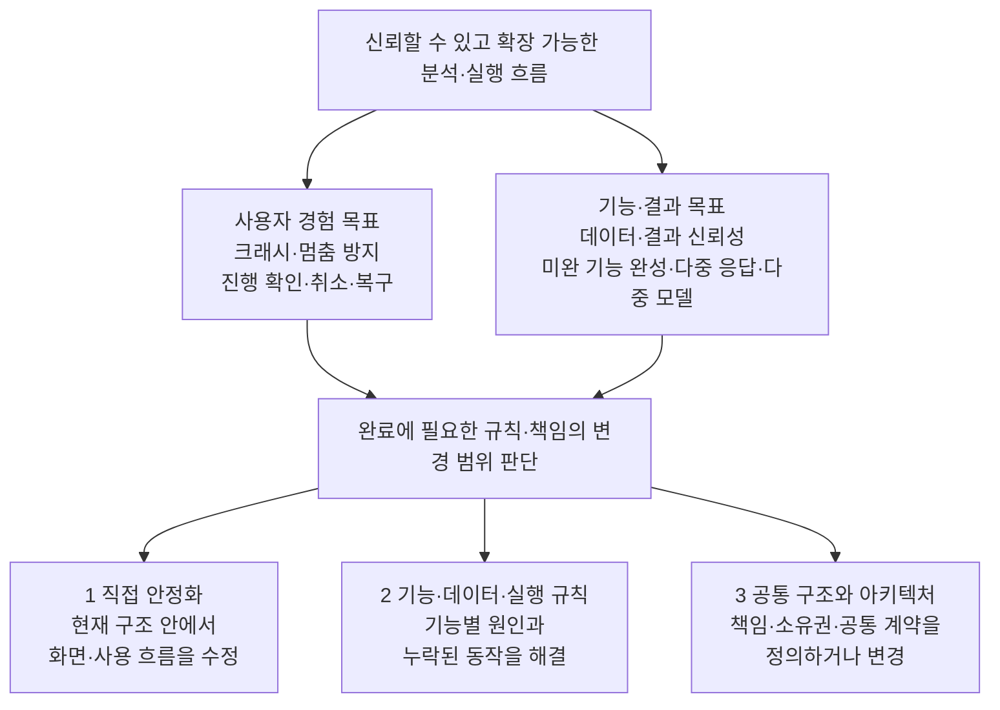

# 작업 분류와 층위 구조

작업의 해결 층위와 배치 기준을 정의한다. 개별 이슈의 배치는 [작업 분류표](Task-Classification.md)에서 관리한다.

현재 프로젝트에서 함께 다뤄야 하는 내용을 넓게 묶어, 각 층위 아래에는 **2~3개의 작업 묶음**만 둔다. 세부 분류 번호는 두지 않고, 구체적인 범위와 완료 조건은 개별 작업에서 정한다.

## 목표에서 해결 층위로 내려가는 구조

**1→2→3은 해결 범위의 깊이를 나타낸다.** 작업의 수행 순서는 실제 의존 관계로 정한다. 한 현상에 직접 수정, 기능 규칙 수정, 공통 구조 변경이 함께 필요할 수 있다. 범위가 명확한 직접 수정은 독립적으로 수행할 수 있다.

상위 목표·Epic은 필요한 작업을 묶어 추적하며 별도의 구현 층위로 세지 않는다.

## 1 화면·사용 흐름의 직접 안정화

현재 구조 안에서 바로 고칠 수 있는 크래시·화면 결함과 사용자 안내를 함께 다룬다. 기능의 동작 규칙이나 공통 구조까지 바꿔야 하는 부분은 2·3에 연결한다.

| 작업 묶음 | 다루는 범위 |
|---|---|
| 크래시·화면 동작 수정 | 잘못된 접근·호출 방지, 화면 갱신·선택·창 조작·신호 연결 등 직접 수정 |
| 진행·취소·실패 안내 | 진행 상태와 취소 가능 여부 표시, 취소 조작 연결, 실패 안내와 복구 동선 |

## 2 기능·데이터·실행 규칙의 완성

각 모듈의 데이터와 실행이 맞게 동작하도록 원인을 해결하고 기능을 완성한다. 서로 얽혀 있는 저장·참조·실행·결과 처리는 필요한 범위를 함께 다룬다.

| 작업 묶음 | 다루는 범위 |
|---|---|
| 데이터·참조·저장 정합성 | Set·모델·산출물의 식별·버전·출처, 저장·복원·보존, 실행 입력과 결과·화면 상태의 일치 |
| 모듈별 실행 흐름 개선 | 비동기 전환, 실행 전후 처리, 배치 실행·취소·실패·재시도와 부분 결과 처리 |
| 기능 완성과 파이프라인 정리 | 누락 기능 완성, 다중 응답·다중 모델과 단계별 입출력 처리, 모듈 내부 데이터·로직 정리 |

## 3 공통 실행 구조와 아키텍처

모듈별 수정만으로 해결하기 어려운 실행 기반과 공통 구조를 정리한다. 책임 경계와 공통 규칙은 실제 적용할 모듈의 요구를 확인하면서 구체화한다.

| 작업 묶음 | 다루는 범위 |
|---|---|
| 공통 실행 기반 정리 | 비동기 작업의 실행·취소·종료, 입력·결과 전달, 자원 수명과 경합, 공통 상태 표시를 함께 정리하고 적용·검증 |
| 공통 구조·모듈 연결 정리 | 화면·데이터·실행의 책임과 의존 관계, 파이프라인 연결과 공유 규칙, 기존 구조의 전환·호환성 |

공통 실행 기반은 실행 방식별 제약을 반영하면서 필요한 공통 보장을 정한다. 세부 상태·소유권·인터페이스는 해당 작업 안에서 구체화한다.

## 배치 기준과 분류 경계

주 배치는 **“이 작업을 완료하려면 주로 무엇을 바꿔야 하는가?”**로 정한다. 현재 확인된 범위로 우선 배치하고, 조사·구현 과정에서 범위가 드러나면 조정한다.

| 경계 | 구분 기준 |
|---|---|
| 1 ↔ 2 | 화면·조작·안내의 직접 수정은 1, 데이터나 실제 실행 동작을 고쳐야 하면 2 |
| 1·2 ↔ 3 | 기존 기반 안에서 모듈을 고치거나 적용하면 1·2, 공통 기반·책임·연결 구조를 바꾸면 3 |

하나의 작업은 주 배치 한 곳을 갖고, 다른 층위와의 관계는 연결로 표현한다. 여러 내용이 얽힌 작업은 한 묶음으로 두고, 실제로 독립해 진행할 수 있을 때 분리한다. 여러 모듈을 수정하거나 공통 헬퍼를 만든다는 이유만으로 3에 배치하지 않는다.

다중 응답·다중 모델 파이프라인 같은 기능 목표는 여러 층위에 걸칠 수 있다. 상위 목표로 연결해 추적하고, 각 작업에 필요한 검증은 해당 작업의 완료 조건에 포함한다.

## 모듈별·층위별 담당 배정안

[기존 이슈 보드](https://github.com/orgs/NumeRealWorks/projects/16/views/8)를 참고하되, 각 담당자는 구현에 적절한 단위로 작업을 정의한다. 필요에 따라 기존 이슈를 보완하거나 새로 발행하고, 작업 범위와 완료 조건을 명시한다.

| 묶음 | 담당 모듈 | 담당 배정안 |
|---|---|---|
| A. 프로젝트·해석 입력 구성 | 프로젝트, 덱, 입력 전처리(Condition/Geometry Parameterization), DOE | 현철님 |
| B. 해석 실행·데이터셋 생성 | 런처, 출력 전처리(Preprocessor) | 형삼님 ↔ 현규님 |
| C. 모델 학습·활용 | Builder, Runner, Optimizer | 현규님 ↔ 형삼님 |

- **프로젝트**는 전체 모듈에 걸친 정책·구조 관리를 담당한다.
- **층위별 담당자는 모듈별 담당자와 별개로 배정한다.** 층위 1~3과 모듈 묶음 A~C는 서로 다른 배정 축이다. 현재 정해진 개별 작업 담당은 아래에 기록하며, 층위 전체의 담당은 별도로 배정한다.

### 공통 아키텍처 기반 정리·도입 담당

| 작업 | 담당 |
|---|---|
| MVC Controller 계층 적용 | 형삼님 |
| MVVM 아키텍처 도입 | 현철님 |

### 현재 개발 담당

| 작업 | 담당 |
|---|---|
| CAD 개발 | 현철님 |
| Runner·Analyzer·Optimizer의 LLM UI 마이그레이션 | 현규님 |
| 출력 전처리(Preprocessor) 및 DOE 리샘플링 개발 | 현규님 |
| 덱·Set·산출물의 공통 식별·참조 관리 기반 구축 | 민호님 |
| 다중 응답·다중 모델 지원 개발 | 민호님 |

CAD와 Geometry Parameterization의 경계는 작업자가 인지하고 있는 구분을 유지한다.
