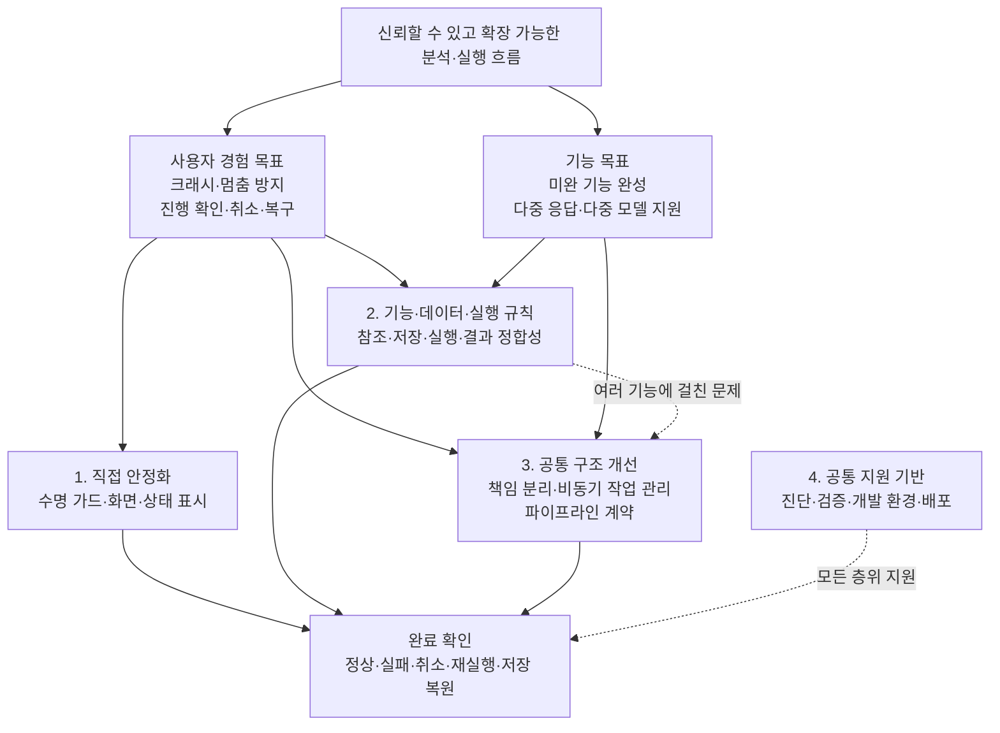

# 작업 분류

사용자에게 보장할 결과를 기준으로 작업을 **화면·사용 흐름의 직접 안정화**, **기능·데이터·실행 규칙의 완성**, **공통 구조 개선**에 배치한다. **검증·진단·개발/배포 기반**은 모든 층위를 지원한다. 1→2→3은 일괄 수행 순서가 아니라 해결 범위의 깊이다. 하나의 사용자 문제에 여러 층위의 작업이 함께 필요할 수 있다.

크래시·멈춤·상태 불명확은 사용자 현상이고, 미완 기능 완성·다중 응답/모델 지원은 별도의 기능 목표다. 후보·보류·범위 재정의는 작업 종류가 아니라 검토 상태로 관리한다.

## 목표와 해결 구조

## 배치와 검토 상태

- 기존 작업 표 **77행, 이슈 78개**를 보존한다. **상위 추적 9행과 개별 작업 68행**으로 분리하며 #446·#447은 기존처럼 한 행이다. 각 행은 한 곳에만 주 배치한다.
- 파이프라인 v7은 **구현 초안 22건과 상위 Epic 1건**이다. 구현 초안은 관련 절에 원문 링크로 연결하고 **설계 초안** 상태를 유지한다.
- **기존 배치**는 기존 본표의 위치를 옮겼다는 뜻이며 새 검토·착수 승인·완료 판정이 아니다. **검토 반영**은 기존 비동기·진행 상태 표의 검토 결과를 유지한다는 뜻이다.
- **검토 전 후보 / 핵심 후보 / 조건부 핵심 / 후순위 후보 / 보류 / 범위 재정의 / 완료로 닫기 후보**를 작업 위치와 별도로 유지한다. 기존 검토 판단 열에는 원문의 상태·중요도 표현을 보존한다. 핵심·조건부 핵심·후순위는 중요도 판단이며, 착수 가능 상태나 구현 우선순위와 동일하지 않다.
- 여러 층위에 걸친 이슈는 주 배치에서 범위·선행을 보존하고, 다른 절에서는 연결만 한다. 아래 분할은 작업 이해를 위한 것으로 GitHub 이슈나 부모·자식 관계를 변경하지 않는다.
- 후보 판단은 2026-10-11 [보드 By week 보기](https://github.com/orgs/NumeRealWorks/projects/16/views/8)와 이슈 본문·댓글·연결을 대조한 기존 기록이다. 비동기·정리 항목은 2026-10-11, 진행·취소 항목은 2026-10-12 dev `a076fde7` 분석 기록을 유지한다. 과거 수치·미재현 결함과 PR 상태는 착수 시 재확인한다.

## 배치 기준

주 배치는 제목이나 파일 위치보다 **완료를 위해 바꿔야 하는 주된 규칙·책임**으로 정한다.

| 배치 | 판단 기준 | 대표 경계 |
|---|---|---|
| 상위 목표·추적 | 다른 작업의 완료를 묶어 확인 | #451·#460·#649 등은 구현 작업과 분리 |
| 1 직접 안정화 | 기존 계약 안에서 수명 가드·화면 배선·조작·알림을 수정 | 버튼·신호 연결은 1, 실제 작업 종결·데이터 보존 규칙은 2 |
| 2 기능·데이터·실행 규칙 | 기능의 입력·저장·실행·결과 규칙 또는 모듈별 실행 흐름을 수정 | 기존 비동기 기반의 모듈 적용은 2-8 |
| 3 공통 구조 개선 | 여러 소비자가 따르는 책임 경계·소유권·공용 실행 계약을 변경 | 공통 ProcessJob 종료 계약·리더 스레드 기반은 3-2 |
| 4 공통 지원 기반 | 진단·검증·개발·배포 체계를 지원 | 기능 구현을 복제하지 않고 완료 검증과 연결 |

여러 층위가 필요한 이슈는 주 배치와 분리 가능한 범위를 함께 기록한다. 예를 들어 #454의 모듈 워커 적용은 2-8, 선행 리더 스레드 기반은 3-2, 국소 수명 가드는 1-1이다. ‘공통 헬퍼’나 ‘비동기’라는 표현만으로 3에 배치하지 않는다.

## 작업 배치 개요

| 층위 | 주 배치하는 작업 | 다른 층위와 연결되는 부분 |
|---|---|---|
| 1 직접 안정화 | #551 수명 가드, #512·#514 화면 결함, #543 창 조작, #461·#463·#464 상태 배선 | 상태의 실제 종결은 2-4, 공통 바인더는 3-2 |
| 2 기능·데이터·실행 규칙 | Set·산출물 참조, 저장, 결과 정합성, 배치 취소·실패, 미완 기능, 다중 처리, 모듈별 비동기 적용 | 공통 책임·실행 기반은 3, 완료 검증은 4 |
| 3 공통 구조 개선 | #318 씬 소유권, #432·#434 의존·자원 분리, #462·#553, ProcessJob·리더 스레드 기반, 파이프라인 공통 계약 | 국소 선처리는 1·2, 모듈별 검증·배포는 4 |
| 4 공통 지원 기반 | 회귀·진단·환경 정리, #483·#484 출고 운영, GUI·DeepOpt 통합 검증·배포 | 별도 이슈 없는 공백은 추가 검토로 표시 |

## 상위 목표와 추적 이슈

상위 추적 9건은 여러 작업의 완료를 묶어 확인하는 단위다. 이 표에서 목표·완료 조건을 유지하고 아래 1~4에는 개별 작업을 배치한다. 구현 연결은 이 문서의 분류 연결이며 GitHub의 부모·자식 관계를 새로 지정한 것이 아니다.

| 이슈 | 상위 추적 | 기존 검토 판단 | 요약 | 세부 분류 | 사용자 영향 | 관계·범위 | 구현 연결 |
|---|---|---|---|---|---|---|---|
| [#451](https://github.com/NumeRealWorks/DashOpti_GUI/issues/451) | — | 검토 반영 | 긴 GUI 동기 작업과 이벤트 펌핑 제거를 모듈별로 추적 | 비동기 전환 / 프리즈·재진입 방지 | 처리 중 화면 정지와 사용자 조작에 따른 재진입 오류 감소 | 상위 추적. 본선 자식 중 [#454](https://github.com/NumeRealWorks/DashOpti_GUI/issues/454)만 격상, 나머지는 범위 재정의·보류 상태의 관련 항목 참조. [#281](https://github.com/NumeRealWorks/DashOpti_GUI/issues/281)·[#457](https://github.com/NumeRealWorks/DashOpti_GUI/issues/457)은 기존 조사에서 별도 개발 범위로 분리. 이 문서에서 #281은 2-8에 배치하며 #457은 별도 작업 행 없이 참조만 유지. 바로 할 작업 없음 (추적용). 선행 정리 남음: 공통 절의 워커 기반 정의를 [#544](https://github.com/NumeRealWorks/DashOpti_GUI/issues/544) 결과 (`DashAsyncJobRunner`) 와 대조해 갱신하고, preprocessor 리더 전용 스레드 액터를 별도 이슈로 발행 | [2-8](#2-8%20%EB%AA%A8%EB%93%88%EB%B3%84%20%EB%B9%84%EB%8F%99%EA%B8%B0%20%EC%A0%84%ED%99%98%EA%B3%BC%20%EC%8B%A4%ED%96%89%20%ED%9D%90%EB%A6%84%20%EA%B0%9C%EC%84%A0) · [3-2](#3-2%20%EA%B3%B5%ED%86%B5%20%EB%B9%84%EB%8F%99%EA%B8%B0%20%EC%8B%A4%ED%96%89%20%EA%B3%84%EC%95%BD%EA%B3%BC%20%EA%B8%B0%EB%B0%98) |
| [#460](https://github.com/NumeRealWorks/DashOpti_GUI/issues/460) | — | 검토 반영 | 실행 진행 표시·취소·중복 실행 가드를 규약 + 모듈 단위로 통일 | 진행·취소 UX / 실행 상태 안내 | 작업이 진행 중인지와 취소 가능한지를 화면에서 일관되게 확인 | 상위 추적. 자식을 관심사 횡단에서 규약 + 모듈 단위로 재구성하고 번호를 재활용 (2026-10-12). 순서 [#462](https://github.com/NumeRealWorks/DashOpti_GUI/issues/462) → [#461](https://github.com/NumeRealWorks/DashOpti_GUI/issues/461)·[#463](https://github.com/NumeRealWorks/DashOpti_GUI/issues/463)·[#464](https://github.com/NumeRealWorks/DashOpti_GUI/issues/464) 병렬. AL Process 는 [#454](https://github.com/NumeRealWorks/DashOpti_GUI/issues/454) 완료 조건. NX CAD 스피너 (구 #464) 는 경로 폐기로 추진하지 않음 | [1-3](#1-3%20%EC%A7%84%ED%96%89%20%EC%83%81%ED%83%9C%20%ED%91%9C%EC%8B%9C) · [1-4](#1-4%20%EC%B7%A8%EC%86%8C%20%EC%A0%9C%EC%96%B4%EC%99%80%20%EC%83%81%ED%83%9C%20%ED%91%9C%EC%8B%9C) · [3-2](#3-2%20%EA%B3%B5%ED%86%B5%20%EB%B9%84%EB%8F%99%EA%B8%B0%20%EC%8B%A4%ED%96%89%20%EA%B3%84%EC%95%BD%EA%B3%BC%20%EA%B8%B0%EB%B0%98) |
| [#438](https://github.com/NumeRealWorks/DashOpti_GUI/issues/438) | — | 검토 반영 | Launcher 배치의 취소·케이스 진행 표시·재열기 상태 추적 | 배치 제어 / 진행 상태 정합성 | 취소 후 작업이 이어지거나 끝난 실행을 진행 중으로 오인하는 문제 방지 | 상위 추적. 착수 순서 [#439](https://github.com/NumeRealWorks/DashOpti_GUI/issues/439) → [#580](https://github.com/NumeRealWorks/DashOpti_GUI/issues/580) → [#716](https://github.com/NumeRealWorks/DashOpti_GUI/issues/716). [#440](https://github.com/NumeRealWorks/DashOpti_GUI/issues/440)은 완료로 닫기 후보 | [1-3](#1-3%20%EC%A7%84%ED%96%89%20%EC%83%81%ED%83%9C%20%ED%91%9C%EC%8B%9C) · [2-4](#2-4%20%EC%8B%A4%ED%96%89%20%EC%83%81%ED%83%9C%C2%B7%EC%B7%A8%EC%86%8C%C2%B7%EC%8B%A4%ED%8C%A8%20%EC%B2%98%EB%A6%AC%20%EA%B7%9C%EC%B9%99) |
| [#465](https://github.com/NumeRealWorks/DashOpti_GUI/issues/465) | — | 검토 반영 | 외부 프로세스의 실패 통지·응답 제한시간 추적 | 외부 실행 안정성 / 무응답 방지 | 실행 실패를 모른 채 기다리는 상황 예방 | 상위 추적 (경계 항목). [#466](https://github.com/NumeRealWorks/DashOpti_GUI/issues/466) 규칙 → [#467](https://github.com/NumeRealWorks/DashOpti_GUI/issues/467) 순. [#468](https://github.com/NumeRealWorks/DashOpti_GUI/issues/468) 종료, [#469](https://github.com/NumeRealWorks/DashOpti_GUI/issues/469) 제외 | [1-5](#1-5%20%EC%8B%A4%ED%8C%A8%20%EC%95%88%EB%82%B4%EC%99%80%20%EB%B3%B5%EA%B5%AC%20%EB%8F%99%EC%84%A0) · [2-4](#2-4%20%EC%8B%A4%ED%96%89%20%EC%83%81%ED%83%9C%C2%B7%EC%B7%A8%EC%86%8C%C2%B7%EC%8B%A4%ED%8C%A8%20%EC%B2%98%EB%A6%AC%20%EA%B7%9C%EC%B9%99) |
| [#443](https://github.com/NumeRealWorks/DashOpti_GUI/issues/443) | — | 기존 배치 | 입력 Set 참조의 setId 전환과 산출물 출처 기록·검증 완료를 추적 | Set·산출물 관계 / 출처 정합성 | 개명·입력 변경 후에도 올바른 입력과 생성 당시 출처를 구분 | 완료 조건은 [#368](https://github.com/NumeRealWorks/DashOpti_GUI/issues/368)·[#685](https://github.com/NumeRealWorks/DashOpti_GUI/issues/685)·[#728](https://github.com/NumeRealWorks/DashOpti_GUI/issues/728); 버전·최신성 판정은 [#650](https://github.com/NumeRealWorks/DashOpti_GUI/issues/650) | [2-1](#2-1%20Set%C2%B7%EB%AA%A8%EB%8D%B8%C2%B7%EC%82%B0%EC%B6%9C%EB%AC%BC%EC%9D%98%20%EC%8B%9D%EB%B3%84%EA%B3%BC%20%EC%B0%B8%EC%A1%B0) |
| [#649](https://github.com/NumeRealWorks/DashOpti_GUI/issues/649) | — | 기존 배치 | DOE Sampler·Analysis Launcher 재구성 후속의 Set 정책·입력 포맷·화면 갱신을 추적 | 기능·정합성 개선 / 데이터·구조 정리 | 입력 지원·결과 보존·버전 경고를 통해 실행과 결과 확인의 정확성 개선 | 상위 추적 이슈; 각 하위 작업의 범위와 완료 조건으로 관리 | [2-1](#2-1%20Set%C2%B7%EB%AA%A8%EB%8D%B8%C2%B7%EC%82%B0%EC%B6%9C%EB%AC%BC%EC%9D%98%20%EC%8B%9D%EB%B3%84%EA%B3%BC%20%EC%B0%B8%EC%A1%B0) · [2-3](#2-3%20%EC%8B%A4%ED%96%89%20%EC%9E%85%EB%A0%A5%C2%B7%EA%B2%B0%EA%B3%BC%C2%B7%ED%99%94%EB%A9%B4%20%EC%83%81%ED%83%9C%EC%9D%98%20%EC%A0%95%ED%95%A9%EC%84%B1) · [2-5](#2-5%20%EB%8B%A8%EA%B3%84%20%EA%B0%84%20%EC%9E%85%EC%B6%9C%EB%A0%A5%EA%B3%BC%20%EB%8B%A4%EC%A4%91%20%EC%9D%91%EB%8B%B5%C2%B7%EB%8B%A4%EC%A4%91%20%EB%AA%A8%EB%8D%B8%20%EA%B7%9C%EC%B9%99) · [2-6](#2-6%20%EA%B8%B0%EB%8A%A5%EB%B3%84%20%EB%88%84%EB%9D%BD%20%EB%8F%99%EC%9E%91%20%EC%99%84%EC%84%B1) |
| [#740](https://github.com/NumeRealWorks/DashOpti_GUI/issues/740) | — | 기존 배치 | Set 설정·입력 참조 처리의 저장 경로 통일·책임 분리·레거시 제거를 추적 | 구조 분해·정리 / 입력 참조 정합성 | 잘못된 입력 연결·선택 복원 오류를 줄이고 처리 규칙의 일관성 개선 | 상위 추적 이슈; [#728](https://github.com/NumeRealWorks/DashOpti_GUI/issues/728)은 [#443](https://github.com/NumeRealWorks/DashOpti_GUI/issues/443)의 완료 조건에서도 추적 | [2-1](#2-1%20Set%C2%B7%EB%AA%A8%EB%8D%B8%C2%B7%EC%82%B0%EC%B6%9C%EB%AC%BC%EC%9D%98%20%EC%8B%9D%EB%B3%84%EA%B3%BC%20%EC%B0%B8%EC%A1%B0) · [2-7](#2-7%20%EA%B8%B0%EB%8A%A5%20%EB%82%B4%EB%B6%80%EC%9D%98%20%EB%8D%B0%EC%9D%B4%ED%84%B0%C2%B7%EB%A1%9C%EC%A7%81%20%EC%A0%95%EB%A6%AC) |
| [#741](https://github.com/NumeRealWorks/DashOpti_GUI/issues/741) | — | 기존 배치 | Runner 예측 항목의 생성·실행·삭제 단계에서 파일·설정·DV 정합성을 추적 | 데이터·비즈니스 로직 정합성 | 중복 항목·잘못된 DV 실행·다른 항목의 파일 삭제 방지 | 상위 추적 이슈; [#475](https://github.com/NumeRealWorks/DashOpti_GUI/issues/475)·[#370](https://github.com/NumeRealWorks/DashOpti_GUI/issues/370)·[#477](https://github.com/NumeRealWorks/DashOpti_GUI/issues/477) 간 강제 선후 관계 없음 | [2-3](#2-3%20%EC%8B%A4%ED%96%89%20%EC%9E%85%EB%A0%A5%C2%B7%EA%B2%B0%EA%B3%BC%C2%B7%ED%99%94%EB%A9%B4%20%EC%83%81%ED%83%9C%EC%9D%98%20%EC%A0%95%ED%95%A9%EC%84%B1) · [2-6](#2-6%20%EA%B8%B0%EB%8A%A5%EB%B3%84%20%EB%88%84%EB%9D%BD%20%EB%8F%99%EC%9E%91%20%EC%99%84%EC%84%B1) |
| [#427](https://github.com/NumeRealWorks/DashOpti_GUI/issues/427) | — | 기존 배치 | 실행·화면 상태 격리의 렌더링 수정과 모핑 격리 검증을 추적 | 실행 상태 격리 / 구조 정리 | 실행이 편집 화면을 훼손하거나 화면 조작이 실행 입력·결과를 바꾸는 문제 방지 | 상위 추적; [#428](https://github.com/NumeRealWorks/DashOpti_GUI/issues/428)·[#429](https://github.com/NumeRealWorks/DashOpti_GUI/issues/429)·[#430](https://github.com/NumeRealWorks/DashOpti_GUI/issues/430) 완료. [#316](https://github.com/NumeRealWorks/DashOpti_GUI/issues/316)·[#319](https://github.com/NumeRealWorks/DashOpti_GUI/issues/319) → [#318](https://github.com/NumeRealWorks/DashOpti_GUI/issues/318)과 [#281](https://github.com/NumeRealWorks/DashOpti_GUI/issues/281) R1 및 최종 통합 확인이 잔여; [#281](https://github.com/NumeRealWorks/DashOpti_GUI/issues/281)의 응답성 작업 전체 완료는 요구하지 않음 | [2-3](#2-3%20%EC%8B%A4%ED%96%89%20%EC%9E%85%EB%A0%A5%C2%B7%EA%B2%B0%EA%B3%BC%C2%B7%ED%99%94%EB%A9%B4%20%EC%83%81%ED%83%9C%EC%9D%98%20%EC%A0%95%ED%95%A9%EC%84%B1) · [2-8](#2-8%20%EB%AA%A8%EB%93%88%EB%B3%84%20%EB%B9%84%EB%8F%99%EA%B8%B0%20%EC%A0%84%ED%99%98%EA%B3%BC%20%EC%8B%A4%ED%96%89%20%ED%9D%90%EB%A6%84%20%EA%B0%9C%EC%84%A0) · [3-1](#3-1%20%EC%B1%85%EC%9E%84%C2%B7%EC%9D%98%EC%A1%B4%20%EB%B0%A9%ED%96%A5%C2%B7%EA%B3%B5%EC%9C%A0%20%EC%9E%90%EC%9B%90%20%EC%86%8C%EC%9C%A0%EA%B6%8C%20%EB%B6%84%EB%A6%AC) · [4-2](#4-2%20%EA%B3%B5%ED%86%B5%20%ED%9A%8C%EA%B7%80%20%EA%B2%80%EC%A6%9D) |

다중 응답·다중 모델의 상위 Epic은 [파이프라인 v7](Multi-Response-Multi-Model-Pipeline-Plan_v7.md)의 설계안으로 관리한다. 기존 발행 이슈 9건과 구분하며, 아래 구현 초안 22건을 묶어 추적한다.

## 1 화면·사용 흐름의 직접 안정화

사용자 접점의 직접 수정과 상태 안내를 모은다. 비동기 구현 전체나 데이터 규칙을 이 층위의 완료 조건으로 일괄 묶지 않는다.

### 1-1 크래시 유발 동작의 직접 수정

객체 수명 가드 등 구조 전환 없이 닫을 수 있는 경로를 우선 배치한다. 입력·수명 계약 자체를 바꾸는 작업은 2·3에서 추적한다.

| 이슈 | 상위 추적 | 기존 검토 판단 | 요약 | 세부 분류 | 사용자 영향 | 관계·범위 |
|---|---|---|---|---|---|---|
| [#551](https://github.com/NumeRealWorks/DashOpti_GUI/issues/551) | — | 기존 배치 | 프로젝트 전환 뒤 모듈 위젯 7곳·delegate 1곳의 해제 Set 모델 역참조를 QPointer·널 가드로 차단 | 크래시 방지 / 객체 수명 | 다른 프로젝트를 연 뒤 Set 선택·생성·삭제, Direct Launch 실행, 조건 값 편집에서 앱이 종료되는 문제 방지 | [#549](https://github.com/NumeRealWorks/DashOpti_GUI/issues/549) 패턴 적용. 대상은 DoeSampler Init·Resample, ModelBuilder Sim·MCU, AnalysisLauncher, Optimizer, Condition 위젯과 FE 값 delegate. 무가드 슬롯 3곳과 전역 sender 슬롯 2곳 포함. Save As 의 restore 누락과 수명 계약 명문화 [#431](https://github.com/NumeRealWorks/DashOpti_GUI/issues/431)는 별건 |

### 1-2 화면 응답성과 조작 상태

화면·신호 배선·행 선택·창 조작의 직접 수정이다. [#455](https://github.com/NumeRealWorks/DashOpti_GUI/issues/455)의 펌핑 5곳 삭제·대체도 이 범위이며, 이슈 주 배치는 2-8에 둔다.

| 이슈 | 상위 추적 | 기존 검토 판단 | 요약 | 세부 분류 | 사용자 영향 | 관계·범위 |
|---|---|---|---|---|---|---|
| [#512](https://github.com/NumeRealWorks/DashOpti_GUI/issues/512) | — | 국소 수정으로 재분류 | Mesh QC 결과 표시의 펌핑 제거와 닫기 시그널 유실 차단 | 범위 정리 | 기존 정리 표에 별도 기재 없음 | 처리 방향: 국소 결함 수정으로 처리. 근거: 남은 것은 `DashMeshQualityDialog.cpp:164` 펌핑 1곳과 `DashGeometryParameterWidget.cpp:921→927` 의 `setResults` 와 `finished` 대기 순서. [#506](https://github.com/NumeRealWorks/DashOpti_GUI/issues/506)이 코루틴·Background 레인 전환을 이미 끝내 비동기 재구조화 불필요 |
| [#514](https://github.com/NumeRealWorks/DashOpti_GUI/issues/514) | — | 기존 배치 | 표 셀 위젯의 현재 행 조회를 통일하고 Runner·Builder MCU의 행 삭제 후 오작동 수정 | GUI 조작 정합성 / 공통 구조 정리 | 행 삭제 후 다른 행의 파일을 바꾸거나 선택이 반영되지 않는 오류 방지 | 독립 이슈; 공통 헬퍼·기존 행 조회 통합·Preview 미사용 인자 정리, #741과 별도 책임 |
| [#543](https://github.com/NumeRealWorks/DashOpti_GUI/issues/543) | — | 검토 반영 | 비동기 작업의 차단 범위·작업 문구·취소 안내 정리 | 비동기 작업 UX / 창 조작 응답성 | 작업 종류를 모르는 대기와 창 이동·크기 조절까지 막히는 불편 완화 | 약간의 선행 (결정). 차단 범위는 훅 람다 1곳, 문구는 `run()`·`scopedUiBlock()` 라벨 인자 + 호출부 5곳. 취소는 QtConcurrent·SDK 부재로 불가, [#462](https://github.com/NumeRealWorks/DashOpti_GUI/issues/462) 규약에서 "취소 불가" 표기 |
| [#446](https://github.com/NumeRealWorks/DashOpti_GUI/issues/446) · [#447](https://github.com/NumeRealWorks/DashOpti_GUI/issues/447) | — | 범위 재정의·실기 재현 필요 | DPI 변경 시 창 크기 확대와 레이아웃 연쇄 제한 | 범위 정리 | 기존 정리 표에 별도 기재 없음 | 처리 방향: 본문 재작성 후 창 조작 안정성 항목으로 분리. 근거: 배치 영속화 [#448](https://github.com/NumeRealWorks/DashOpti_GUI/issues/448)·크기 구조 [#449](https://github.com/NumeRealWorks/DashOpti_GUI/issues/449)·창 구조 [#450](https://github.com/NumeRealWorks/DashOpti_GUI/issues/450)은 제외. [#313](https://github.com/NumeRealWorks/DashOpti_GUI/issues/313) Qt6 전환으로 본문의 반올림 정책 논의가 무효 (PassThrough 기본, 핸들러 없음). 메인 창에 `availableGeometry` 클램프·DPI 핸들러·geometry 복원 모두 없음. 프리즈는 resize 마다 중첩 `resizeDocks` + `ResizeToContents` 81곳의 레이아웃 연쇄이고, pinned AI 레이아웃의 비례 최소폭 (DashMainWindow.cpp:717-720) 이 양의 되먹임 후보. 국소 가드 (클램프·debounce·고정 최소폭) 로 복구 불가 상태는 막을 수 있음. 실기 재현 없음 |

### 1-3 진행 상태 표시

사용자가 보는 상태와 모듈별 UI 배선을 다룬다. 공통 규약·바인더 [#462](https://github.com/NumeRealWorks/DashOpti_GUI/issues/462)는 3-2, 상태의 실제 종결 보장은 2-4에 배치한다. [#440](https://github.com/NumeRealWorks/DashOpti_GUI/issues/440)은 신규 구현이 아닌 닫기 정리 후보다.

| 이슈 | 상위 추적 | 기존 검토 판단 | 요약 | 세부 분류 | 사용자 영향 | 관계·범위 |
|---|---|---|---|---|---|---|
| [#461](https://github.com/NumeRealWorks/DashOpti_GUI/issues/461) | [#460](https://github.com/NumeRealWorks/DashOpti_GUI/issues/460) | 검토 반영 | DoeSampler Run 의 실행 상태 표시 — 버튼 정합·stop_token·진행·취소 | 모듈 배선 / 실행 상태 안내 | Run 연타가 무시된 것인지 실행 중인지 구분, 취소 가능 | 선행 [#462](https://github.com/NumeRealWorks/DashOpti_GUI/issues/462). 시그널은 있고 버튼 비활성·view 수신 없음, `QtConcurrent::run` 에 stop_token 추가 |
| [#463](https://github.com/NumeRealWorks/DashOpti_GUI/issues/463) | [#460](https://github.com/NumeRealWorks/DashOpti_GUI/issues/460) | 검토 반영 | ModelBuilder Sim·MCU · TopOpt 의 실행 상태 표시 — ProcessJob 기반 2모듈 | 모듈 배선 / 실행 상태 안내 | 학습·후처리 중 버튼 상태와 취소 가능 여부 확인 | 선행 [#462](https://github.com/NumeRealWorks/DashOpti_GUI/issues/462). ProcessJob cancel 과 종료 시그널은 있고 UI 배선·cancel 노출만 없음. ModelBuilder 조기 재활성 2곳 수정, MCU 는 취소 불가 모드. Optimizer 는 #462 로 이관 |
| [#464](https://github.com/NumeRealWorks/DashOpti_GUI/issues/464) | [#460](https://github.com/NumeRealWorks/DashOpti_GUI/issues/460) | 검토 반영 | ModelRunner 의 실행 상태 표시 — 버튼 정합·stop 노출·진행 | 모듈 배선 / 실행 상태 안내 | 예측 실행 중 버튼 상태와 취소 가능 여부 확인 | 선행 [#462](https://github.com/NumeRealWorks/DashOpti_GUI/issues/462) + PR [#722](https://github.com/NumeRealWorks/DashOpti_GUI/issues/722) 머지. 구 NX CAD 스피너 내용은 폐기. `stopPrediction` 추가, 소멸자 cancel 누락도 함께 |
| [#716](https://github.com/NumeRealWorks/DashOpti_GUI/issues/716) | [#438](https://github.com/NumeRealWorks/DashOpti_GUI/issues/438) | 검토 반영 | Launcher 재열기 시 저장된 Running·Enqueued 와 실제 실행 구분 | 재열기 상태 안내 | 이전 실행을 현재 실행 중으로 오인하는 문제 방지 | 약간의 선행. 수정은 실행기 `isRunning()` 을 케이스 표에 넘기는 국소 변경이나, [#439](https://github.com/NumeRealWorks/DashOpti_GUI/issues/439)·[#580](https://github.com/NumeRealWorks/DashOpti_GUI/issues/580) 이 먼저 들어가야 판정이 맞음 |
| [#440](https://github.com/NumeRealWorks/DashOpti_GUI/issues/440) | [#438](https://github.com/NumeRealWorks/DashOpti_GUI/issues/438) | 완료로 닫기 후보 | Direct 케이스 표 상태 배선 | 케이스 진행 표시 | — | 이미 해결 ([#604](https://github.com/NumeRealWorks/DashOpti_GUI/issues/604)). 본문이 가리킨 함수는 호출처 없는 죽은 코드. 삭제 후 닫기 |

### 1-4 취소 제어와 상태 표시

별도 중복 이슈를 만들지 않고 [#461](https://github.com/NumeRealWorks/DashOpti_GUI/issues/461)·[#463](https://github.com/NumeRealWorks/DashOpti_GUI/issues/463)·[#464](https://github.com/NumeRealWorks/DashOpti_GUI/issues/464)의 UI 범위로 연결한다. Optimizer 첫 적용은 [#462](https://github.com/NumeRealWorks/DashOpti_GUI/issues/462), 취소 불가 안내는 [#543](https://github.com/NumeRealWorks/DashOpti_GUI/issues/543)에 포함한다.

취소 가능·불가, 요청 접수, 처리 중, 실제 종료를 구분한다. 버튼 표시의 완료 조건은 2-4의 취소 규칙 및 3-2의 종료 신호 계약과 함께 확인한다. 기존 이슈의 범위 변경이 필요한 부분은 별도 검토한다.

### 1-5 실패 안내와 복구 동선

오류·완료 알림과 결과 표시를 통해 대기·실패를 이해하고 다음 동작을 선택할 수 있게 한다. 저장 실패 안내는 2-2의 [#638](https://github.com/NumeRealWorks/DashOpti_GUI/issues/638), 프로세스 제한시간은 2-4의 [#467](https://github.com/NumeRealWorks/DashOpti_GUI/issues/467)과 연결한다.

| 이슈 | 상위 추적 | 기존 검토 판단 | 요약 | 세부 분류 | 사용자 영향 | 관계·범위 |
|---|---|---|---|---|---|---|
| [#636](https://github.com/NumeRealWorks/DashOpti_GUI/issues/636) | — | 국소 수정으로 재분류 | Modal Frequency KPI 와 일반 결과의 완료 알림 정리 | 범위 정리 | 기존 정리 표에 별도 기재 없음 | 처리 방향: 국소 결함 수정으로 처리. 근거: Modal KPI 가 행마다 `allProcessFinished` 를 내고 (DashAnalysisLauncherKPI.cpp:374-376) 래퍼가 1회 더 냄 (DashAnalysisLauncher.cpp:1338-1340). 위젯이 직접 연결로 `QMessageBox` 를 띄워 배치 중 멈춤. 원형도 경로도 최대 3회. 신호 배선 수정이며 알림 형태만 [#454](https://github.com/NumeRealWorks/DashOpti_GUI/issues/454) 설계와 맞춤 |
| [#466](https://github.com/NumeRealWorks/DashOpti_GUI/issues/466) | [#465](https://github.com/NumeRealWorks/DashOpti_GUI/issues/465) | 검토 반영 | 외부 프로세스 실패 통지 규칙 수립 | 실패 통지 / 대기 상태 안내 | 실행기가 실패했는데 화면에 변화가 없어 기다리는 상황 예방 | 바로 가능 (문서). `DashNotify` 관례 위에 규칙만 정함, 문서는 [#482](https://github.com/NumeRealWorks/DashOpti_GUI/issues/482)와 공유. 완전 무음 6종 (Optimizer·DeepOpt train·MCU 데몬·Sensitivity 데몬·dash::cl create·Direct submit) 은 규칙 뒤 분리 발행 |

이번 실행의 결과 파일 연결은 이전 결과를 이번 결과로 오인하지 않도록 하는 정합성 작업이므로 2-3에 배치한다. 실패 안내는 이 절과 연결한다.

## 2 기능·데이터·실행 규칙의 완성

올바른 입력으로 실행하고 결과·설정·화면을 일관되게 유지하며 누락된 기능을 완성한다. 안정화의 원인 해결과 기능 확장을 함께 다루되 각 이슈의 목적은 구분한다.

### 2-1 Set·모델·산출물의 식별과 참조

Set 식별자, 산출물 출처, 산출물 버전의 의미를 구분한다. 상위 추적과 구현 자식은 중복 집계하지 않는다.

| 이슈 | 상위 추적 | 기존 검토 판단 | 요약 | 세부 분류 | 사용자 영향 | 관계·범위 |
|---|---|---|---|---|---|---|
| [#368](https://github.com/NumeRealWorks/DashOpti_GUI/issues/368) | [#443](https://github.com/NumeRealWorks/DashOpti_GUI/issues/443) | 기존 배치 | Sampler→Launcher→Builder의 입력 Set 참조와 생성 당시 산출물 출처를 기록 | Set·산출물 관계 / 출처 식별 | 개명 후에도 같은 입력을 참조하고 산출물의 실제 생성 출처를 확인 | Builder model_info.json과 공통 판독 계약 제공; 소비 측은 [#685](https://github.com/NumeRealWorks/DashOpti_GUI/issues/685) |
| [#685](https://github.com/NumeRealWorks/DashOpti_GUI/issues/685) | [#443](https://github.com/NumeRealWorks/DashOpti_GUI/issues/443) | 기존 배치 | Runner·Optimizer의 Builder 참조를 setId로 저장·복원하고 산출물 출처를 검증 | Set·산출물 관계 / 실행·프리뷰 정합성 | 동명 재생성 Set의 잘못된 사용을 막고 실제 모델의 deck으로 실행·프리뷰 | [#368](https://github.com/NumeRealWorks/DashOpti_GUI/issues/368)의 계약 사용; Runner NodeSet 목록·모핑·추출의 deck 통일 포함 |
| [#728](https://github.com/NumeRealWorks/DashOpti_GUI/issues/728) | [#740](https://github.com/NumeRealWorks/DashOpti_GUI/issues/740) | 기존 배치 | Launcher의 Geometry Set 연결을 이름 대신 기록된 setId로 해석 | Set·산출물 관계 / 참조 정합성 | 동명으로 재생성한 다른 Set을 잘못 사용하는 문제 방지 | [#727](https://github.com/NumeRealWorks/DashOpti_GUI/issues/727) 선행; [#443](https://github.com/NumeRealWorks/DashOpti_GUI/issues/443)의 완료 조건에서도 추적 |
| [#650](https://github.com/NumeRealWorks/DashOpti_GUI/issues/650) | [#649](https://github.com/NumeRealWorks/DashOpti_GUI/issues/649) | 기존 배치 | 소비한 상류 산출물 버전을 기록하고 불일치 경고를 다른 모듈로 확장 | Set·산출물 관계 / 버전 식별 | 오래된 입력이나 모델을 사용한 결과임을 인지 | setId는 Set 식별자이며 산출물 버전과 구분 |

### 2-2 저장 형식과 데이터 보존

저장·로드 규칙, 형식 식별, 저장 실패·동시 쓰기·종료 시 데이터 보존을 다룬다. 일반 설정의 형식 버전 정책과 파이프라인 v7의 구형 Sim 재생성 정책은 별개다.

| 이슈 | 상위 추적 | 기존 검토 판단 | 요약 | 세부 분류 | 사용자 영향 | 관계·범위 |
|---|---|---|---|---|---|---|
| [#480](https://github.com/NumeRealWorks/DashOpti_GUI/issues/480) | — | 기존 배치 | 설정 JSON에 형식 버전을 기록하고 로드 전에 지원 여부를 검사 | 저장 형식 식별 / 데이터 정합성 | 미지원 형식을 기본값으로 오독해 실행하거나 기존 설정을 덮어쓰는 문제 방지 | 일반 저장·읽기 계약; 구 산출물 호환 복원·자동 마이그레이션 제외. [#478](https://github.com/NumeRealWorks/DashOpti_GUI/issues/478)과 공통 구현 조율; 기존 Morphing.handles 버전 유지, [#650](https://github.com/NumeRealWorks/DashOpti_GUI/issues/650)의 산출물 버전과 구분 |
| [#478](https://github.com/NumeRealWorks/DashOpti_GUI/issues/478) | — | 핵심 후보 | JSON 변환 소비자를 공통 코덱으로 옮기고 저장·로드 왕복 동일성 검증 | 저장 데이터 정합성 / 공통 구조 정리 | 저장 후 다시 열었을 때 값이 누락·변형되는 문제 방지 | 핵심 후보; 본문에 왕복 단절 28건 기재. [#479](https://github.com/NumeRealWorks/DashOpti_GUI/issues/479)의 선행이며 손실 경로부터 단계적으로 이행; [#480](https://github.com/NumeRealWorks/DashOpti_GUI/issues/480)과 버전 기록·판별의 공통 구현 조율 |
| [#479](https://github.com/NumeRealWorks/DashOpti_GUI/issues/479) | — | 핵심 후보 | 공통 저장 헬퍼에 QSaveFile을 적용해 파일 쓰기를 원자적으로 처리 | 저장 원자성 / 데이터 보존 | 저장 중 크래시·디스크 부족으로 기존 JSON이 비거나 잘리는 문제 방지 | 핵심 후보; [#478](https://github.com/NumeRealWorks/DashOpti_GUI/issues/478) 선행. [#638](https://github.com/NumeRealWorks/DashOpti_GUI/issues/638)의 빈 파일 발생 원인과 관련하나 정상화·오류 안내는 별도 책임 |
| [#638](https://github.com/NumeRealWorks/DashOpti_GUI/issues/638) | — | 핵심 후보 | 빈 Launcher 설정 파일의 저장을 허용하고 저장 실패 사유 전달 | 저장 로직 정합성 / 오류 안내 | 설정 저장 거절과 DOE 스냅샷 누락에 따른 결과 XML의 설계변수 누락 방지 | 핵심 후보; 빈·공백 파일과 손상 JSON을 구분하고 손상 파일은 보존. [#479](https://github.com/NumeRealWorks/DashOpti_GUI/issues/479)와 보완 관계; 공용 readRoot/writeRoot 수정 |
| [#486](https://github.com/NumeRealWorks/DashOpti_GUI/issues/486) | — | 조건부 핵심 | 동일 프로젝트를 여러 앱에서 열 때 잠금과 실패 안내 적용 | 동시 쓰기 방지 / 데이터 보존 | 두 인스턴스가 설정을 상호 덮어쓰거나 워처 갱신을 증폭시키는 문제 방지 | 조건부 핵심; 동일 프로젝트 동시 실행 시 영향이 큼. 단일 인스턴스 작업만 하는 경우 직접 결함 수정 뒤 배치 |
| [#485](https://github.com/NumeRealWorks/DashOpti_GUI/issues/485) | — | 검토 전 후보 | 변경 여부를 추적하고 앱 종료 시 저장 여부를 확인 | 종료 안정성 / 데이터 손실 예방 | 저장하지 않은 작업을 경고 없이 닫아 잃는 문제 방지 | 주요 안정성 항목을 보완하는 데이터 보존 작업. 저장·종료 흐름 기반 [#432](https://github.com/NumeRealWorks/DashOpti_GUI/issues/432)와 저장 실패 전달 [#394](https://github.com/NumeRealWorks/DashOpti_GUI/issues/394)에 의존 |

파이프라인 v7 연결 작업 — **설계 초안**이며 기존 발행 이슈와 구분한다.

| 구현 초안 | 선행·후속과 범위 |
|---|---|
| [GUI: Launcher 응답 표를 Config로 저장·복원한다](Multi-Response-Multi-Model-Pipeline-Plan_v7.md#GUI%3A%20Launcher%20%EC%9D%91%EB%8B%B5%20%ED%91%9C%EB%A5%BC%20Config%EB%A1%9C%20%EC%A0%80%EC%9E%A5%C2%B7%EB%B3%B5%EC%9B%90%ED%95%9C%EB%8B%A4) | 선행 없음. XML 전환과 독립적으로 통합할 수 있다. Launcher 설정 전체의 재생성을 요구하지 않는다. |

### 2-3 실행 입력·결과·화면 상태의 정합성

파일·설정·DV·응답·화면 상태가 서로 다른 대상을 가리키거나 실패를 정상 결과로 기록하지 않도록 한다. 공유 씬의 공통 소유권은 3-1, 그에 앞선 개별 프리뷰 수정은 이 절에 배치한다.

| 이슈 | 상위 추적 | 기존 검토 판단 | 요약 | 세부 분류 | 사용자 영향 | 관계·범위 |
|---|---|---|---|---|---|---|
| [#475](https://github.com/NumeRealWorks/DashOpti_GUI/issues/475) | [#741](https://github.com/NumeRealWorks/DashOpti_GUI/issues/741) | 기존 배치 | 예측 항목 추가·교체 시 파일·표·설정·DV 기록을 일치시킴 | 데이터·비즈니스 로직 정합성 | 이름 충돌·중복 기록·잘못된 DV 사용과 실패 항목의 정상 등록 방지 | 추가와 교체 구분; 같은 항목의 예측 재실행 결과 교체는 허용 |
| [#477](https://github.com/NumeRealWorks/DashOpti_GUI/issues/477) | [#741](https://github.com/NumeRealWorks/DashOpti_GUI/issues/741) | 기존 배치 | 선택한 예측 항목에 속한 파일·표 행·설정만 삭제 | 데이터·비즈니스 로직 정합성 | 접두사가 비슷한 다른 항목의 파일까지 삭제되는 데이터 손실 방지 | 파일 생성·채번은 [#475](https://github.com/NumeRealWorks/DashOpti_GUI/issues/475) 담당; 세 하위 작업 간 강제 선후 관계 없음 |
| [#645](https://github.com/NumeRealWorks/DashOpti_GUI/issues/645) | [#649](https://github.com/NumeRealWorks/DashOpti_GUI/issues/649) | 기존 배치 | Add File 덮어쓰기 뒤 화면을 갱신하고 복사 실패 시 기존 등록 보존 | 데이터·로직 정합성 | 파일과 화면의 불일치 및 기존 등록·Set 손실 방지 | 사용자 영향: 데이터 손실 방지 |
| [#646](https://github.com/NumeRealWorks/DashOpti_GUI/issues/646) | [#649](https://github.com/NumeRealWorks/DashOpti_GUI/issues/649) | 기존 배치 | 재실행 뒤 Preprocess 목록 갱신, 실패 시 기존 결과 보존, Skip 의미 안내 | 데이터·로직 정합성 / 업무 흐름 개선 | 오래된 결과 표시·재실행 실패에 따른 결과 소실 방지 | 사용자 영향: 데이터 손실 방지·상태 이해 |
| [#639](https://github.com/NumeRealWorks/DashOpti_GUI/issues/639) | [#649](https://github.com/NumeRealWorks/DashOpti_GUI/issues/649) | 기존 배치 | Target Part 로딩 중 실행을 막고 로드 실패 시 저장값을 보존 | 데이터·로직 정합성 | 빈 Target으로 인한 실행 실패와 기존 선택값 소실 방지 | 비동기 로딩 중 상태 정합성; GUI freeze 제거 작업과 구분 |
| [#648](https://github.com/NumeRealWorks/DashOpti_GUI/issues/648) | [#616](https://github.com/NumeRealWorks/DashOpti_GUI/issues/616) | 기존 배치 | fe-safe 실행에 필요한 다른 Set의 ODB를 찾아 실행 폴더에 배치 | 입력·산출물 관계 정합성 | ODB 출처를 찾지 못해 모든 케이스가 실패하는 문제 해소 | [#649](https://github.com/NumeRealWorks/DashOpti_GUI/issues/649) → [#616](https://github.com/NumeRealWorks/DashOpti_GUI/issues/616) → [#648](https://github.com/NumeRealWorks/DashOpti_GUI/issues/648); 미확인 경로는 실패 사유 표시 |
| [#316](https://github.com/NumeRealWorks/DashOpti_GUI/issues/316) | [#427](https://github.com/NumeRealWorks/DashOpti_GUI/issues/427) | 기존 배치 | Optimizer Preview를 자기 소유 오버레이로 표시하고 로드 모델·편집 상태·카메라 보존 | 프리뷰 상태 정합성 / 기능 복구 | 프리뷰가 타 모듈 actor와 편집 기준 모델을 지우거나 바꾸는 문제 방지 | [#427](https://github.com/NumeRealWorks/DashOpti_GUI/issues/427) 자식; [#318](https://github.com/NumeRealWorks/DashOpti_GUI/issues/318)의 선행·파일럿, [#319](https://github.com/NumeRealWorks/DashOpti_GUI/issues/319)와 병렬 가능. 생성 루프의 이벤트 펌핑은 [#281](https://github.com/NumeRealWorks/DashOpti_GUI/issues/281), 결과 표시 단계는 이 이슈 |
| [#319](https://github.com/NumeRealWorks/DashOpti_GUI/issues/319) | [#427](https://github.com/NumeRealWorks/DashOpti_GUI/issues/427) | 기존 배치 | FE 모델 숨김 복원·카메라 정책·Runner 프리뷰 중첩·Geometry actor 등록 해제 수정 | 렌더링 자원 수명·상태 정합성 | 모델 표시를 복구하지 못하거나 카메라·관리 목록이 어긋나는 문제 방지 | [#427](https://github.com/NumeRealWorks/DashOpti_GUI/issues/427) 자식; [#318](https://github.com/NumeRealWorks/DashOpti_GUI/issues/318)·[#315](https://github.com/NumeRealWorks/DashOpti_GUI/issues/315) 선행. Optimizer 전체 actor 삭제는 [#316](https://github.com/NumeRealWorks/DashOpti_GUI/issues/316), 공통 씬 소유권은 [#318](https://github.com/NumeRealWorks/DashOpti_GUI/issues/318) 담당 |
| [#494](https://github.com/NumeRealWorks/DashOpti_GUI/issues/494) | — | 핵심 후보 | 응답 카탈로그에 스텝·성분 선택을 반영하고 조회·추출·표시 규칙을 통일 | 결과 선택·표시 정합성 | 다른 스텝의 응답 노출과 텐서 노름의 잘못된 응력 표시 방지 | 핵심 후보; 본문에 실측 오표시 근거. [#637](https://github.com/NumeRealWorks/DashOpti_GUI/issues/637)과 성분·Mode Shape 규칙 조율; 도메인 필터 전달은 Preprocessor 선행 확인 |
| [#630](https://github.com/NumeRealWorks/DashOpti_GUI/issues/630) | — | 조건부 핵심 | 필드 출력 질의에 응답 이름을 싣고 Motion 미리보기의 응답 키 누락 수정 | 응답 식별·질의 정합성 | 동일 operator의 다른 결과 선택과 Motion 미리보기 실패 방지 | 조건부 핵심; operator 중복은 미재현 잠재 결함, Motion 키 누락은 코드상 결함. 선행 [#634](https://github.com/NumeRealWorks/DashOpti_GUI/issues/634)는 닫힘; [#637](https://github.com/NumeRealWorks/DashOpti_GUI/issues/637)과 함께 조율 |
| [#631](https://github.com/NumeRealWorks/DashOpti_GUI/issues/631) | — | 핵심 후보 | Side Force KPI 계산 실패를 정상값 0과 구분하고 Force 성분 조회 수정 | 계산 결과 정합성 | 계산 실패가 정상 결과 0으로 저장되어 후속 판단에 쓰이는 문제 방지 | 핵심 후보; LGE 빌드에 한정. 실제 sideforce.rst로 성분 순서 확인 필요; [#573](https://github.com/NumeRealWorks/DashOpti_GUI/issues/573)의 실패 샘플 제외 규칙 적용 |
| [#637](https://github.com/NumeRealWorks/DashOpti_GUI/issues/637) | — | 핵심 후보 | Mode Shape의 변위 선택을 통일하고 성분 프리뷰·단일 파일 배치 초기화 수정 | 결과 선택 정합성 / 기능 복구 | 다른 물리량을 변위로 표시하거나 프리뷰·배치 결과가 누락되는 문제 방지 | 핵심 후보; [#494](https://github.com/NumeRealWorks/DashOpti_GUI/issues/494)·[#630](https://github.com/NumeRealWorks/DashOpti_GUI/issues/630)과 같은 카탈로그·질의 경로 조율. 모달 실파일 검증은 본문상 미완료 |
| [#563](https://github.com/NumeRealWorks/DashOpti_GUI/issues/563) | — | 조건부 핵심 | 새 핸들 구조에서 fixed 영역의 참조·라벨·마스크와 편집 UI를 정리 | Non-design 설정·영속 정합성 | Non-design 영역을 식별·편집하고 Set 재진입 후에도 의도한 제약을 사용 | 조건부 핵심; PR [#654](https://github.com/NumeRealWorks/DashOpti_GUI/pull/654) 병합으로 구 JSON·VTP 복원안은 대체됨. 최신 댓글의 DashFixedRegion·Morphing.handles.unpinned[] 범위로 재정의하고 현행 유실 재현부터 확인 |
| [#487](https://github.com/NumeRealWorks/DashOpti_GUI/issues/487) | — | 후순위 후보 | 숫자 입력에 허용 범위 검증과 안내를 단계적으로 적용 | 입력 검증 / 업무 규칙 | 범위를 벗어난 입력과 그에 따른 실행 오류 예방 | 후순위 후보; 본문에 필드별 범위·실패 사례가 없어 일괄 작업의 긴급성 근거 부족. 실행 실패·오답을 만드는 필드부터 구체화 |

파이프라인 v7 연결 작업 — **설계 초안**이며 기존 발행 이슈와 구분한다.

| 구현 초안 | 선행·후속과 범위 |
|---|---|
| [GUI: 이번 실행의 결과 파일을 명시 경로로 표시한다](Multi-Response-Multi-Model-Pipeline-Plan_v7.md#GUI%3A%20%EC%9D%B4%EB%B2%88%20%EC%8B%A4%ED%96%89%EC%9D%98%20%EA%B2%B0%EA%B3%BC%20%ED%8C%8C%EC%9D%BC%EC%9D%84%20%EB%AA%85%EC%8B%9C%20%EA%B2%BD%EB%A1%9C%EB%A1%9C%20%ED%91%9C%EC%8B%9C%ED%95%9C%EB%8B%A4) | 선행: DeepOpt 실패 코드·명시 결과 경로. 후속: Runner 일괄 실행과 Optimizer 실행 계약. 형식 불변인 수정분은 먼저 통합할 수 있다. |
| [GUI: 최적화 실행 직전에 Sim 1D 참조와 새 CLI 계약을 검증한다](Multi-Response-Multi-Model-Pipeline-Plan_v7.md#GUI%3A%20%EC%B5%9C%EC%A0%81%ED%99%94%20%EC%8B%A4%ED%96%89%20%EC%A7%81%EC%A0%84%EC%97%90%20Sim%201D%20%EC%B0%B8%EC%A1%B0%EC%99%80%20%EC%83%88%20CLI%20%EA%B3%84%EC%95%BD%EC%9D%84%20%EA%B2%80%EC%A6%9D%ED%95%9C%EB%8B%A4) | 선행: Sim 1D Builder 모델 선택, GUI 명시 결과 표시. 후속: Optimizer 다중 Builder 참조. DeepOpt 선택 모델 식 평가와 통합 검증한다. |

### 2-4 실행 상태·취소·실패 처리 규칙

대기부터 성공·실패·취소까지 종결 상태를 보장하고, 실제 실행과 저장된 상태를 구분한다. 공통 실행기의 종료 신호 구현은 3-2에 둔다.

| 이슈 | 상위 추적 | 기존 검토 판단 | 요약 | 세부 분류 | 사용자 영향 | 관계·범위 |
|---|---|---|---|---|---|---|
| [#439](https://github.com/NumeRealWorks/DashOpti_GUI/issues/439) | [#438](https://github.com/NumeRealWorks/DashOpti_GUI/issues/438) | 검토 반영 | 배치 취소 시 진행 프로세스와 Motion 대기 큐를 함께 정리 | 취소 완결 | Stop 직후 다음 케이스가 다시 실행되는 문제 방지 | 바로 가능. `DashJobRunner.cpp`·`DashJobRunnerAnsysMotion.cpp` 두 파일: 큐 clear + Cancelled emit, 루프 stop token 검사, 기동 실패 시 시그널 disconnect. [#468](https://github.com/NumeRealWorks/DashOpti_GUI/issues/468) 이관 2건 포함 |
| [#580](https://github.com/NumeRealWorks/DashOpti_GUI/issues/580) | — | 검토 반영 | Enqueued 이후 종결 상태 없는 종료 경로 전부에 Failed·Cancelled 전달 | 작업 종료 보장 / 상태·버튼 복원 | 실행이 끝났는데 케이스가 대기 상태로 남고 Start 가 잠기는 문제 방지 | 바로 가능. 본문 4곳 중 Direct 는 해결, 대신 Mechanical·Abaqus·Motion 의 json-only 경로 14곳 추가. 기존 `failActiveCases` 사용 |
| [#467](https://github.com/NumeRealWorks/DashOpti_GUI/issues/467) | [#465](https://github.com/NumeRealWorks/DashOpti_GUI/issues/465) | 검토 반영 | 데몬 명령 응답에 제한시간과 초과 통지 적용 | 무한 대기 방지 / 실패 안내 | 데몬이 응답하지 않을 때 끝없이 기다리지 않음 | 약간의 선행 (결정). 기동 타임아웃은 이미 있고 명령 응답만 무한. `m_commandTimer` 추가로 `DashExtensionProcess` 안에서 끝남. 명령별 상한·STP watchdog 관계·[#484](https://github.com/NumeRealWorks/DashOpti_GUI/issues/484) 경계 결정, 통지 노출은 [#466](https://github.com/NumeRealWorks/DashOpti_GUI/issues/466) 무음 경로 선행 |

파이프라인 v7 연결 작업 — **설계 초안**이며 기존 발행 이슈와 구분한다.

| 구현 초안 | 선행·후속과 범위 |
|---|---|
| [DeepOpt: 실행 실패 코드와 명시 결과 경로를 제공한다](Multi-Response-Multi-Model-Pipeline-Plan_v7.md#DeepOpt%3A%20%EC%8B%A4%ED%96%89%20%EC%8B%A4%ED%8C%A8%20%EC%BD%94%EB%93%9C%EC%99%80%20%EB%AA%85%EC%8B%9C%20%EA%B2%B0%EA%B3%BC%20%EA%B2%BD%EB%A1%9C%EB%A5%BC%20%EC%A0%9C%EA%B3%B5%ED%95%9C%EB%8B%A4) | 선행 없음. 후속: GUI 결과 표시, 두 차원의 학습·예측, 선택 모델 식 평가. |
| [GUI: Builder 실행 수명을 모델 상태 파일 기준으로 처리한다](Multi-Response-Multi-Model-Pipeline-Plan_v7.md#GUI%3A%20Builder%20%EC%8B%A4%ED%96%89%20%EC%88%98%EB%AA%85%EC%9D%84%20%EB%AA%A8%EB%8D%B8%20%EC%83%81%ED%83%9C%20%ED%8C%8C%EC%9D%BC%20%EA%B8%B0%EC%A4%80%EC%9C%BC%EB%A1%9C%20%EC%B2%98%EB%A6%AC%ED%95%9C%EB%8B%A4) | 선행: ProcessJob 종료 계약, 공통 참조, 모델 행, Sim XML 배열 전환. fixture로 먼저 구현하고 실제 학습 검증은 DeepOpt 1D 학습 뒤 수행한다. |

### 2-5 단계 간 입출력과 다중 응답·다중 모델 규칙

[다중 응답·다중 모델 파이프라인 v7](Multi-Response-Multi-Model-Pipeline-Plan_v7.md)을 기능 목표로 유지하면서 관련 구현 초안을 층위별로 배치한다. 구현 초안 22건과 상위 Epic 1건이며, 이 절에는 단계별 기능 구현 13건을 둔다. 공통 기반은 3-2·3-3, 저장은 2-2, 실행·결과 정합성과 실행 상태 규칙은 2-3·2-4에 연결한다.

범위는 **Sim 1D·ND의 모델 관리 형식 통일**이다. MCU는 기존 계약을 유지하고 Optimizer는 Sim 1D만 지원한다. 기존 Sim 설정·XML·학습 결과는 재생성을 요구하며 자동 변환은 포함하지 않는다. 1D 학습→예측→최적화를 먼저 완성하고 ND를 연결한 뒤 함께 배포한다.

| 이슈 | 상위 추적 | 기존 검토 판단 | 요약 | 세부 분류 | 사용자 영향 | 관계·범위 |
|---|---|---|---|---|---|---|
| [#643](https://github.com/NumeRealWorks/DashOpti_GUI/issues/643) | [#649](https://github.com/NumeRealWorks/DashOpti_GUI/issues/649) | 기존 배치 | Preprocess XML을 Set 단위로 통합하고 중복 데이터를 줄임 | 데이터 구조 정리 / 산출물 식별 | 산출물 중복과 크기를 줄이고 Builder·Launcher 사이의 데이터 호환성 개선 | HDF5 전환은 검토 단계; Set ID·deck 식별·버전의 의미를 구분 |

파이프라인 v7 연결 작업 — **설계 초안**이며 기존 발행 이슈와 구분한다.

| 구현 초안 | 선행·후속과 범위 |
|---|---|
| [GUI: Sim XML 작성·파서를 응답 배열 형식으로 전환한다](Multi-Response-Multi-Model-Pipeline-Plan_v7.md#GUI%3A%20Sim%20XML%20%EC%9E%91%EC%84%B1%C2%B7%ED%8C%8C%EC%84%9C%EB%A5%BC%20%EC%9D%91%EB%8B%B5%20%EB%B0%B0%EC%97%B4%20%ED%98%95%EC%8B%9D%EC%9C%BC%EB%A1%9C%20%EC%A0%84%ED%99%98%ED%95%9C%EB%8B%A4) | 선행: MCU XML 처리 경계 분리. 후속: XML N개와 Builder 실행 수명. |
| [GUI: Launcher Preprocess가 XML 하나에 응답 N개를 쓴다](Multi-Response-Multi-Model-Pipeline-Plan_v7.md#GUI%3A%20Launcher%20Preprocess%EA%B0%80%20XML%20%ED%95%98%EB%82%98%EC%97%90%20%EC%9D%91%EB%8B%B5%20N%EA%B0%9C%EB%A5%BC%20%EC%93%B4%EB%8B%A4) | 선행: Sim XML 배열 전환. DeepOpt 측 중복 키 검증은 DeepOpt XML 판독 작업이 맡는다. |
| [DeepOpt: XML의 응답 배열과 중복 키를 판독한다](Multi-Response-Multi-Model-Pipeline-Plan_v7.md#DeepOpt%3A%20XML%EC%9D%98%20%EC%9D%91%EB%8B%B5%20%EB%B0%B0%EC%97%B4%EA%B3%BC%20%EC%A4%91%EB%B3%B5%20%ED%82%A4%EB%A5%BC%20%ED%8C%90%EB%8F%85%ED%95%9C%EB%8B%A4) | 선행: DeepOpt 공통 계약 (fixture). GUI XML 배열 전환과 같은 형식을 쓴다. 후속: 1D·ND 학습. |
| [GUI: Sim 1D·ND의 설정과 옵션을 모델 ID별 행으로 저장한다](Multi-Response-Multi-Model-Pipeline-Plan_v7.md#GUI%3A%20Sim%201D%C2%B7ND%EC%9D%98%20%EC%84%A4%EC%A0%95%EA%B3%BC%20%EC%98%B5%EC%85%98%EC%9D%84%20%EB%AA%A8%EB%8D%B8%20ID%EB%B3%84%20%ED%96%89%EC%9C%BC%EB%A1%9C%20%EC%A0%80%EC%9E%A5%ED%95%9C%EB%8B%A4) | 선행: GUI 공통 참조·ID 발급, 모델 차원 명시·MCU 처리 경계. 후속: Builder 실행 수명. DeepOpt 두 학습 CLI와 같은 배열 계약을 사용한다. |
| [DeepOpt: Configuration의 실행 행마다 1D 모델 하나를 학습해 모델 ID 디렉터리에 둔다](Multi-Response-Multi-Model-Pipeline-Plan_v7.md#DeepOpt%3A%20Configuration%EC%9D%98%20%EC%8B%A4%ED%96%89%20%ED%96%89%EB%A7%88%EB%8B%A4%201D%20%EB%AA%A8%EB%8D%B8%20%ED%95%98%EB%82%98%EB%A5%BC%20%ED%95%99%EC%8A%B5%ED%95%B4%20%EB%AA%A8%EB%8D%B8%20ID%20%EB%94%94%EB%A0%89%ED%84%B0%EB%A6%AC%EC%97%90%20%EB%91%94%EB%8B%A4) | 선행: DeepOpt 공통 계약, XML 판독, 실패 코드 처리. 후속: 1D 예측, ND 학습. |
| [DeepOpt: ND를 행별 학습과 공통 산출물 형식으로 전환한다](Multi-Response-Multi-Model-Pipeline-Plan_v7.md#DeepOpt%3A%20ND%EB%A5%BC%20%ED%96%89%EB%B3%84%20%ED%95%99%EC%8A%B5%EA%B3%BC%20%EA%B3%B5%ED%86%B5%20%EC%82%B0%EC%B6%9C%EB%AC%BC%20%ED%98%95%EC%8B%9D%EC%9C%BC%EB%A1%9C%20%EC%A0%84%ED%99%98%ED%95%9C%EB%8B%A4) | 선행: 1D 학습 (진입 규칙·writer 재사용), 실패 코드 처리. GUI 실행 수명과 함께 검증하고 ND 예측의 학습 산출물을 제공한다. |
| [GUI: Runner의 모델별 선택 영속과 차원별 실행 모드를 정리한다](Multi-Response-Multi-Model-Pipeline-Plan_v7.md#GUI%3A%20Runner%EC%9D%98%20%EB%AA%A8%EB%8D%B8%EB%B3%84%20%EC%84%A0%ED%83%9D%20%EC%98%81%EC%86%8D%EA%B3%BC%20%EC%B0%A8%EC%9B%90%EB%B3%84%20%EC%8B%A4%ED%96%89%20%EB%AA%A8%EB%93%9C%EB%A5%BC%20%EC%A0%95%EB%A6%AC%ED%95%9C%EB%8B%A4) | 선행: GUI 공통 참조, Sim 모델 차원 명시. 후속: 전체 참조 해석·일괄 실행. ND 지원 여부는 DeepOpt 예측 계약과 맞춘다. #724를 닫는다. |
| [GUI: Runner가 전체 참조를 해석해 한 번에 실행한다](Multi-Response-Multi-Model-Pipeline-Plan_v7.md#GUI%3A%20Runner%EA%B0%80%20%EC%A0%84%EC%B2%B4%20%EC%B0%B8%EC%A1%B0%EB%A5%BC%20%ED%95%B4%EC%84%9D%ED%95%B4%20%ED%95%9C%20%EB%B2%88%EC%97%90%20%EC%8B%A4%ED%96%89%ED%95%9C%EB%8B%A4) | 선행: Runner 선택 영속, GUI 명시 결과 표시. DeepOpt 1D·ND 예측과 통합 검증한다. |
| [DeepOpt: 1D 모델 로더·입력 어댑터로 case당 CSV 한 행을 모은다](Multi-Response-Multi-Model-Pipeline-Plan_v7.md#DeepOpt%3A%201D%20%EB%AA%A8%EB%8D%B8%20%EB%A1%9C%EB%8D%94%C2%B7%EC%9E%85%EB%A0%A5%20%EC%96%B4%EB%8C%91%ED%84%B0%EB%A1%9C%20case%EB%8B%B9%20CSV%20%ED%95%9C%20%ED%96%89%EC%9D%84%20%EB%AA%A8%EC%9D%80%EB%8B%A4) | 선행: 1D 학습 (산출물), 공통 계약, 실패 코드·명시 결과 경로. GUI Runner 일괄 실행과 같은 CSV 계약을 사용한다. 후속: 선택 모델 식 평가. |
| [DeepOpt: ND 모델 로더로 case·모델별 VTU를 저장한다](Multi-Response-Multi-Model-Pipeline-Plan_v7.md#DeepOpt%3A%20ND%20%EB%AA%A8%EB%8D%B8%20%EB%A1%9C%EB%8D%94%EB%A1%9C%20case%C2%B7%EB%AA%A8%EB%8D%B8%EB%B3%84%20VTU%EB%A5%BC%20%EC%A0%80%EC%9E%A5%ED%95%9C%EB%8B%A4) | 선행: ND 학습 (산출물), 1D 예측 (어댑터), 실패 코드·명시 결과 경로. fixture로 먼저 구현하고 실제 저장 파일 검증은 ND 학습 전환 뒤 수행한다. |
| [GUI: Sim 1D Builder의 모델과 심볼을 저장·복원한다](Multi-Response-Multi-Model-Pipeline-Plan_v7.md#GUI%3A%20Sim%201D%20Builder%EC%9D%98%20%EB%AA%A8%EB%8D%B8%EA%B3%BC%20%EC%8B%AC%EB%B3%BC%EC%9D%84%20%EC%A0%80%EC%9E%A5%C2%B7%EB%B3%B5%EC%9B%90%ED%95%9C%EB%8B%A4) | 선행: GUI 공통 참조. 후속: 최적화 실행 계약, Optimizer 다중 Builder 참조. #726의 Optimizer 재적용 작업과 범위를 맞춘다. |
| [DeepOpt: 선택한 1D 모델로 목적·제약식을 평가한다](Multi-Response-Multi-Model-Pipeline-Plan_v7.md#DeepOpt%3A%20%EC%84%A0%ED%83%9D%ED%95%9C%201D%20%EB%AA%A8%EB%8D%B8%EB%A1%9C%20%EB%AA%A9%EC%A0%81%C2%B7%EC%A0%9C%EC%95%BD%EC%8B%9D%EC%9D%84%20%ED%8F%89%EA%B0%80%ED%95%9C%EB%8B%A4) | 선행: 1D 예측 (로더·어댑터), 실패 코드 처리. GUI Optimizer 실행 계약과 함께 검증한다. |
| [GUI: Optimizer가 여러 Sim 1D Builder의 모델을 참조한다](Multi-Response-Multi-Model-Pipeline-Plan_v7.md#GUI%3A%20Optimizer%EA%B0%80%20%EC%97%AC%EB%9F%AC%20Sim%201D%20Builder%EC%9D%98%20%EB%AA%A8%EB%8D%B8%EC%9D%84%20%EC%B0%B8%EC%A1%B0%ED%95%9C%EB%8B%A4) | 선행: Sim 1D Builder 모델 선택, 최적화 실행 계약. 형식 변경 없음. |

[#643](https://github.com/NumeRealWorks/DashOpti_GUI/issues/643)의 Preprocess XML 정리는 v7의 배열 XML·응답 N개 작성 작업과 경계가 겹친다. 병행 구현 전에 흡수·선행·별도 범위를 정하고 중복 계산하지 않는다. v7이 흡수하는 [#724](https://github.com/NumeRealWorks/DashOpti_GUI/issues/724)의 선택 영속 문제와 [#725](https://github.com/NumeRealWorks/DashOpti_GUI/issues/725)의 설정 쓰기 경로도 함께 조율한다.

### 2-6 기능별 누락 동작 완성

미완 기능은 안정화의 원인 목록과 구분하여 기능별 완료 대상으로 관리한다. 상위 추적 #649의 자식은 실제 작업 성격에 따라 2-1·2-3·2-5에도 배치한다.

| 이슈 | 상위 추적 | 기존 검토 판단 | 요약 | 세부 분류 | 사용자 영향 | 관계·범위 |
|---|---|---|---|---|---|---|
| [#604](https://github.com/NumeRealWorks/DashOpti_GUI/issues/604) | [#649](https://github.com/NumeRealWorks/DashOpti_GUI/issues/649) | 기존 배치 | Direct Launch를 Tool 메뉴 다이얼로그로 분리하고 상태 갱신 수정 | 기능·업무 흐름 개선 / 구조 분리 | 독립 해석 실행과 케이스 상태 확인 가능 | 진행 상태 표시에도 관련; 새 진행률 표시 요구를 추가하는 것은 아님 |
| [#615](https://github.com/NumeRealWorks/DashOpti_GUI/issues/615) | [#649](https://github.com/NumeRealWorks/DashOpti_GUI/issues/649) | 기존 배치 | DOE Sampler의 Resample Set 추가·번호 부여와 입력 참조 정책을 완성 | 기능·업무 규칙 완성 | 여러 차례 Resampling을 구성하고 올바른 입력·이력을 사용 | Init 1개 유지, Resample 추가 정책 |
| [#616](https://github.com/NumeRealWorks/DashOpti_GUI/issues/616) | [#649](https://github.com/NumeRealWorks/DashOpti_GUI/issues/649) | 기존 배치 | RW 미지원 입력 포맷의 등록·Set 생성·Launcher 처리 규칙을 통일 | 기능·업무 규칙 완성 / 입력 관계 정합성 | 포맷에 맞는 실행 경로를 사용하고 지원하지 않는 편집·읽기를 방지 | 실제 하위 연결은 [#648](https://github.com/NumeRealWorks/DashOpti_GUI/issues/648); Direct Launch 지원은 별도 |
| [#370](https://github.com/NumeRealWorks/DashOpti_GUI/issues/370) | [#741](https://github.com/NumeRealWorks/DashOpti_GUI/issues/741) | 기존 배치 | 파일 없는 DV-only 항목의 1D 예측 실행과 사용자 DV 전달 보장 | 미완인 기능·실행 로직 개선 | 입력 파일 없이 1D 예측 가능, 기본 DV로 대체된 오답 방지 | ND 파일 요구 유지; 생성·기록 보존은 [#475](https://github.com/NumeRealWorks/DashOpti_GUI/issues/475) 담당 |
| [#653](https://github.com/NumeRealWorks/DashOpti_GUI/issues/653) | — | 기존 배치 | Runner·Optimizer의 입력 파일을 FE Validation에서 실행하고 결과 프리뷰로 연결 | 미완인 기능 개선·추가 | 예측·최적화에 사용한 입력을 실제 FE 해석으로 확인 | 입력 파일 생성 제외; [#659](https://github.com/NumeRealWorks/DashOpti_GUI/issues/659) 선행, [#604](https://github.com/NumeRealWorks/DashOpti_GUI/issues/604) 재사용 |
| [#684](https://github.com/NumeRealWorks/DashOpti_GUI/issues/684) | — | 기존 배치 | 예측 호출을 SurrogatePredictor로 분리하고 Resampling 세 기법을 연결 | 미완인 기능 완성 / 구조 분해 | Uncertainty·EI·Confidence-bound 실행과 예측 결과 대응의 정확성 개선 | 1차 General 모드; 예측 결과 검증·취소 포함, Probabilistic 모드는 별도 |
| [#459](https://github.com/NumeRealWorks/DashOpti_GUI/issues/459) | — | 조건부 핵심 | MCU Set의 SHAP Feature 콤보가 채워지도록 입력 경로 수정 | 미완 기능 복구 | MCU 분석에서 Feature를 선택할 수 없는 문제 해소 | 조건부 핵심으로 상향; 명확한 기능 결손으로 MCU SHAP 사용 시 우선. 관련 [#409](https://github.com/NumeRealWorks/DashOpti_GUI/issues/409)는 완료됐지만 해당 복구는 범위 밖이므로 현행 CSV 경로의 잔여 결함 확인 |
| [#499](https://github.com/NumeRealWorks/DashOpti_GUI/issues/499) | — | 조건부 핵심 | 모핑 box·단면 핸들 생성을 mesh-ops BoxHandles·SectionFrameHandles로 대체 | 미완 기능 완성 / 외부 라이브러리 이관 | 핸들 격자 구성이 바뀌어 모핑 결과가 달라질 수 있어 사용자 노출 전 정책 결정 필요 | 조건부 핵심; W5 배정. 버전 범프·고립 handle 통로는 PR [#501](https://github.com/NumeRealWorks/DashOpti_GUI/pull/501)·[#506](https://github.com/NumeRealWorks/DashOpti_GUI/pull/506) 완료, 잔여는 작업 1·2. 열린 PR [#577](https://github.com/NumeRealWorks/DashOpti_GUI/pull/577)이 작업 1 진행; 내부 lattice·축별 분할·단면당 격자 차이 결정이 선행. 핸들 소유 구조는 PR [#654](https://github.com/NumeRealWorks/DashOpti_GUI/pull/654) 상태기 기준으로 재정의, libs/DashMarchingPlane 삭제는 [#331](https://github.com/NumeRealWorks/DashOpti_GUI/issues/331)과 연결 |

범위 확인: [#604](https://github.com/NumeRealWorks/DashOpti_GUI/issues/604)는 기존 본표의 행을 보존한 항목이며, [#440](https://github.com/NumeRealWorks/DashOpti_GUI/issues/440) 설명에는 이미 해결한 근거로 등장한다. 남은 구현이 있는지 확인하기 전에는 신규 미완 기능으로 집계하지 않는다.

### 2-7 기능 내부의 데이터·로직 정리

개별 기능의 쓰기 경로·표현·중복·레거시·국소 IO를 정리한다. 전역 의존 방향과 공통 자원 소유권 변경은 3-1에 둔다.

| 이슈 | 상위 추적 | 기존 검토 판단 | 요약 | 세부 분류 | 사용자 영향 | 관계·범위 |
|---|---|---|---|---|---|---|
| [#725](https://github.com/NumeRealWorks/DashOpti_GUI/issues/725) | [#740](https://github.com/NumeRealWorks/DashOpti_GUI/issues/740) | 기존 배치 | Runner의 DV 설정 쓰기와 저장 선택 캐시 갱신 경로를 통일 | 구조 정리 / 설정 정합성 | DV·응답·Part/NodeSet 선택의 저장·복원 일관성 유지 | [#724](https://github.com/NumeRealWorks/DashOpti_GUI/issues/724)와 같은 설정 쓰기 경로 조율 |
| [#726](https://github.com/NumeRealWorks/DashOpti_GUI/issues/726) | [#740](https://github.com/NumeRealWorks/DashOpti_GUI/issues/740) | 기존 배치 | Builder 중복 적재와 Part/NodeSet 콤보의 비동기 갱신 경쟁 정리 | 구조 정리 / 로직 정합성 | 빠른 Set 전환 시 이전 선택으로 덮이는 문제 방지, 불필요한 재읽기 감소 | 중복 작업 감소를 GUI freeze 해결로 단정하지 않음 |
| [#727](https://github.com/NumeRealWorks/DashOpti_GUI/issues/727) | [#740](https://github.com/NumeRealWorks/DashOpti_GUI/issues/740) | 기존 배치 | Parameter Set 처리와 DOE 입력 처리를 분리하고 구형 마이그레이션 제거 | 구조 분해·레거시 정리 | 입력 처리 규칙의 일관성 개선; 구형 프로젝트 처리 방식 변경 | 후속 [#728](https://github.com/NumeRealWorks/DashOpti_GUI/issues/728)·[#729](https://github.com/NumeRealWorks/DashOpti_GUI/issues/729)·[#731](https://github.com/NumeRealWorks/DashOpti_GUI/issues/731)·[#732](https://github.com/NumeRealWorks/DashOpti_GUI/issues/732)의 선행 |
| [#729](https://github.com/NumeRealWorks/DashOpti_GUI/issues/729) | [#740](https://github.com/NumeRealWorks/DashOpti_GUI/issues/740) | 기존 배치 | 모듈 JSON 파일 접두 정의를 공통 표 한 곳으로 통합 | 중복 정의·구조 정리 | 파일 인식 규칙의 불일치 예방; 기존 동작 유지 | [#727](https://github.com/NumeRealWorks/DashOpti_GUI/issues/727) 선행 |
| [#730](https://github.com/NumeRealWorks/DashOpti_GUI/issues/730) | [#740](https://github.com/NumeRealWorks/DashOpti_GUI/issues/740) | 기존 배치 | Preprocess에서 항상 거부되는 구형 launch 입력 대체 경로 제거 | 레거시·불필요한 경로 정리 | 지원하지 않는 입력의 처리와 실패 안내를 일관되게 유지 | [#727](https://github.com/NumeRealWorks/DashOpti_GUI/issues/727)과 독립; 실행 대장 도입 없음 |
| [#731](https://github.com/NumeRealWorks/DashOpti_GUI/issues/731) | [#740](https://github.com/NumeRealWorks/DashOpti_GUI/issues/740) | 기존 배치 | 구형 DV source 경로 추론을 제거하고 source 누락 시 거부로 통일 | 입력 검증·정합성 / 레거시 정리 | 우연히 남은 동명 파일 사용과 모듈별 다른 입력 판정 방지 | [#727](https://github.com/NumeRealWorks/DashOpti_GUI/issues/727) 선행; [#557](https://github.com/NumeRealWorks/DashOpti_GUI/issues/557) 흡수, [#685](https://github.com/NumeRealWorks/DashOpti_GUI/issues/685)와 모핑 변경 조율 |
| [#732](https://github.com/NumeRealWorks/DashOpti_GUI/issues/732) | [#740](https://github.com/NumeRealWorks/DashOpti_GUI/issues/740) | 기존 배치 | Sampler가 선택 Set을 파일명 대신 구조체로 보관하고 변환 축소 | 데이터 표현·구조 정리 | 선택·저장 동작 유지, 반복 변환에서의 오류 가능성 감소 | [#727](https://github.com/NumeRealWorks/DashOpti_GUI/issues/727) 선행; 저장 JSON 형식 유지, setId 전환 자체와 구분 |
| [#456](https://github.com/NumeRealWorks/DashOpti_GUI/issues/456) | — | 범위 재정의 | Analysis Launcher 정규 해석 경로의 남은 GUI 동기 처리 정리 | 범위 정리 | 기존 정리 표에 별도 기재 없음 | 처리 방향: 범위 재정의 후 개발 표 재검토. 근거: 정규 경로 펌핑 0곳. `generateInputCases` 는 [#269](https://github.com/NumeRealWorks/DashOpti_GUI/issues/269)에서 제거, 모핑은 QCoro 로 GUI 밖 (DashJobRunner.cpp:634). 남은 것은 케이스마다 launcher json 전체를 다시 쓰는 `writeCaseStatus` (O(N²) IO), 참조 덱 복사, 템플릿 치환 같은 국소 IO 비용 |
| [#423](https://github.com/NumeRealWorks/DashOpti_GUI/issues/423) | — | 후순위 후보 | 설정 초기값의 소유자·읽기 진입점·대체값 로그 정책 통일 | 설정 정책 / 공통 로직 정리 | 누락·비정상 입력이 조용히 기본값으로 바뀌어 실행되는 문제 예방 | 후순위 후보; 전수 조사·정책 수립 범위가 넓고 현재 기본값 불일치는 미확인. 실제 오실행 경로가 확인되면 해당 사례부터 상향 |

### 2-8 모듈별 비동기 전환과 실행 흐름 개선

기존 실행 기반을 사용해 특정 모듈의 동기 처리·이벤트 펌핑·결과 반영 흐름을 바꾸는 작업이다. 공통 실행 계약이나 스레드 소유권 기반을 새로 정하는 부분은 3-2에 연결한다. 작업량이 크거나 여러 파일을 수정한다는 이유만으로 아키텍처 작업으로 분류하지 않는다.

비동기 범위는 형삼님이 작업 중이며 재정리할 예정이다. 이 배치는 담당 작업의 재배정을 뜻하지 않는다. [#454](https://github.com/NumeRealWorks/DashOpti_GUI/issues/454)는 리더 전용 스레드 기반과 모듈 적용을 구분하고, [#455](https://github.com/NumeRealWorks/DashOpti_GUI/issues/455)는 국소 펌핑 제거와 파싱 워커 이관을 구분한다. [#513](https://github.com/NumeRealWorks/DashOpti_GUI/issues/513)은 선행 정리 뒤 기존 QCoro 패턴을 적용하는 작업으로 보류 상태를 유지한다. [#281](https://github.com/NumeRealWorks/DashOpti_GUI/issues/281)의 R1 격리 검증은 2-3·4-2와 연결한다.

| 이슈 | 상위 추적 | 기존 검토 판단 | 요약 | 세부 분류 | 사용자 영향 | 관계·범위 |
|---|---|---|---|---|---|---|
| [#454](https://github.com/NumeRealWorks/DashOpti_GUI/issues/454) | [#451](https://github.com/NumeRealWorks/DashOpti_GUI/issues/451) | 검토 반영 | Analysis Launcher 결과 읽기·Preprocess 를 워커로 옮기고 펌핑 17곳 제거 | GUI freeze 제거 / 크래시 방지 | 큰 결과 처리 중 응답 없음과 Set 삭제·프로젝트 닫기 재진입에 따른 해제 객체 접근 방지 | 펌핑 17곳 (Launcher 9 · ResultProcessor 8) 전부 GUI 스레드 동기, 비동기 기반 사용 0. 인계 3항목 미완료: `ProcessContext` const 참조 스냅샷 (DashAnalysisLauncher.cpp:1135), 리더 호출 스레드 고정, `DashProject.cpp:1215` 무가드 deleteLater. 전환 대상 약 1,000줄 (processResults 305 · loadResultKeys 199 · requestVtkPreview 128 · loadPreprocessInputs 122 외) + ResultProcessor 298. custom KPI 8곳은 [#435](https://github.com/NumeRealWorks/DashOpti_GUI/issues/435) 보존. 바로 할 수 있는 작업: `ProcessContext` 입력의 값 복사 전환과 Set 삭제·프로젝트 닫기 수명 가드 (워커 이관과 독립). 선행 정리 남음: 리더 전용 스레드 액터 (`DashRwActor` 선례, 정의된 이슈 없음) 와 완료 판정 기준 ([#453](https://github.com/NumeRealWorks/DashOpti_GUI/issues/453) 내용 없이 종료) |
| [#455](https://github.com/NumeRealWorks/DashOpti_GUI/issues/455) | — | 범위 축소·분할 | TopOpt 후처리·View Options·프로젝트 Load 의 남은 펌핑 제거 | 범위 정리 | 기존 정리 표에 별도 기재 없음 | 처리 방향: TopOpt FEM 파싱 4곳만 남기고 범위 축소, 나머지 5곳은 국소 삭제로 선처리. 근거: 본문 10곳 중 실제 9곳. FEM 파싱 (TopOptPostprocessDialog.cpp:240·418·564·1088) 만 워커 이관이고 TopOpt :302·:1811, ViewOptions :82·:94, MainWindow :3195 는 삭제 또는 `layout()->activate()` 대체. 파싱 펌핑 중 Browse 재클릭 시 옛 파일 결과가 새 파일을 덮는 재진입 경로 확인. `onProgressTimer` 는 호출처 없는 죽은 코드이며 개발자 로컬 경로 포함 ([#483](https://github.com/NumeRealWorks/DashOpti_GUI/issues/483) 대상) |
| [#513](https://github.com/NumeRealWorks/DashOpti_GUI/issues/513) | — | 보류 | Model Runner 폴더 선택의 스캔·메타데이터 적재 비동기 전환 | 범위 정리 | 기존 정리 표에 별도 기재 없음 | 처리 방향: 보류. [#722](https://github.com/NumeRealWorks/DashOpti_GUI/issues/722) 머지 → [#726](https://github.com/NumeRealWorks/DashOpti_GUI/issues/726) → [#725](https://github.com/NumeRealWorks/DashOpti_GUI/issues/725) 뒤 재정의. 근거: 콤보 1회에 model_info.json 약 5회·GeometryParameter JSON 2N+2회 파싱 확인. 미머지 PR [#722](https://github.com/NumeRealWorks/DashOpti_GUI/issues/722)가 같은 경로를 재작성하고 [#726](https://github.com/NumeRealWorks/DashOpti_GUI/issues/726)이 `load()` 를 1회로 줄이므로 지금 착수하면 충돌. 그 뒤 남는 작업은 `load()` 1회 워커 이관 + `scopedUiBlock` 으로, 위젯이 이미 쓰는 QCoro 패턴 재사용 |
| [#281](https://github.com/NumeRealWorks/DashOpti_GUI/issues/281) | [#427](https://github.com/NumeRealWorks/DashOpti_GUI/issues/427) | 기존 배치 | 모핑 입력 격리를 검증하고 남은 동기 후처리와 Optimizer 이벤트 펌핑 정리 | 실행 입력·수명 정합성 / 잔여 응답성 개선 | 화면·프로젝트 전환 중 실행 오염과 오래된 결과 반영 방지, 후처리 중 GUI 정지 개선 | [#427](https://github.com/NumeRealWorks/DashOpti_GUI/issues/427) 자식; R1 격리 검증만 부모 완료 조건. 값 경계·모핑 비동기 요청은 구현됨; R2~R4 후처리·펌핑·회귀 검증은 별도. QC 결정 시그널 유실은 [#512](https://github.com/NumeRealWorks/DashOpti_GUI/issues/512) |

**이슈 범위가 비어 있는 실행 경로**

소유자 없는 펌핑: `model/DashJobRunnerAnsysMotion.cpp` 의 펌핑 14곳·블로킹 대기 5곳 (vtu 폴링 60+60초, motion-writer 동기 실행 300초, 샘플 루프) 은 [#451](https://github.com/NumeRealWorks/DashOpti_GUI/issues/451)이 보존으로 두고 [#452](https://github.com/NumeRealWorks/DashOpti_GUI/issues/452)·[#456](https://github.com/NumeRealWorks/DashOpti_GUI/issues/456)이 서로 범위 밖으로 넘긴다. 루프가 stop token 을 보지 않아 Stop 뒤에도 체인이 돌고 `runMotionWriter` 의 지역 QProcess 는 `cancelAllRuns` 로 죽지 않는다. [#439](https://github.com/NumeRealWorks/DashOpti_GUI/issues/439)에 이관한 큐 2건과 묶어 새 이슈 발행이 필요하다.

## 3 공통 실행 구조와 아키텍처

여러 기능에 반복되는 문제를 공통 계약·책임 경계·실행 기반으로 해결한다. 모든 국소 수정을 구조 전환 뒤로 미루지 않는다.

### 3-1 책임·의존 방향·공유 자원 소유권 분리

화면·실행·저장의 책임과 공유 자원의 소유권을 정립한다. MVC/MVVM 전환은 검토할 구조 선택이며, 이 분류만으로 특정 전환 방식을 확정하지 않는다.

| 이슈 | 상위 추적 | 기존 검토 판단 | 요약 | 세부 분류 | 사용자 영향 | 관계·범위 |
|---|---|---|---|---|---|---|
| [#318](https://github.com/NumeRealWorks/DashOpti_GUI/issues/318) | [#427](https://github.com/NumeRealWorks/DashOpti_GUI/issues/427) | 기존 배치 | 공유 씬의 모듈 소유권·콘텐츠 유지 정책과 split view·공유 표시 자원 복원 | 공유 자원 소유권 / 화면 상태 정합성 | 화면 전환 후 렌더가 보이지 않거나 Load 모델과 표시 상태가 소실되는 문제 방지 | [#427](https://github.com/NumeRealWorks/DashOpti_GUI/issues/427) 자식; [#316](https://github.com/NumeRealWorks/DashOpti_GUI/issues/316)·[#319](https://github.com/NumeRealWorks/DashOpti_GUI/issues/319) 이후 본 구현, [#315](https://github.com/NumeRealWorks/DashOpti_GUI/issues/315)·[#320](https://github.com/NumeRealWorks/DashOpti_GUI/issues/320) 후행. 독립 renderer·OCCT 전체 개편은 제외 |
| [#432](https://github.com/NumeRealWorks/DashOpti_GUI/issues/432) | — | 후순위 후보 | 모델의 전역 프로젝트 관리자 역참조를 필요한 값의 전달로 교체 | 의존 방향·저장 구조 정리 | 저장·종료 흐름을 일관되게 관리하는 기반 마련 | 후순위 후보; 부모 [#246](https://github.com/NumeRealWorks/DashOpti_GUI/issues/246). 직접 사용자 결함보다 구조 개선 비중이 큼; 착수 보류 사유였던 PR [#570](https://github.com/NumeRealWorks/DashOpti_GUI/pull/570)은 병합됨. [#485](https://github.com/NumeRealWorks/DashOpti_GUI/issues/485) 추진 시 우선도 상향, [#394](https://github.com/NumeRealWorks/DashOpti_GUI/issues/394)와 저장 실패 처리 조율 |
| [#434](https://github.com/NumeRealWorks/DashOpti_GUI/issues/434) | — | 후순위 후보 | DashManager의 자원을 실제 소유자로 옮기고 전역 접근 축소 | 전역 자원 소유권 / 구조 분해 | 계층 간 결합을 줄여 자원 수명과 모듈 변경의 일관성 개선 | 후순위 후보; 부모 [#246](https://github.com/NumeRealWorks/DashOpti_GUI/issues/246), 자식 [#586](https://github.com/NumeRealWorks/DashOpti_GUI/issues/586)·[#605](https://github.com/NumeRealWorks/DashOpti_GUI/issues/605)는 닫힘. 잔여 범위를 다시 산정하고 [#432](https://github.com/NumeRealWorks/DashOpti_GUI/issues/432)·[#428](https://github.com/NumeRealWorks/DashOpti_GUI/issues/428) 등과 중복 조율; 전체 해체를 단기 핵심으로 묶지 않음 |

### 3-2 공통 비동기 실행 계약과 기반

여러 소비자가 함께 따르는 준비·실행·완료·취소 계약과 공통 바인더·실행기·리더 스레드 기반을 배치한다. 모듈별 결과 읽기·파싱·후처리의 워커 적용은 2-8에서 관리한다.

기존 조사 기준은 2026-10-11 dev `a076fde7`이다. [#451](https://github.com/NumeRealWorks/DashOpti_GUI/issues/451)은 공통 기반을 본선 최초 착수 이슈에서 함께 구축하도록 두었고, [#544](https://github.com/NumeRealWorks/DashOpti_GUI/issues/544)의 `DashAsyncJobRunner`는 QtConcurrent·단일 직렬·취소 없음·UI 차단 훅을 제공한다. preprocessor 리더 전용 스레드 고정은 기존 문서상 별도 정의가 없으며, reader-writer SDK의 `DashRwActor`가 선례다.

[#462](https://github.com/NumeRealWorks/DashOpti_GUI/issues/462)의 진행·취소 UI 규약과 파이프라인 초안의 `ProcessJob` 실제 종료 계약은 서로 다른 책임이다. [#553](https://github.com/NumeRealWorks/DashOpti_GUI/issues/553)을 모든 전환의 확정 선행으로 격상하지 않고 기존 후보 판단을 유지한다. 공통 기반과 그 소비 모듈은 같은 PR에서 구현하더라도 분류상 책임을 구분한다.

| 이슈 | 상위 추적 | 기존 검토 판단 | 요약 | 세부 분류 | 사용자 영향 | 관계·범위 |
|---|---|---|---|---|---|---|
| [#462](https://github.com/NumeRealWorks/DashOpti_GUI/issues/462) | [#460](https://github.com/NumeRealWorks/DashOpti_GUI/issues/460) | 검토 반영 | 진행 표시·취소 규약 1종 정의와 공통 바인더 — 첫 소비자 Optimizer | 진행 표시·취소 가능 여부 표준 | 진행률 있는 작업, 대기 중 작업, 취소 가능 여부를 구분 | 바로 가능. 원천 `controller/async/Job.h` 존재, 바인더는 AL Start `setLauncherIdle` 패턴의 일반화. Optimizer 를 같은 PR 에서 배선해 규약을 코드로 검증. [#543](https://github.com/NumeRealWorks/DashOpti_GUI/issues/543) 결정은 같은 문서의 별도 절이며 완료 조건 아님 |
| [#553](https://github.com/NumeRealWorks/DashOpti_GUI/issues/553) | — | 조건부 핵심 | DashAsyncJobRunner의 콜백 3개를 준비·실행·완료 훅 구조체로 재구성 | 비동기 실행층 구조 정리 | 직접 결함 수정은 아니며 비동기 전환 호출부의 일관성과 준비 단계 예외 처리 보장 | 조건부 핵심; [#451](https://github.com/NumeRealWorks/DashOpti_GUI/issues/451) 하위 전환([#454](https://github.com/NumeRealWorks/DashOpti_GUI/issues/454)·[#513](https://github.com/NumeRealWorks/DashOpti_GUI/issues/513))과 [#543](https://github.com/NumeRealWorks/DashOpti_GUI/issues/543)이 run() 호출부를 늘리기 전에 결정해야 재작성 방지. 보드 밖 [#552](https://github.com/NumeRealWorks/DashOpti_GUI/issues/552) 취소 도입을 먼저 하는 편이 싸다는 댓글 판단 반영; Job::State의 Skipped·Aborted 추가 포함 |

파이프라인 v7 연결 작업 — **설계 초안**이며 기존 발행 이슈와 구분한다.

| 구현 초안 | 선행·후속과 범위 |
|---|---|
| [GUI: ProcessJob이 취소 뒤 실제 종료에서 finished를 보낸다](Multi-Response-Multi-Model-Pipeline-Plan_v7.md#GUI%3A%20ProcessJob%EC%9D%B4%20%EC%B7%A8%EC%86%8C%20%EB%92%A4%20%EC%8B%A4%EC%A0%9C%20%EC%A2%85%EB%A3%8C%EC%97%90%EC%84%9C%20finished%EB%A5%BC%20%EB%B3%B4%EB%82%B8%EB%8B%A4) | 선행 없음. 후속: Builder 실행 수명. 형식 불변이므로 독립 검증 뒤 dev에 먼저 통합한다. |

### 3-3 파이프라인 공통 계약과 실행 구조

파이프라인의 모델 참조·ID·상태 파일과 Sim/MCU 경계를 공통 계약으로 구현한다. 모든 단계를 포괄하는 새 오케스트레이터 도입은 별도 결정 사항이며 v7 범위에 임의로 추가하지 않는다.

파이프라인 v7 연결 작업 — **설계 초안**이며 기존 발행 이슈와 구분한다.

| 구현 초안 | 선행·후속과 범위 |
|---|---|
| [GUI: Sim 모델 차원을 명시하고 MCU의 기존 처리를 분리한다](Multi-Response-Multi-Model-Pipeline-Plan_v7.md#GUI%3A%20Sim%20%EB%AA%A8%EB%8D%B8%20%EC%B0%A8%EC%9B%90%EC%9D%84%20%EB%AA%85%EC%8B%9C%ED%95%98%EA%B3%A0%20MCU%EC%9D%98%20%EA%B8%B0%EC%A1%B4%20%EC%B2%98%EB%A6%AC%EB%A5%BC%20%EB%B6%84%EB%A6%AC%ED%95%9C%EB%8B%A4) | 선행 없음. MCU 분리는 형식 전환 전 수행한다. 후속: Sim XML 전환, 모델 행, 실행 수명, Runner 실행 모드. |
| [GUI: 모델 참조·상태 파일 판독·ID 발급을 공통화한다](Multi-Response-Multi-Model-Pipeline-Plan_v7.md#GUI%3A%20%EB%AA%A8%EB%8D%B8%20%EC%B0%B8%EC%A1%B0%C2%B7%EC%83%81%ED%83%9C%20%ED%8C%8C%EC%9D%BC%20%ED%8C%90%EB%8F%85%C2%B7ID%20%EB%B0%9C%EA%B8%89%EC%9D%84%20%EA%B3%B5%ED%86%B5%ED%99%94%ED%95%9C%EB%8B%A4) | 선행 #722. MCU 공통 호출부를 교체할 때는 MCU 처리 경계 분리가 필요하다. 후속: 모델 행, Runner 선택, Optimizer 선택. |
| [DeepOpt: 상태 파일 writer·설정 판독·fixture를 만든다](Multi-Response-Multi-Model-Pipeline-Plan_v7.md#DeepOpt%3A%20%EC%83%81%ED%83%9C%20%ED%8C%8C%EC%9D%BC%20writer%C2%B7%EC%84%A4%EC%A0%95%20%ED%8C%90%EB%8F%85%C2%B7fixture%EB%A5%BC%20%EB%A7%8C%EB%93%A0%EB%8B%A4) | 선행 없음. 후속: XML 판독, 1D 학습, 1D 예측. Sim 구형 파일용 fallback은 만들지 않는다. |

### 3-4 단계적 전환과 호환성 경계

별도 발행 이슈는 현재 분류표에 없다. [v7의 통합과 검증](Multi-Response-Multi-Model-Pipeline-Plan_v7.md#%ED%86%B5%ED%95%A9%EA%B3%BC%20%EA%B2%80%EC%A6%9D)을 전환 작업의 근거로 연결한다.

- 형식 불변인 독립 선행은 자체 검증 뒤 먼저 통합할 수 있다.
- 실제 Sim 형식 전환은 GUI·DeepOpt 각각의 통합 브랜치에서 함께 검증한다.
- 1D 흐름, ND 흐름, MCU·Optimizer 회귀 확인 뒤 두 저장소의 검증된 조합을 함께 배포한다.
- 구형 Sim 사용 거부·재생성 안내·기존 파일 무변경을 확인하고 MCU의 기존 데이터 경로를 보존한다.
- 그 밖의 구조 전환은 전환 단위와 되돌릴 경계를 정하는 추가 검토 대상으로 둔다.

## 4 검증·진단 및 개발/배포 기반

각 층위의 결과를 재현·검증하고 일관된 환경에서 배포할 수 있게 한다. 빈 범주는 추가 검토 상태로 남겨 실제 발행 작업과 구분한다.

### 4-1 진단과 재현 정보

**추가 검토·미발행.** 실행 식별자와 입력·설정, 단계별 로그, 실패·취소 원인, 재현 자료를 어느 범위까지 연결할지 정한다. 기존 접점은 [#466](https://github.com/NumeRealWorks/DashOpti_GUI/issues/466)의 통지 규칙과 공유 문서 [#482](https://github.com/NumeRealWorks/DashOpti_GUI/issues/482)다. 사용자 통지와 내부 진단 수집은 구분한다.

### 4-2 공통 회귀 검증

기존 이슈의 완료 검증과 공통 시나리오를 연결한다. 별도 테스트 체계 구축은 추가 검토 대상이며 이미 이슈에 포함된 검증을 중복 발행하지 않는다.

| 검증 범위 | 연결 작업·완료 기준 |
|---|---|
| 프로젝트 전환·닫기·실행 중 삭제 | [#551](https://github.com/NumeRealWorks/DashOpti_GUI/issues/551)·[#454](https://github.com/NumeRealWorks/DashOpti_GUI/issues/454)의 객체 수명, 오래된 결과 반영 방지 |
| 취소·실패·재실행·재열기 | [#439](https://github.com/NumeRealWorks/DashOpti_GUI/issues/439)·[#580](https://github.com/NumeRealWorks/DashOpti_GUI/issues/580)·[#716](https://github.com/NumeRealWorks/DashOpti_GUI/issues/716), ProcessJob 실제 종료 뒤 finished 1회, 종료 전 재실행 차단 |
| 저장·로드·쓰기 실패 | [#478](https://github.com/NumeRealWorks/DashOpti_GUI/issues/478)·[#479](https://github.com/NumeRealWorks/DashOpti_GUI/issues/479)·[#480](https://github.com/NumeRealWorks/DashOpti_GUI/issues/480)·[#638](https://github.com/NumeRealWorks/DashOpti_GUI/issues/638)의 왕복 동일성·기존 파일 보존·오류 구분 |
| 실행과 편집 화면 격리 | [#281](https://github.com/NumeRealWorks/DashOpti_GUI/issues/281) R1 및 [#427](https://github.com/NumeRealWorks/DashOpti_GUI/issues/427) 통합 확인. [#281](https://github.com/NumeRealWorks/DashOpti_GUI/issues/281) 전체 완료를 부모 조건으로 확대하지 않음 |
| 다중 응답·모델 파이프라인 | 1D 학습·예측·최적화 → ND 학습·예측, 다중 모델·부분 재학습·삭제·취소·기동 실패 |
| 형식 전환과 경계 보존 | 구형 Sim 거부·재생성 안내, MCU 회귀, Optimizer의 ND 거부, 양 저장소 공통 fixture |

### 4-3 개발·실행 환경 재현

**추가 검토·미발행.** 빌드 재현성, 의존성 공급, 외부 실행 도구·설정·경로, 지원 환경을 정리한다. 문서·에이전트 동작 기반과 공통 개발 규칙도 이 절에서 관리한다. 아키텍처 규칙의 자동 검사는 실제 구조 경계가 정해진 뒤 범위를 구체화한다.

### 4-4 빌드·배포·업데이트 검증

기존 안정성 후보에 섞여 있던 출고 운영 이슈를 이동한다. 두 항목 모두 검토 전 후보 상태를 유지한다. 파이프라인은 GUI·DeepOpt의 검증된 커밋 조합과 Sim 재생성 절차를 함께 배포 안내에 남긴다.

| 이슈 | 상위 추적 | 기존 검토 판단 | 요약 | 세부 분류 | 사용자 영향 | 관계·범위 |
|---|---|---|---|---|---|---|
| [#484](https://github.com/NumeRealWorks/DashOpti_GUI/issues/484) | — | 검토 전 후보 | exe에 버전 리소스를 넣고 라이선스 만료일을 런타임 설정으로 전환 | 릴리즈 운영 / 출고 식별 | 만료 연장마다 재빌드·재배포하지 않고, 설치본의 버전을 파일 속성으로 확인 | 안정성·응답성 밖의 출고 운영 항목으로 추가. 본문의 타임아웃 상수화는 [#467](https://github.com/NumeRealWorks/DashOpti_GUI/issues/467)의 제한시간 적용과 조율; [#483](https://github.com/NumeRealWorks/DashOpti_GUI/issues/483)과 묶어 릴리즈 전 처리 |
| [#483](https://github.com/NumeRealWorks/DashOpti_GUI/issues/483) | — | 검토 전 후보 | 출고 빌드의 개발자 로컬 경로와 플레이스홀더 문구를 일괄 제거 | 출고 품질 / 사용자 노출 문구 | 고객 빌드에 개발 환경 경로나 임시 문구가 보이는 문제 방지 | 본문에 대상 목록이 없어 착수 시 스윕 범위 산정; [#484](https://github.com/NumeRealWorks/DashOpti_GUI/issues/484)와 같은 릴리즈 준비 묶음 |

## 여러 층위에 걸친 작업의 경계

아래는 같은 이슈를 중복 배정하는 표가 아니라, 주 배치에서 분리해 생각할 구현·검증 범위다. 신규 이슈 발행이나 기존 범위 변경은 아직 수행하지 않는다.

| 작업                                                                                                                                                                                                    | 직접 대응·내부 규칙                                                                                                                                                                                                                       | 공통 구조·검증과의 연결                                                                                                                                                                                                           |
| ----------------------------------------------------------------------------------------------------------------------------------------------------------------------------------------------------- | --------------------------------------------------------------------------------------------------------------------------------------------------------------------------------------------------------------------------------- | ----------------------------------------------------------------------------------------------------------------------------------------------------------------------------------------------------------------------- |
| [#454](https://github.com/NumeRealWorks/DashOpti_GUI/issues/454) AL Process                                                                                                                           | 1-1 수명 가드, 2-3 ProcessContext 값 복사는 워커 이관과 독립 선처리 가능                                                                                                                                                                              | 2-8 모듈 워커 이관·펌핑 제거, 선행 3-2 리더 스레드 기반, 4-2 프로젝트 닫기·삭제 회귀                                                                                                                                                                            |
| [#455](https://github.com/NumeRealWorks/DashOpti_GUI/issues/455) TopOpt 등                                                                                                                             | 1-2 펌핑 5곳 삭제·대체를 국소 선처리                                                                                                                                                                                                           | 2-8 FEM 파싱 4곳 워커 이관. 죽은 코드·로컬 경로는 [#483](https://github.com/NumeRealWorks/DashOpti_GUI/issues/483)과 연결                                                                                                                  |
| [#281](https://github.com/NumeRealWorks/DashOpti_GUI/issues/281) 모핑                                                                                                                                   | 2-3 R1 실행 입력·수명 격리 검증만 [#427](https://github.com/NumeRealWorks/DashOpti_GUI/issues/427) 완료 조건                                                                                                                                     | 2-8 R2~R4의 후처리·펌핑 정리와 4-2 회귀는 별도 범위                                                                                                                                                                                     |
| [#462](https://github.com/NumeRealWorks/DashOpti_GUI/issues/462) 진행·취소 규약                                                                                                                             | 1-3·1-4 Optimizer를 첫 소비자로 같은 PR에서 배선                                                                                                                                                                                              | 3-2 공통 규약·바인더, 이후 [#461](https://github.com/NumeRealWorks/DashOpti_GUI/issues/461)·[#463](https://github.com/NumeRealWorks/DashOpti_GUI/issues/463)·[#464](https://github.com/NumeRealWorks/DashOpti_GUI/issues/464) 적용 |
| [#438](https://github.com/NumeRealWorks/DashOpti_GUI/issues/438) Launcher 배치                                                                                                                          | 2-4 [#439](https://github.com/NumeRealWorks/DashOpti_GUI/issues/439) 취소 완결 → [#580](https://github.com/NumeRealWorks/DashOpti_GUI/issues/580) 종결 상태 → 1-3 [#716](https://github.com/NumeRealWorks/DashOpti_GUI/issues/716) 재열기 표시 | [#440](https://github.com/NumeRealWorks/DashOpti_GUI/issues/440)은 완료 근거에 따라 닫기 정리 후보로 유지                                                                                                                                |
| [#478](https://github.com/NumeRealWorks/DashOpti_GUI/issues/478)·[#479](https://github.com/NumeRealWorks/DashOpti_GUI/issues/479)·[#480](https://github.com/NumeRealWorks/DashOpti_GUI/issues/480) 저장 | 2-2 코덱·원자적 쓰기·형식 버전의 책임 구분                                                                                                                                                                                                        | 4-2 왕복 동일성·실패 시 기존 파일 보존 검증                                                                                                                                                                                             |
| [#643](https://github.com/NumeRealWorks/DashOpti_GUI/issues/643)와 다중 모델 v7                                                                                                                            | 2-5 XML·데이터셋 전환의 중복 범위 조율                                                                                                                                                                                                         | 3-3 공통 계약 → 4-2 통합 검증 → 4-4 함께 배포                                                                                                                                                                                       |

## 추가 검토할 작업 공백

기존 이슈를 대체하지 않는 검토 목록이다. 먼저 기존 범위로 처리할 수 있는지 확인한 뒤 별도 발행 여부를 결정한다.

| 공백 | 배치 | 다음 정리 |
|---|---|---|
| preprocessor 리더 전용 스레드 액터 | [3-2 공통 비동기 실행 계약과 기반](#3-2%20%EA%B3%B5%ED%86%B5%20%EB%B9%84%EB%8F%99%EA%B8%B0%20%EC%8B%A4%ED%96%89%20%EA%B3%84%EC%95%BD%EA%B3%BC%20%EA%B8%B0%EB%B0%98) | [#451](https://github.com/NumeRealWorks/DashOpti_GUI/issues/451) 공통 절·[#544](https://github.com/NumeRealWorks/DashOpti_GUI/issues/544) 결과와 대조하고 [#454](https://github.com/NumeRealWorks/DashOpti_GUI/issues/454)의 선행 범위·완료 기준 정의 |
| Motion의 남은 펌핑·블로킹 대기·프로세스 취소 | [2-8](#2-8%20%EB%AA%A8%EB%93%88%EB%B3%84%20%EB%B9%84%EB%8F%99%EA%B8%B0%20%EC%A0%84%ED%99%98%EA%B3%BC%20%EC%8B%A4%ED%96%89%20%ED%9D%90%EB%A6%84%20%EA%B0%9C%EC%84%A0) / [2-4](#2-4%20%EC%8B%A4%ED%96%89%20%EC%83%81%ED%83%9C%C2%B7%EC%B7%A8%EC%86%8C%C2%B7%EC%8B%A4%ED%8C%A8%20%EC%B2%98%EB%A6%AC%20%EA%B7%9C%EC%B9%99) | [#439](https://github.com/NumeRealWorks/DashOpti_GUI/issues/439)의 큐 처리와 남은 프로세스 종료 책임을 구분해 범위 확정. 공통 기반 변경이 필요한 부분만 3-2와 연결 |
| 외부 프로세스 완전 무음 경로 6종 | [1-5 실패 안내와 복구 동선](#1-5%20%EC%8B%A4%ED%8C%A8%20%EC%95%88%EB%82%B4%EC%99%80%20%EB%B3%B5%EA%B5%AC%20%EB%8F%99%EC%84%A0) / [2-4 실행 상태·취소·실패 처리 규칙](#2-4%20%EC%8B%A4%ED%96%89%20%EC%83%81%ED%83%9C%C2%B7%EC%B7%A8%EC%86%8C%C2%B7%EC%8B%A4%ED%8C%A8%20%EC%B2%98%EB%A6%AC%20%EA%B7%9C%EC%B9%99) | [#466](https://github.com/NumeRealWorks/DashOpti_GUI/issues/466) 통지 규칙 뒤 모듈별 이슈 분리 검토 |
| 실행·입력·로그를 잇는 재현 정보 | [4-1 진단과 재현 정보](#4-1%20%EC%A7%84%EB%8B%A8%EA%B3%BC%20%EC%9E%AC%ED%98%84%20%EC%A0%95%EB%B3%B4) | 기존 로그·통지 문서와 겹치지 않는 최소 범위 정의 |
| 공통 실패·취소·저장 복원 시나리오 | [4-2 공통 회귀 검증](#4-2%20%EA%B3%B5%ED%86%B5%20%ED%9A%8C%EA%B7%80%20%EA%B2%80%EC%A6%9D) | 기존 이슈·v7 완료 기준을 모아 누락된 검증만 추가 |
| 개발 환경·의존성·배포 재현성 | [4-3 개발·실행 환경 재현](#4-3%20%EA%B0%9C%EB%B0%9C%C2%B7%EC%8B%A4%ED%96%89%20%ED%99%98%EA%B2%BD%20%EC%9E%AC%ED%98%84) / [4-4 빌드·배포·업데이트 검증](#4-4%20%EB%B9%8C%EB%93%9C%C2%B7%EB%B0%B0%ED%8F%AC%C2%B7%EC%97%85%EB%8D%B0%EC%9D%B4%ED%8A%B8%20%EA%B2%80%EC%A6%9D) | 기존 도구·문서·검증 범위를 확인하고 실제 작업으로 구체화 |

## 착수 관계와 상태 관리

번호 순서대로 일괄 착수하지 않는다. 기존 기록의 주요 의존 관계는 다음과 같다.

- 진행·취소 표시: [#462](https://github.com/NumeRealWorks/DashOpti_GUI/issues/462) → [#461](https://github.com/NumeRealWorks/DashOpti_GUI/issues/461)·[#463](https://github.com/NumeRealWorks/DashOpti_GUI/issues/463)·[#464](https://github.com/NumeRealWorks/DashOpti_GUI/issues/464). #464는 PR #722 병합도 선행한다.
- Launcher 상태: [#439](https://github.com/NumeRealWorks/DashOpti_GUI/issues/439) → [#580](https://github.com/NumeRealWorks/DashOpti_GUI/issues/580) → [#716](https://github.com/NumeRealWorks/DashOpti_GUI/issues/716).
- Runner 적재 정리: PR #722 → [#726](https://github.com/NumeRealWorks/DashOpti_GUI/issues/726) → [#725](https://github.com/NumeRealWorks/DashOpti_GUI/issues/725) 이후 [#513](https://github.com/NumeRealWorks/DashOpti_GUI/issues/513) 재정의. #513은 보류를 유지한다.
- 공유 씬: [#316](https://github.com/NumeRealWorks/DashOpti_GUI/issues/316)·[#319](https://github.com/NumeRealWorks/DashOpti_GUI/issues/319) → [#318](https://github.com/NumeRealWorks/DashOpti_GUI/issues/318). #427은 #281 R1과 최종 통합 확인을 요구하며 #281 전체 응답성 작업을 요구하지 않는다.
- 저장 보호: [#478](https://github.com/NumeRealWorks/DashOpti_GUI/issues/478) → [#479](https://github.com/NumeRealWorks/DashOpti_GUI/issues/479), [#480](https://github.com/NumeRealWorks/DashOpti_GUI/issues/480)과 공통 구현 조율.
- 설정·입력 정리: [#727](https://github.com/NumeRealWorks/DashOpti_GUI/issues/727) → [#728](https://github.com/NumeRealWorks/DashOpti_GUI/issues/728)·[#729](https://github.com/NumeRealWorks/DashOpti_GUI/issues/729)·[#731](https://github.com/NumeRealWorks/DashOpti_GUI/issues/731)·[#732](https://github.com/NumeRealWorks/DashOpti_GUI/issues/732); [#730](https://github.com/NumeRealWorks/DashOpti_GUI/issues/730)은 독립이다.
- 다중 모델: v7의 작업별 선행 관계를 유지하고 1D 흐름 완성 뒤 ND를 연결한다. 1D 우선 구현과 두 차원 공동 배포를 구분한다.

후보를 검토 반영으로 옮길 때는 현행 범위·재현 또는 코드 근거·선행 조건·완료 기준을 확인한다. 핵심 후보는 구체적인 결과 오표시·데이터 손실·기능 중단 근거, 조건부 핵심은 사용 기능·발생 조건·현행 재확인, 후순위 후보는 광범위한 예방·구조 개선을 기준으로 한 기존 판단이다. 이번 재배치만으로 후보를 격상하거나 완료·보류 상태를 변경하지 않는다.
