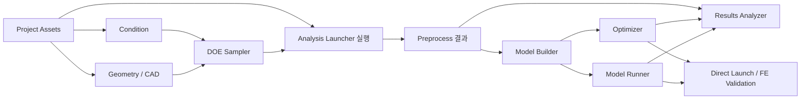

# 현재 모듈과 사용자 흐름

> **2026-10-08 개정 반영** — [이슈 개정 이력](../Issue-Revision-History.md). 설계 반영과 구현 완료는 구분한다.

코드 조사 기준은 2026-10-05 dev `b08a91b`의 실제 화면/모델이다. 구 Analysis Launcher는 DOE Sampler로, 구 Data Preprocessor는 Analysis Launcher로 이름이 바뀌었고 Launcher 탭도 이동했다. 옛 이름을 단순 치환하는 대신 사용자 행위와 현재 호출 경로로 소속을 정했다.

## 모듈 지도와 조사 결과 위치

| 현재 영역 | 조사한 사용자 흐름 | 주요 구현 | 결과 |
|---|---|---|---|
| 프로젝트 / Module Tree | New/Open/Save/Save As/Close, Set 추가·삭제·개명·전환, 참조 변경 경고 | DashProjectManager, DashProject, DashMainWindow | PRJ, IO; research/common.md |
| Project Assets | 파일/폴더 복사·덮어쓰기·등록·삭제, FE deck 적재, 표시 토글, 특수포맷 | MainWindow, ModelingTree, AnalysisModelContextRegistry, RwActor | AST, AL-09; research/geometry.md |
| Geometry Parameter / Morphing | 핸들 생성·편집·sampling·범위·고정 영역·QC·프리뷰·저장·복원 | GeometryParameterWidget/PM, HandlePickingInteraction, MorphingController/Run | GEO; research/geometry.md |
| Geometry Parameter / CAD | 파일 load, 파라미터 범위·프리뷰·저장, NX 요청 완료 | GeometryParameterCAD, SolverNxCad | CAD; research/geometry.md |
| Condition Parameter | 참조 파일과 Set 연동, 조건 선택·수치 편집·DV 지정, 파일 교체 후 복원 | ConditionParameterization, FeConditionValueDelegate | CON; research/geometry.md |
| DOE Sampler | Init/Resample 추가, 이전 Set/active 이력, 샘플링 옵션·표 생성·저장 | DoeSampler, DoeTableFile, DoeConfigManager | DOE; research/execution.md |
| Analysis Launcher / Launcher | Target Part·DOE 연결, 입력 준비, 실행·Stop·상태표, Skip/Re-run, 결과 기록 | AnalysisLauncherWidgetLauncher, AnalysisLaunchExecutor, JobRunner 및 solver TU | AL; research/execution.md |
| Analysis Launcher / Preprocess | 결과 Load, 시점·부품·응답 선택, Preview, 일반/KPI Process, 파일 쓰기 | ReaderSession, ResultQuery/Batch/Processor/XmlWriter, KPI | RES; research/execution.md |
| Direct Launch 도구 | Tool 진입, 입력 선택, 실행·취소·창 닫힘, Result Preview | PR652의 Direct Launch dialog | DIR; research/execution.md |
| Model Builder Sim/MCU | 데이터셋·라벨 선택, 학습 설정, Start/Stop, 모델 조회·삭제, 메타데이터 | ModelBuilder/MCU, WidgetBase/MCU, PM | BLD; research/downstream.md |
| Model Runner Sim/MCU | 학습 Set/모델 선택, 1D/ND 예측, NodeSet·입력 Generate, 출력 목록·삭제, FE 검증 | ModelRunner/MCU, Widget/PM, MorphingUtils | RUN; research/downstream.md |
| Optimizer | 모델·DV·목적/제약·옵션 편집, Run/Stop, 프리뷰·결과·FE 검증 | Optimizer, Widget/PM, solver service | OPT 및 VIS-001; research/downstream.md |
| Results Analyzer | target·dataset·method·feature 선택, 플롯 작성·스타일 변경, 내보내기·재진입 | ResultsAnalyzerWidget, PlotWidgetFactory, PlotRequestHandler, XmlParser | ANA; research/downstream.md |
| 공통 VTK | 모듈/문서 전환, actor 등록·해제·가시성, 카메라·범례·split view | RenderingManager, Manager, Gizmo | VIS; research/geometry.md |
| 공통 실행 / TopOpt | job 준비·실행·완료·반려, 데몬 ready/command/stop, FEM 후처리 | AsyncJobRunner, ExtensionProcess, TopOptPostprocessDialog | ASY; research/common.md |
| 앱 shell / 공통 UI | 다중모니터·도크·오버레이, 설정·통지·표·메뉴 | MainWindow, TitleBar, WidgetHelpers, Notify | UI; research/common.md |
| 개발 / 배포 | toolchain/cache, 테스트레벨·CI, CRT·SDK·버전·설정 | CMake, vcpkg, hooks, tests, 외부 Registry/meta | DEV; research/common.md |

## 데이터가 넘어가는 지점

참조·출처는 PRJ-03(#368) → PRJ-04(#685)로 나눈다. #368은 DOE Sampler가 선택한 Geometry·Condition, Launcher가 선택한 DOE Sampler, Builder가 선택한 Launcher의 개별 `setId`와 실제 deck·세부 선택 정보를 기록하고 `model_info.json` 생성까지 공통 판독 계약을 제공한다. #685는 이를 Runner·Optimizer가 소비하는 경계에서 Builder `setId` 저장·복원, 출처 검증, 실행·조회·프리뷰를 맡는다. 외부 실행에는 ID로 해석한 실제 경로를 전달한다.

현재 Set의 ID를 유지하며 다른 상류 `setId`로 참조를 변경할 수 있다. 입력 선택만 바꾸면 기존 산출물 출처는 유지하고 재실행으로 산출물을 덮어쓸 때 실제 입력 출처도 함께 갱신한다. 조합 ID와 최초 입력 영구 고정은 폐기한다. 필수 출처가 없는 구산출물은 재생성을 요구하며 이름·경로 추론이나 자동 이관은 하지 않는다. #520의 기존 Set ID 발급·복원은 유지한다.

버전·최신성은 PRJ-11과 모듈별 #650 카드가 별도로 담당한다. 생산 Set이 버전을 기록하고 소비 Set이 실제 소비한 입력 버전으로 판정하며 프로젝트가 호출·집계하고 VM은 표시한다. Set 설정과 산출물이 원본 기록이며 별도 생산·소비 대장(PRJ-05·IO-10·IO-11)은 철회했다. 과거 산출물·출처의 전체 이력 보존은 요구하지 않고 #470의 출처 추적 상위 목표는 유지한다.

MCU의 사용자 CSV와 Sim의 deck 기반 입력은 공통 출처 계약에서 실제 필요한 출처를 구분한다. 옛 조합 핀 예외를 새 계약의 요구로 재사용하지 않는다. 특수 입력 포맷은 RW 파싱을 전제하지 않는다. Result Analyzer는 여러 모듈의 호스트 UI로 쓰이며 새 독립 Set 개념을 추가하지 않는다.

## 확인 관점

각 흐름에서 정상 입력뿐 아니라 빈 입력·잘못된 값·실패·취소·중복 실행·늦은 완료·재시작·Set 삭제/개명·프로젝트 교체를 대조했다. A~G는 이 대조의 관점과 결과 태그로 쓰며 같은 축이라는 이유로 여러 모듈의 구현을 하나의 거대한 부모 작업에 묶지 않는다.

AI/demo UI, solver 내부 수치 알고리즘, 모든 외부 저장소의 전수 감사는 이 보드의 남은 제품 흐름 재정의 범위에 넣지 않았다. 외부 코드가 실제 요구의 선행인 곳만 공급/검증 작업으로 기록했다.
