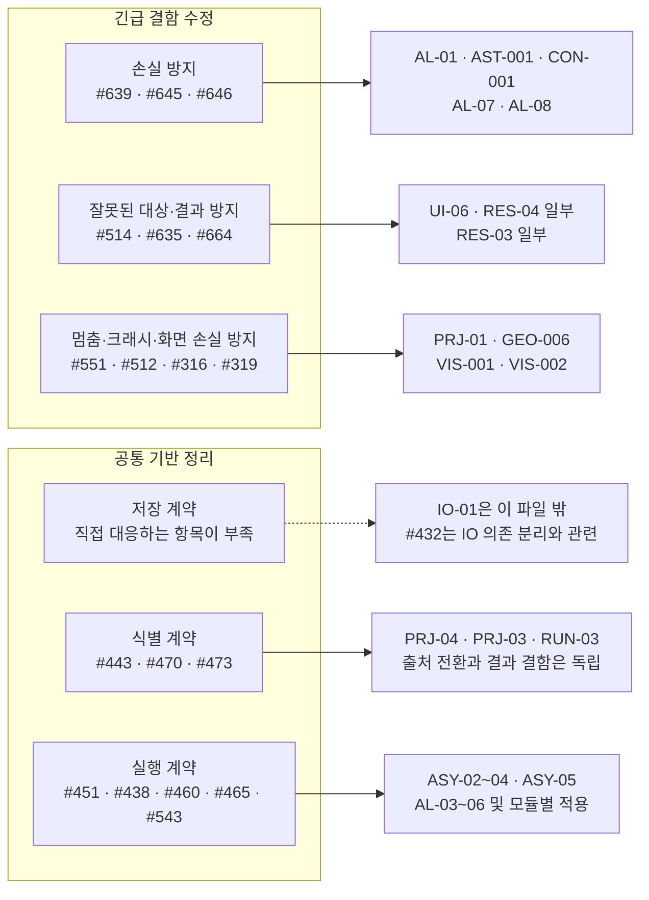

# board.txt와 기존 작업 정의의 겹침·변환 검토

> **2026-10-08 개정 반영** — [이슈 개정 이력](../Issue-Revision-History.md). 설계 반영과 구현 완료는 구분한다.

원본 이슈 수·보드 상태·주차와 research JSON은 2026-10-07 스냅샷이다. 아래 설계 대응은 2026-10-08 개정이며 과거 JSON의 폐기 요구를 현재 실행에 사용하지 않는다.

## 판단

**대응시켜 변환할 수 있다. 다만 이슈 번호를 새 작업 ID로 일대일 치환하는 변환은 아니다.** 원본의 상위 묶음을 유지하고, 구체 이슈를 기존 작업에 다대다로 연결하는 방식이 적합하다. 부모는 완료 추적, 실제 작업은 독립적인 완료 조건의 단위로 관리한다.

입력은 사용자가 지정한 `board.txt`의 **상위 표시 항목17개·고유 이슈62개**다. 첫 숫자53~70은 표시 번호이고 `#246` 등의 번호가 이슈 식별자다. W4 부모 밑의 자식에는 W2·W3·W5·미배정이 섞여 있으므로 전체62개를 이번 주 실행 목록으로 해석하지 않는다.

- [원본 사본](research/board_overlay_2026-10-07/board.txt)
- [62개 상세 대응표·역방향 작업 색인](research/board_overlay_2026-10-07/MAPPING.md)
- [통합 대응 JSON](research/board_overlay_2026-10-07/mapping.json)
- [기존 작업 정의에 이슈를 겹친 JSON](research/board_overlay_2026-10-07/task_overlay.json)
- [변환 구조 검증](research/board_overlay_2026-10-07/validation.json)

## 여섯 핵심 꼭지에 겹쳐 보기

아래는 대표 대응이다. 화살표는 범위의 연관이며 모든 이슈와 카드가 완전히 같다는 뜻은 아니다. 전체 대응과 예외는 상세표를 따른다.

저장에 관련된 이슈가 없는 것은 아니다. #645는 파일 교체 실패, #646은 재실행 실패 시 보존, #432는 프로젝트 IO 의존 분리를 다룬다. 그러나 **공용 저장 헬퍼·버전 판별·오류 반환을 다루는 IO-01 자체는 이 파일의 직접 대응 항목으로 확보되지 않는다.** 기존 보드의 #478/#479/#480 등은 이 입력 파일에 없으므로 선택 누락 여부는 별도로 판단할 수 있다. 누락을 발견했다고 이번 overlay에 새 실행 이슈를 자동 추가하지 않았다.

## 원본의 상위 항목을 유지한 대응

아래 카드들은 대표적인 주된 대응이다. `상위 묶음`은 별도의 구현 PR 한 개로 추가하지 않는다. 같은 카드가 여러 행에 나타나도 구현량을 중복 합산하지 않는다.

| 원본 표시 / 상위 이슈 | 기존 작업에 겹치는 범위 | 변환 방식 |
|---|---|---|
| 53 / #246 관리자 해체 | PRJ-01, PRJ-09/10, IO-07/08/09, 결과 처리 잔여 | 상위 묶음 유지. 수명, IO 의존, 전역 접근, 결과 처리로 나눔 |
| 54 / #427 화면·실행 격리 | GEO-002/007, OPT-02, VIS-001~004 | 상위 묶음 유지. #430은 PR655 통합 확인, #316/#319는 별도 결함, #281은 잔여 재판정 |
| 55 / #446 창·레이아웃 | UI-01/02/03 | 프리즈 실측·저장복원·레이아웃 정리로 나눔. 창 구조 전체 교체는 자동 포함하지 않음 |
| 56 / #451 워커·펌핑 | RES-08/09, AL-12, OPT-02, GEO-006, RUN-06, ASY-05 | 모듈의 구체 실행 흐름으로 분할. 부모의 오래된 호출 수를 완료 기준으로 쓰지 않음 |
| 57 / #473 결과 항목 조작 | RUN-03 | #474 표 연결·#475 덮어쓰기 방지·#477 삭제 정합. 출처 전환과 독립; UI-06(#514) 접점은 담당 조율 계획 |
| 58 / #438 취소·상태·복구 | AL-03/04/05/06, DIR-01 관련 | 취소, 상태 증분 기록, 재시작 복구를 구분. 병합 완료 Direct 범위는 잔여 확인 |
| 59 / #443 Set 입력 참조 | PRJ-03 → PRJ-04 | #520 기반 #368 생산→#685 소비 전환. 별도 Set 원장 불도입; #444는 #441 하위 AL-05, #369는 독립 RUN-04 |
| 60 / #460 실행 UI 표준 | ASY-02 및 모듈별 실패·취소·진행 처리 | 규약과 모듈 적용으로 나눔. #543과 중복 구현하지 않음 |
| 61 / #465 외부 프로세스 | ASY-03/04, UI-05 및 실패 표시 | 명령 응답 시한·호출 경계·통지로 분할. 완료된 기동 timeout/UTF-8 기반은 제외 |
| 62 / #470 출처 추적 | #368→PRJ-03, #685→PRJ-04 | 상위 목표 유지. 별도 대장 #471은 취소하고 Set·산출물 원본을 프로젝트가 조회·집계 |
| 63 / #514 행 콜백 | UI-06 | 직접 대응. 제거된 Direct 표 등 최신 코드의 잔여 대상만 적용 |
| 64 / #543 실행 UI | ASY-02 | #460/#462 등과 같은 계약의 입력으로 통합 |
| 65 / #551 해제 모델 접근 | PRJ-01 | #431의 수명 계약과 실제 결함 수정을 한 작업 안에서 연결 |
| 66 / #499 생성기 이관 | GEO-004/005 | Box FFD와 단면 생성으로 분할. 완료된 버전 범프는 제외 |
| 68 / #635 Motion component | RES-04의 component 질의 부분 | 카드 전체와 동일하지 않음. State 처리와 component 처리의 잔여 구분 |
| 69 / #649 Launcher 후속 | AL-01/07/08/09/10, AST-001, CON-001, DOE-01/02, RES-12/13, 세대 경고 카드들 | 상위 묶음 유지. 입력·저장·재실행·포맷·경고로 나눔. W5 작업을 W4로 자동 이동하지 않음 |
| 70 / #664 Motion preview | RES-03의 Motion Preview 응답 키 부분 | 10월5일 카탈로그 이후 신설된 이슈를 기존 카드의 부분 범위에 연결 |

## 실제 변환 예

| 변환 형태 | 원본 | 결과 | 경계 |
|---|---|---|---|
| 직접 대응 | #316 | VIS-001 | 프리뷰의 비파괴 overlay |
| 여러 이슈를 통합 | #475 + #477 + #474의 Runner 몫 | RUN-03 | 채번·복원·삭제를 한 산출물 생명주기로 연결 |
| 계약과 결함을 통합 | #431 + #551 | PRJ-01 | 수명 계약과 프로젝트 전환 결함을 함께 다룸. 원문 QPointer 처방 자체를 무조건 고정하지 않음 |
| 한 이슈를 분할 | #645 | AST-001 + CON-001 | 파일/등록 보존과 Condition 소비자 갱신을 구분 |
| 한 이슈를 분할 | #646 | AL-07 + AL-08 | 실패 시 기존 결과 보존과 완료 후 목록 갱신 |
| 한 이슈를 분할 | #615 | DOE-01 + DOE-02 | Resample Set 추가와 비활성 케이스 이력 제외 정책 |
| 부분만 대응 | #664 | RES-03 일부 | Preview 응답 키 수정만으로 writer/모든 질의 경로가 완료되는 것은 아님 |
| 병합 후 확인으로 전환 | #648 | AL-09의 fe-safe 부분 검증 | PR651 병합을 구현 반복의 근거로 쓰지 않음 |
| 제외 | #442 | 신규 구현 없음 | 원본의 not planned 처분 유지 |

## 반영한 결정과 남은 확인

1. **#471:** 별도 생산·소비 대장은 취소했다. PRJ-05·IO-10·IO-11은 문서 내 철회 기록이며 실행 대상이 아니다. #470 상위 목표와 #650 최신성은 유지한다.
2. **#368 → #685:** PRJ-03은 Sampler·Launcher·Builder 생산·공통 판독, PRJ-04는 Runner·Optimizer 소비·검증·프리뷰다. PR530은 10월7일 미병합 CLOSED인 과거 자료이며 조합 핀 재이식 요구는 폐기한다.
3. **#443:** #520의 Set JSON `setId`와 역조회를 활용하고 별도 원장을 만들지 않는다. 참조는 다른 상류 `setId`로 바꿀 수 있고 현재 Set ID는 유지한다. 선택 변경만으로 산출물 출처를 수정하지 않으며 덮어쓰기 재실행 때 실제 출처도 갱신한다. 필수 출처 없는 구산출물은 재생성하며 추론·자동 이관은 금지한다.
4. **#444:** #441 하위에서 비용을 먼저 확인하고 필요할 때만 저장을 분리한다. 모든 Set 파일 일괄 분할이나 Set ID 전환을 선행으로 요구하지 않는다. AL-05 뒤 AL-06 재시작 복구를 진행한다.
5. **남은 확인:** #650 버전 의미·비교 불가 상태, #615 자동 선택, #643 이어쓰기, #646 교체 시점, #514·#474 및 #513·#685 공유 코드 담당은 팀 논의 사항이다. History의 추가 개정 계획은 GitHub 미반영이다.
6. **기존 별도 확인 유지:** #430의 PR655 통합 이후 GEO-002 잔여, #281·#450의 광역 요구/수명·실측 범위는 이번 출처 개정으로 완료 판정하지 않는다.

## 변환 데이터 사용법

2026-10-07 과거 대응의 구조 판정은 직접11·통합6·분할14·부모10·부분12·재판정8·제외1이다. 이는 실행 준비도의 등급이 아니며 직접 대응에도 최신 PR 반영 등 주의사항이 있을 수 있다. 기존 카드64개의 일부 범위와 대조하고, 그 밖의13개 카드는 묶음/보조 참조로만 연결했다. 총77개 카드 참조를 신규77개 작업 또는 W4 범위로 계산하지 않는다.

`mapping.json`은 보존된 2026-10-07 원본 이슈 중심 스냅샷이다. 현재 설계 실행표가 아니며 폐기 요구와 카드 의미 변경은 이 문서 및 현재 카탈로그가 우선한다. `task_ids`는 주된 범위 대응, `supporting_task_ids`는 관련/선행/롤업 참조다. 어느 쪽도 자동으로 새 PR을 생성하라는 뜻은 아니다. `relation`과 `proposed_scope`·`caveat`를 함께 읽는다.

`task_overlay.json`은 기존 작업 중심이다. 같은 작업 ID에 연결된 이슈들을 모으고 원래 카드 정의를 보존한다. 직접 범위 대조, 부모 묶음, 보조 관련을 분리한다. 원래 카드 전체를 이번 W4의 완료 조건으로 확대하지 않는다.

원본의 High/Medium/Low와 기존 카탈로그의 P1/P2/P3는 평가 기준이 달라 자동 치환하지 않았다. 부모의 iteration도 자식에게 상속하지 않는다. board.txt의 #649 아래 #647/#648은 실제 GitHub에서는 #616의 자식이므로 입력의 표시 묶음과 GitHub 부모를 별도 보존한다. #368의 입력 Backlog와 15:14 KST 조회의 In review도 각각 원자료로 남긴다.

## 확인 범위

기준 카탈로그는 2026-10-05 dev `b08a91b3`이며 최신 구현 상태를 의미하지 않는다. 이슈/PR 상태 보정은 `research/w4_review_2026-10-07`의 2026-10-07 15:14 KST 읽기 스냅샷에 한정한다. 사용자의 board.txt 원본은 16:44 파일이다. 상태 차이를 발견해도 어느 한쪽을 자동 덮어쓰지 않았다.

세 subagent의 분담 범위 대조와 root 통합을 거쳤다. 최신 코드 빌드·GUI·solver 실행은 하지 않았다. 당시에는 GitHub 이슈·보드나 카탈로그를 변경하지 않고 대응 뷰만 추가했다. 2026-10-08에는 로컬 카탈로그·대응표·생성 원본의 설계를 개정했으며 GitHub 이슈·보드와 과거 research 스냅샷은 변경하지 않았다.
