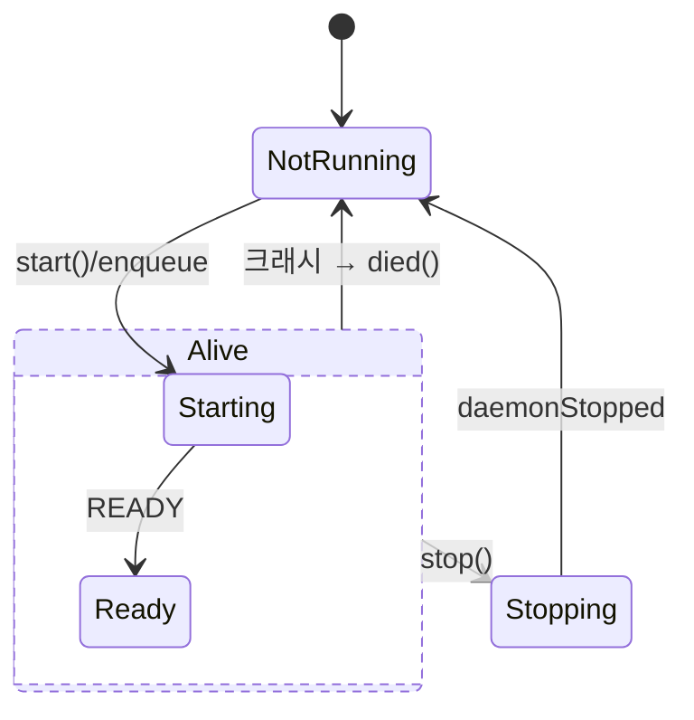

# #212 W10-c: 데몬 기동 비동기화 — DaemonHost 이식 (기동 이벤트 수신·명령 경로 무변경)

- URL: https://github.com/NumeRealWorks/DashOpti_GUI/issues/212
- Board status: Done
- Labels: ['refactor', 'split-group:210']

## Original Request
> obsidian://open?vault=DashOpti_Docs&file=dashgui2-prioritized-backlog, obsidian://open?vault=DashOpti_Docs&file=dashgui2-w6-w10-async-minimal-example, obsidian://open?vault=DashOpti_Docs&file=dashgui2-w6-w10-thread-execution-design 참고하여
> W6, W10 티켓 순차로 분할생성하자.

## Goal
데몬 기동이 이벤트 수신으로 전환된다 — `bool startDaemon()`(반환 = ready 보증, 반환까지 메인 스레드 정지)을 `void start()` + `ready()`/`died()` 시그널로 재계약(P8)하고 busy-wait 를 제거해, NX 데몬 최초 기동의 최대 120초 UI 프리즈가 소멸한다. **명령 경로·소비 표면은 무변경** — 명령 큐(enqueue → ready flush)와 도메인 파사드 4곳의 `commandCompleted` 번역은 기존 그대로 ([#205](https://github.com/NumeRealWorks/DashOpti_GUI/wiki/205-5-w6-w10-async-minimal-example) 개정 2·3: `DaemonCommandJob` 폐기). 데몬 사망 시 진행 중·대기 명령이 무음 없이 Failed 로 drain 된다.

## Background
> source: `DashOpti_Docs/dashgui2-w6-w10-async-minimal-example.md` 3-3절 (개정 3, 2026-07-22 — 요지 2건으로 재서술) · `dashgui2-async-execution-patterns.md` 7절 서브태스크 c · `dashgui2-qprocess-antipattern-catalog.md` P1·P2·P8

- 데몬은 "프로세스 종료 = 완료"인 one-shot 과 달리 장수하며 명령 단위를 반복 처리하므로(종료 = 사망), ProcessJob 을 쓰지 않고 기존 데몬 구현(`DashExtensionProcess` 의 수명·명령 큐)을 in-place 로 강화한다 — "DaemonHost" 는 신설 클래스가 아니라 그 역할의 이름이다(R5=E2).
- 근본 문제는 `bool startDaemon()` 의 동기 대기 계약 하나이며, 메인 스레드 프리즈와 호출부마다의 "직접 ready 판정 → 동기 기동 시도 → 그래도 아니면 명령 폐기·실패 확정" 분기가 모두 여기서 파생됐다 (전수는 Technical Details 의 소비처 18곳 표).
- 프리즈 상한은 ready-timeout 값과 같고 기본 30000ms(`DashExtensionProcess.h:172`) 중 NX CAD 만 120000ms 로 오버라이드(`DashSolverNxCad.cpp:16`) 하므로, Goal 의 "120초"는 이 한 줄이 유일한 근거이자 수용 기준이다.
- 프리즈 재현 경로는 `DashSolverNxCad.cpp:124-126`·`:147-149` 의 첫 enqueue 가 `tryStartIfConfigured()` 를 타 동기 부팅을 유발하는 흐름이다.
- 목표 형태의 시그널 경로는 이미 구현돼 있다 — connect 3건(`readyReadStandardOutput`·`finished`·`errorOccurred`, `DashExtensionProcess.cpp:155-160`)과 명령 큐·ready→flush(`sendCommand:224`·`trySendNext:235`·`handleDaemonLine:278-282`)가 완성형이다.
- 따라서 busy-wait 루프 2곳(`:117-125` 재기동 대기·`:176-184` 최초 기동 대기)과 `waitForStarted(30000)`(`:163`)을 삭제하면 이미 연결된 시그널 경로가 `[READY]` 를 배달한다.
- 루프 안의 수동 `onDaemonReadyRead()`(`:124`·`:183`)는 `waitForReadyRead()` 가 방출한 같은 시그널이 버퍼를 이미 비운 뒤 실행되는 죽은 이중 경로라, 루프째 삭제해도 라인 배달에 손실이 없다.
- 현재 `daemonReady` 는 `startDaemon()` 호출 스택 안에서 발신되고 replay 가 없어 늦게 connect 한 소비자가 영구히 놓치는데(view 의 `// Connect daemonReady BEFORE startDaemon()` 주석이 그 방증 — `DashModelRunnerMCUWidget.cpp:127`), `start()` 즉시 반환 + 이벤트 루프 경유 `ready()` 로 바뀌면 이 순서 의존이 소멸하고 명령 경로는 큐가 맡아 ready 관측은 UI 활성화 용도만 남는다.
- 래퍼의 "이미 켜져 있으면 그 자리에서 emit" 갈래(`DashModelBuilderMCU.cpp:117-119`·`DashModelRunner.cpp:231-234`)는 이 순서 의존의 잔존분이므로 emit 을 제거하고 소비자가 초기 상태를 조회하게 바꾼다 — 데몬의 `daemonReady` 는 부팅당 1회뿐이어서, 공유 데몬에서 Set 전환·탭 재초기화로 부팅 후 연결된 소비자는 조회 없이는 영구 미통보가 된다.

## Technical Details
### as-is — 현재 계약·구조
- `bool startDaemon()` 은 반환 시점에 ready 를 보증하고 그때까지 메인 스레드를 세우며, `stopDaemon()` 도 동기 종료를 기다린다(P1·P2·P8).
- 명령 큐는 이미 완성형이다 — 무조건 enqueue, ready 전이면 대기, ready 후 `[FINISHED]` 수신마다 1건씩 직렬 배출.
- 소비 표면도 이미 실존한다 — 도메인 파사드 4곳이 `commandCompleted` 를 도메인 시그널(`loadPrtCompleted` 등)로 번역한다.
- 래퍼(`DashModelBuilderMCU`·`DashModelRunner`)의 `daemonReady` 는 두 성격을 섞어 보낸다 — 데몬 시그널 릴레이(변화)와 `startDaemon()` 호출에 대한 "이미 ready" 즉답(`:117-119`·`:231-234`).
- DOE(`runWbpjDoeAsync`)는 `isDaemonReady()` 게이트로 4곳에서 분기하고(아래 표 A5~A8), `DashJobRunner` 는 중첩 `processEvents` 펌프로 파일·완료를 기다린다.
- `mcuDaemon`·`sensitivityDaemon` 은 다수 Set 가 1 인스턴스를 공유하며, desired 는 per-instance `m_wantUp` 1비트다.
- `[FINISHED]`/`[ERROR]` 는 데몬 출력 라인 문자열 매칭으로 판정한다.

### to-be — 본 티켓이 바꾸는 것
- API 재계약: `bool startDaemon()` → `void start()`(결과는 `ready()`/`died()` 시그널), `stopDaemon` 의 동기 종료 대기 제거.
- `start()` 는 Ready·Starting 에서 idempotent 해야 한다 — 래퍼 조기 return 이 사라져 매 호출이 여기까지 내려오므로, 보장이 없으면 호출마다 재시작돼 진행 중 명령을 잃는다(R6).
- 첫 enqueue 는 lazy 기동만 유발하고 즉시 반환하며, 큐가 순서를 흡수하므로 호출부의 ready 판정 분기는 사라진다.
- `cancel(id)` 로 취소·늦은 결과를 host 가 흡수한다 — 큐 미전송이면 제거, 전송 중이면 결과 폐기.
- 래퍼 `daemonReady` 는 변화 통보 전용이 된다 — 즉답 emit 2곳을 제거하고 소비자 view 4곳이 `connect` 후 초기 1회 조회로 현재값을 반영한다(`DashModelRunnerMCU::isDaemonReady()` 위임 신설, 지연 방출안 기각).
- 기동 중 간섭 2건 규칙 — Starting 중 `stop()` 은 프리즈 없이 접수되고 대기 명령을 `commandCompleted(ok=false)` 로 통보하며(종료는 exit → 타임아웃 → kill 승격), 설정 변경은 `start()` 시점 스냅샷으로 진행 중 기동에 간섭하지 않고 다음 기동부터 적용된다.
- DOE 게이트는 config 판정(NX 경로 설정 여부)으로 교체하고 `nxStarted` 를 `nxConfigured` 로 재의미화하며, A7 의 STP 재사용 분기는 재생성 경로로 합류시킨다("파일이 있다" ≠ "이번 파라미터로 생성됐다").
- 정확성 책임은 host 상태머신이 진다 — W11(view 버튼 비활성화)에 의존하지 않으며, 진입점 대부분이 버튼 아닌 프로그램적 경로이기 때문이다.

### not-to-be — 바꾸지 않는 것
- 명령 큐·파사드 소비 표면은 그대로 쓰고 `DaemonCommandJob` 은 도입하지 않는다 — 이미 실존하는 표면의 Job 재포장은 이중 표면이다([#205](https://github.com/NumeRealWorks/DashOpti_GUI/wiki/205-5-w6-w10-async-minimal-example) 개정 2).
- 공유 데몬의 단일 활성 Set 가정과 per-instance `m_wantUp` 은 유지한다 — 완료 오귀속은 R3 의 commandId 로 차단하고, desired refcount 는 백로그다.
- 중첩 `processEvents` 제거는 #215 소유다 — 본 티켓 몫은 그 전까지 소비자가 데몬 포인터를 든 채로도 drain/teardown 이 안전하도록 보장하는 것.
- 마커 프로토콜 강화는 별 티켓이다 — 문자열 판정 오탐은 선재 문제.
- 데몬 예열(이른 시점 선행 `start()` 로 부팅 120초를 사용자 유휴 시간과 겹치기)은 후속 후보다.
- 축별(NX/MCU/Sensitivity/Journal) 분할은 하지 않는다 — 구 `bool startDaemon()` 호환 분기가 필요해져 하위호환 폴백 금지 원칙을 위반하므로 한 브랜치·한 커밋으로 처리한다.

### ★ old-동기-계약 소비처 전수 18곳 — 본 티켓의 실제 작업량

> 계약 변경이 **공유 기반 클래스**에 있어 데몬 4개 × 소비처 18곳이 동시에 깨진다. 아래 표가 본 티켓의 범위 정본이다. **`bool` 반환을 읽는 3곳(A1·A9·A14)만 컴파일 에러로 잡히고 나머지 15곳은 조용히 오작동**하므로, 컴파일 통과를 완료 신호로 삼으면 안 된다.

**⑴ 회귀 — 반드시 함께 고친다 (11곳)**

| # | 위치 | 미준비 분기 동작 | 매 호출 발동 |
|---|---|---|---|
| A18 | `view/DashMainWindow.cpp:2185-2188` | **모달** "Failed to start DashOptiCADNX daemon." + return. `:2162` 로딩 스피너의 stop 짝을 건너뛰어 **애니메이션 누수** | O |
| A12 | `model/DashModelBuilderMCU.cpp:699-705` | `trainingFailed("...daemon is not ready")` — cold 상태 학습 시작 전부 거부 | O |
| A10 | `model/DashModelBuilderMCU.cpp:142-148` | **무음 드롭** — `qWarning` 뿐, 시그널·UI 피드백 0. 호출부 `:471`·`:750` | O |
| A4 | `controller/DashManager.cpp:160-166` | `journalLaunchFailed` 방출 + launch 폐기 → **DOE Step 2 전멸** | O |
| A5 | `model/DashJobRunner.cpp:2538-2545` | `nxStarted=false` → 로그 + **`:2546` return 으로 배치 통째 abort** | O |
| A8 | `model/DashJobRunner.cpp:2639-2645` | 케이스를 Failed 로 확정하고 **DOE JSON 에 영속화** | O (STP 미존재 케이스) |
| A6 | `model/DashJobRunner.cpp:2553-2555` | `setBatchMode(true)` 미실행 → 파사드가 **대화형 시그널**을 방출 → `onStpCaseCompleted` 미발화로 배치가 워치독까지 정지 + **케이스마다 모달** | O |
| A7 | `model/DashJobRunner.cpp:2620-2626` | **낡은 STP 를 조용히 재사용해 성공 처리** — 잘못된 형상이 결과로 확정, 에러 0 | O (STP 존재 케이스) |
| A14 | `model/DashModelRunner.cpp:237-243` | `daemonError` → 위젯이 `setPlotEnabled(false)`. `daemonReady` 가 `:229` 에서 선연결돼 자가 복구 | O |
| A16 | `model/DashModelRunner.cpp:945-950` | `isDaemonRunning()` 게이트로 감도 plot 요청 폐기 (로그만) | 준비 전 클릭 시 |
| A15 | `model/DashModelRunner.cpp:326-331` | 명령 드롭 (로그만) — start 시도조차 없음 | 준비 전 클릭 시 |

**⑵ 로그 오탐 (2곳)** — 성공할 기동에 "failed to start" 를 남긴다: `controller/DashSolverNxCad.cpp:115-119` · `model/DashModelBuilderMCU.cpp:121-126`(추가로 `daemonReady` 재방출을 건너뜀 — ctor `:48` 연결로 복구).

**⑶ 무해 (5곳)** — `DashSolverNxCad.cpp:124-126`·`:147-149`(2차 검사 없이 큐로 낙하) · `DashModelBuilderMCU.cpp:441-448`(`m_pendingTest` defer-replay — model 계층에서 유일하게 async 로 쓰인 곳) · `:432`(`restartDaemon`) · `DashModelRunnerMCU.cpp:130`(위임).

**⑷ 이미 async 정합** — view 4곳은 `daemonReady` 를 **선연결 후** start 하고 버튼을 비활성화한다 (`DashModelBuilderMCUWidget.cpp:150-160`·`DashModelRunnerMCUWidget.cpp:103-111`·`:133-140`·`DashModelRunnerWidget.cpp:169-183`). 연결 순서는 **이식의 목표 형태가 이것**이라 무수정, 단 위 "래퍼 `daemonReady`" 항목에 따라 **초기 상태 조회 1줄씩 추가**(람다를 변수로 뽑아 재사용) — 동기 emit 제거분의 대체다.

**⑸ 테스트** — `tests/tst_process_runtime.cpp:241`·`:271`·`:300`, `tests/e2e/tst_e2e_real_exe.cpp:164-167` 이 `QVERIFY(ext.startDaemon())` 형태라 함께 갱신.

## Design

### 현황 분석
- `DashExtensionProcess`: 큐 인프라(직렬 명령 큐·`commandCompleted`·마커 파싱·readyRead 경로) 완성형 기존재. 문제는 기동(`startDaemon` busy-wait — P1)·종료(`stopDaemon` 동기 대기 — P2)·API 계약(`bool` 동기 반환 — P8)의 3점뿐.
- **한 클래스에 데몬+one-shot 동거**: `runBlocking`/`runAsync`(one-shot = W6 영역)와 데몬 로직이 같은 클래스(`DashExtensionProcess`)에 공존. `DashSolverNxCad : public DashExtensionProcess` 가 가상함수 3개(`resolveExePath`·`setupEnvironment`·`isReadyLine`)를 오버라이드해 NX 파이썬 버전 경로·환경변수를 주입 — 커스터마이즈가 상속 기반(R5 전제).

### 대안 비교 (소비 표면)

| 방안 | 핵심 | 판정 |
|---|---|---|
| A. DaemonHost + 기존 도메인 파사드 (명령 Job 없음) | 수명·큐는 host 로, 명령 소비는 파사드 4곳 무변경 | **선택** — [#205](https://github.com/NumeRealWorks/DashOpti_GUI/wiki/205-5-w6-w10-async-minimal-example) 개정 2·3 정본. 변경이 기동 계약 1점에 수렴, 소비 표면 이중화 없음 |
| B. DaemonHost + DaemonCommandJob (명령 1건 = Job 1개) | 명령도 Job 표면으로 통일 | 기각 (개정 2) — 소비 표면이 이미 파사드 4곳에 실존해 Job 재포장은 이중 표면 + 재배선 비용만 추가. 취소·늦은 결과 폐기는 host 로 흡수 가능 |
| C. one-shot ProcessJob 재사용 | 클래스 절약 | 기각 — `finished` = 완료 계약이 장수 프로세스와 불일치 (사망을 완료로 오인) |

### 선택 — 방안 A (DaemonHost 역할 + 파사드 유지)

**선택 근거**: [#205](https://github.com/NumeRealWorks/DashOpti_GUI/wiki/205-5-w6-w10-async-minimal-example) 개정 2 판정 — 이 티켓의 문제는 명령 처리가 아니라 기동 계약이다. 명령 경로는 이미 이벤트 구동이므로 손대지 않는 것이 최소 변경.
**기각된 대안**: B 는 본 티켓의 이전 판(DaemonCommandJob 신설)이었으나 개정 2 로 폐기 · C 는 의미론 충돌.
**물리적 형태는 R5 에서 확정** — "DaemonHost" 는 신설 클래스가 아니라 `DashExtensionProcess` 의 데몬 역할을 in-place 강화한 것(E2).

#### 핵심 시그니처 ([#205](https://github.com/NumeRealWorks/DashOpti_GUI/wiki/205-5-w6-w10-async-minimal-example) 3-3절 — 개정 3; 형태는 R5=E2)
```cpp
// DashExtensionProcess 데몬 역할 (in-place 강화 — 신클래스 아님, R5)
    void start();                            // 즉시 반환 — 기동 완료는 시그널 (P8 재계약, 구 bool startDaemon)
    void stop();                             // 동기 종료 대기 제거 (P2) — Starting 중이면 kill + drain
    void enqueue(const DaemonCommand& cmd);  // 미기동이어도 큐잉 — 즉시 반환 (구 sendCommand 큐 재사용)
    void cancel(int id);                     // 큐 미전송 = 제거, 전송 중 = 결과 폐기 (개정 2 — host 가 흡수)
signals:
    void ready();                            // "[READY]" 수신 시 — 큐 flush (구 daemonReady)
    void commandCompleted(int id, bool ok, QString output);  // 소비 = 기존 도메인 파사드 4곳 (무변경)
    void died();                             // ★ 종료 = 완료가 아니라 사망 → 진행 중·대기 명령 Failed drain (R2)
private:
    enum class State { NotRunning, Starting, Ready, Stopping };  // actual — 프로세스 이벤트로 갱신 (R2)
    bool   m_wantUp = false;                 // desired(Up/Down) — start/stop 의도. reconcile 이 actual 을 여기로 수렴 (R6)
    // 기동 시점 스냅샷: start() 순간 exe·args 지역 복사 — Starting 중 설정 변경 무간섭 (개정 3)
    QTimer m_readyTimer;                      // ready-timeout — busy-wait 소멸분 대체 (R1)
    QTimer m_stopTimer;                       // stop-timeout — kill 에스컬레이션 (R6)
```

### 세부 설계 결정 (코드 실측 2026-07-29 보강 — R1~R6)

> busy-wait 제거·`died` 재계약이 실제 코드에 닿을 때 갈라지는 6개 하위 결정. 각 대안 비교 후 선택. (앵커는 `controller/DashExtensionProcess.cpp` 및 model 래퍼·파사드) *(R1·R3·R6 은 2026-07-29 병렬 에이전트 검토로 보강 — 공유 데몬·DOE 게이트는 대안이 "현행 유지/중립화"라 별도 소절 없이 Technical Details 범위 노트로 기록)*

#### R1 — 기동 타임아웃: busy-wait 소멸분 대체
**문제**: ready-timeout 은 busy-wait 루프(`:117-125`·`:176-184`, 조건 `timer.elapsed() < m_readyTimeoutMs` — `m_readyTimeoutMs` 참조는 `:120`·`:179` **두 곳뿐**)에만, start-timeout 은 `waitForStarted(30000)`(`:163`)에만 존재. 루프 삭제 시 데몬 자체의 타임아웃은 전무 → `[READY]` 미방출 데몬이 무한 Starting. 게다가 `onDaemonProcessError`(`:351-362`)는 `m_waitingFinished` 일 때만 통지 → **기동 중(명령 in-flight 없음) FailedToStart 무음**. 또 exe 부재(`:135-138`)·`resolveExePath` 빈 경로는 QProcess 생성 전 반환이라 `errorOccurred` 조차 안 뜬다 (제3 실패 모드 — pre-launch).

*(참조 — "루프가 유일한 타임아웃"은 데몬 계층 한정: NX DOE 경로만은 `DashJobRunner` 의 per-case 워치독 600s(`m_stpWatchdog->start`, `DashJobRunner.cpp:2688`)가 `enqueue` 보다 먼저 무장돼 있어, 루프를 지우면 배치는 이 워치독으로 떨어진다. 즉 삭제 직후에도 DOE 는 "행"이 아니라 "600초 뒤 실패"가 된다 — 무한 정지로 오판하지 말 것. 나머지 소비처는 진짜로 상한이 없다.)*

| 대안 | 핵심 | 판정 |
|---|---|---|
| A1 | 단발 `QTimer(m_readyTimeoutMs)` — `start()` 무장 / **Starting 이탈(ready·died·stop) 전부 해제**, 만료 시 kill + `died()` + 큐 drain. FailedToStart 는 기존 `errorOccurred` connect 를 Starting 에도 통지하도록 확장 + pre-launch 실패는 즉시 라우팅 | **선택** |
| A2 | QProcess 시그널만 의존(QTimer 없음) | 기각 — "기동됐으나 `[READY]` 영원히 안 옴"(=프리즈의 실패 모드)에 타임아웃 없음 |
| A3 | 명령별 워치독(per-command timeout)까지 확장 | 범위 초과 — 본 티켓은 *기동* 한정. 명령 무응답 워치독은 후속(백로그) |

**선택 A1 · 근거**: busy-wait 가 주던 "Starting 은 유한하다" 보장을 이벤트 구동으로 그대로 복원. 세 실패 모드(never-ready·failed-to-start·pre-launch)를 모두 `died()`/failure 로 라우팅 → 큐 drain → **"무음 실패 금지" DoD 충족**. A3 은 유용하나 기동 vs 실행의 별개 관심사라 분리.
※ **타이머 수명 = Starting 상태**(병렬 검토 반영): ready-timer 는 actual==Starting 인 동안만 유효 — **Starting 진입 시 무장, 이탈 시(어느 전이든: ready·died·stop) 해제**. 이 한 규칙이 "Starting 중 `stop()`(개정3) 뒤 잔존 타이머가 이미 멈춘 데몬에 가짜 `died()`"(R2 위반, NX 120s 창)를 자동 차단 — 별도 열거 불요. **pre-launch 실패**(exe 부재 `:116-119`·`resolveExePath` 빈 경로)는 프로세스가 안 떠 `errorOccurred` 가 없으므로 타이머와 무관하게 즉시 실패+drain 라우팅.
※ **구현 형태**: `QTimer m_readyTimer` 멤버 직접 사용(그 자체가 최소 껍데기). 커스텀 데드라인 헬퍼 추출은 조기 추상화(현재 타임아웃 구현 1곳뿐) — "arm/disarm on signal" 사용처가 3곳+(ready-timeout·per-command 워치독 A3·ProcessJob 타임아웃·WorkerJob 데드라인)로 늘면 그때 얇은 `DeadlineGuard` 로 추출(백로그).

#### R2 — `died()` vs 정상 종료 구분
**문제**: 현재 `daemonStopped()` 가 `stopDaemon()`(의도적 `:219`)·`onDaemonFinished()`(사망 `:348`) **양쪽에서 동일 발신**. `stopTraining()`(`DashModelBuilderMCU.cpp:432`)이 `restartDaemon()` 으로 데몬을 **일부러 죽임** → 구분 없으면 정상 중단이 매번 가짜 `died()` 를 쏜다.

**현행 사망 경로의 무음 실측** (본 티켓이 뒤집는 대상): 크래시 시 `onDaemonProcessError` 가 in-flight 상태를 먼저 지우고(`:355-357`) `if (error != QProcess::Crashed)` 가드(`:358`)로 `commandFailed` 를 **막는다** → 이어지는 `onDaemonFinished` 는 `wasWaiting == false`(`:329`)라 `:346` 도 건너뛰고 `daemonStopped`(`:348`) 만 낸다. 꼬리 라인 drain(`:320-325`)도 `handleDaemonLine` 의 `!m_waitingFinished` 조기 반환(`:285-287`)에 막혀 죽어가는 데몬의 `[ERROR]` 마지막 줄까지 삼킨다. `stopDaemon()` 도 동일 — `:191-195` 에서 상태를 먼저 지운 뒤 프로세스를 죽인다. **즉 현재 "데몬이 죽으면 진행 중 명령은 아무에게도 알려지지 않는다"** 가 코드 사실이고, 본 티켓의 drain 이 이를 `commandFailed` 로 전환한다.

| 대안 | 핵심 | 판정 |
|---|---|---|
| B1 | `m_stopRequested` bool 플래그로 `onDaemonFinished` 분기 | 차선 — 동작하나 상태머신이 가져야 할 상태를 플래그로 중복 |
| B2 | 상태머신에 `Stopping` 상태 추가(`NotRunning→Starting→Ready→Stopping`). Stopping 중 finished = 정상, 그 외 = 사망 | **선택** |
| B3 | 구분 안 함 — 소비처가 판단 | 기각 — 파사드 4곳+래퍼로 판단 전가, "host 가 보증" 원칙 위반 |

**선택 B2 · 근거**: 티켓이 이미 상태머신을 도입하므로 `Stopping` 추가가 자연스러운 귀속처. `Stopping` 은 동시에 **R6(재기동 순서)의 토대** — "옛 프로세스 finished → relaunch" 를 상태로 표현할 자리를 제공한다 (`startDaemon` 내부 `stopDaemon:110`·`restartDaemon` stop;start 의 async 경합 흡수). 구체 순서 보장은 R6 의 desired/actual reconcile 이 담당.
**소유**: `State m_state` 는 host(=`DashExtensionProcess` 데몬 역할, R5=E2) private 멤버 — 4 인스턴스 각자 하나. 현행 흩어진 불리언(`m_daemonReady` + 암묵적 Starting + `m_waitingFinished`)을 통합. **model 래퍼는 상태 미소유** — `ready()`/`died()` 관찰만, host 가 단일 진실원("host 가 보증"). 래퍼의 `isDaemonReady()` 자체추론(R3 드롭 원인)이 이래서 제거됨.

상태 전이 (사고사만 `died()`, 의도적 종료는 `Stopping` 경유라 아님):


> `Alive` (점선·음영) 는 상태가 아니라 `Starting`+`Ready` 묶음 — died/stop 엣지 중복을 접기 위한 그룹. **재기동**(stop 뒤 start)은 직접 엣지가 아니라 `Stopping → NotRunning → (desired=Up) → Starting` 경유 — reconcile 이 NotRunning 에서만 launch (R6).

#### R3 — 명령 전송·완료 상관 재계약 (래퍼 + 파사드 drop 전수)
**문제**: 재계약이 leaf(`DashExtensionProcess`)뿐 아니라 **model 래퍼**(`DashModelRunner`·`DashModelBuilderMCU`·`DashModelRunnerMCU`) + **컨트롤러 파사드**까지 관통. 실측 패턴:
- bool 분기 **3곳**: `DashModelRunner.cpp:237`·`DashModelBuilderMCU.cpp:121`·`DashSolverNxCad.cpp:115` = `if (startDaemon()) … else 실패 통지`. **`void start()` 로 바꾸면 이 3곳만 컴파일 에러**로 드러난다.
- **미준비 처리 3곳 — 성격이 서로 다르다** (한 덩어리로 다루면 오판): `DashModelBuilderMCU::sendDaemonCommand:142-148` = **무음 드롭**(`qWarning` 뿐) · `DashModelRunner::sendSensitivityCommand:326-331` = **드롭 + 로그**(start 시도조차 없음) · journal `DashManager::enqueueLaunch:159-167` = **버리지 않고 `journalLaunchFailed` 방출**(무음 아님, 그래서 async 화 시 "매 호출 실패 통지"라는 다른 증상이 된다). 앞 2곳은 host 큐로 흡수, 마지막은 게이트 제거로 처리.
- **완료 상관 = 가변 스칼라**: `DashModelBuilderMCU::m_currentCommandMode`·`DashModelRunner::m_pendingCommand` 로 완료를 매칭(commandId 무시). 두 클래스의 `onCommandCompleted`/`onCommandFailed` 는 파라미터명을 주석 처리(`const QString& /*commandId*/`, `DashModelBuilderMCU.cpp:184`·`DashModelRunner.cpp:285`)해 **식별자를 실제로 버린다**. 본 티켓이 새로 허용하는 다중 큐잉 시 train+test 큐에서 mode 가 덮어써져 먼저 끝난 명령 후처리가 스킵됨.
- 현행 유일한 비-드롭 처리: `testModel1D:441-448` + `onDaemonReadySignal:159-163`(`m_pendingTest`) — 드롭이 아닌 defer-replay(고립상 정확).

| 대안 | 핵심 | 판정 |
|---|---|---|
| C1 | 버퍼 단일화 — 래퍼는 `start(); enqueue()` 만, 자체 ready-게이팅·드롭·defer-replay 전부 제거. host 큐가 유일 버퍼 | **선택** |
| C2 | 래퍼 defer-replay 유지(`m_pendingTest` 식) | 조건부 fallback — payload 가 ready 시점 데몬 상태에 의존하는 op 가 실제 발견될 때만 |
| C3 | 현행 유지(래퍼 각자 버퍼) | 기각 — sendDaemonCommand 드롭 버그 존치 · 이중 버퍼 |

**선택 C1 · 근거**: 명령 버퍼를 host 큐 하나로 단일화 → 드롭 버그 원천 소멸(NxCad `enqueueLoadPrt:124` 가 이미 무사). 실측상 `testModel1D` 의 payload 조립(`testCsvPath`·`modelDirs`·`smoothWindow`)도 **데몬 상태 무의존** — 즉시 조립+enqueue 가능하므로 `m_pendingTest` defer-replay 는 **host 단일 큐가 서면 중복 버퍼가 되어 제거 대상**. C2 는 구현 중 "ready 시점에야 조립 가능한 payload" 가 실제로 나오면 그때만 부활시키는 조건부 fallback. bool 분기의 성공/실패 재발신은 `ready()`/`died()` 슬롯으로 기계적 이전. 드롭 제거는 **3곳 전수**(MCU sendDaemonCommand + journal enqueueLaunch + sensitivity sendSensitivityCommand). **(A4 상관)** 완료 상관은 가변 스칼라 → `commandId` 기준으로 정정 — `onDaemonCommandCompleted` 가 이미 `commandId` 수신(`:170`)이라 `m_currentCommandMode` 잉여 가드 제거로 해결(소비 '번역'은 무변경, '상관'만 commandId 화). *(초안의 "C1 주 + C2 보조" 를 실측 후 **C1 단독**으로 정정, 드롭 3곳·상관은 병렬 검토 반영.)*

#### R4 — 사망 시 자동 재기동 정책
**문제**: 데몬이 명령 실행 중 죽으면 무엇을 할지. (이미 있는 `restartDaemon()`(`DashModelBuilderMCU.cpp:132-136`, `stopTraining:429` 사용)과 안 겹치게)

예시 — "`train-model` 실행 중 데몬 크래시":

```
문제 케이스 (D2 자동 재기동이면):
   train-model 실행 → 데몬 크래시 → 데몬 새로 켜고 train-model 재전송
                                   → 같은 명령이 또 크래시 → 또 재전송 …  (크래시 루프)

고친 케이스 (D1 종착 — 채택):
   train-model 실행 → 데몬 크래시
        → died() : "train-model 실패" 통지 + 대기 명령 Failed drain → 멈춤
        → 사용자가 다음 명령을 넣을 때 그때 데몬 새로 켜짐 (lazy 재기동)
```

**선택 D1 (종착 + lazy 재기동) · 근거**: 크래시 유발 명령을 자동 replay(D2)하면 크래시 루프 + 정책 P5(자동 재시도 금지) 위반. D1 은 사망을 종착(통지+drain)으로 두고, 재가용은 **다음 enqueue 의 lazy 재기동**(R6 reconcile — desired=Up + actual==NotRunning → launch; NxCad `enqueueLoadPrt:124` 가 그 표본, MCU `:141` 은 R3 에서 드롭 제거 후 동일 경로 편입)에 맡긴다 → respawn 폭주 없이 다음 사용 시 자연 부활.
*`restartDaemon()` 은 무관* — 사용자가 **일부러** 껐다 켜는 것(사고사 아님)이라 `died()` 를 안 쏜다. 사고/의도 구분은 R2 의 `Stopping` 상태가 담당.

#### R5 — DaemonHost 형태: 추출 vs 상속·one-shot 동거
**문제**: 방안 A 는 `controller/async/DaemonHost` 신설을 암시했으나 실측상 (a) `DashExtensionProcess` 가 **데몬 + one-shot 동거**(`runBlocking`/`runAsync` = W6) (b) `DashSolverNxCad : public DashExtensionProcess` 가 가상함수 3개(`resolveExePath`·`setupEnvironment`·`isReadyLine`) 오버라이드 (c) 인스턴스 4개(NxCad·journal·mcu·sensitivity).

| 대안 | 핵심 | 판정 |
|---|---|---|
| E1 | DaemonHost 추출 + 상속→**합성**(exe-resolver·env-setup 콜백 주입), one-shot 분리 | 기각(현시점) — 최대 diff. 작동 중 상속을 합성으로 갈고 one-shot 분리+4인스턴스 재배선 = "기동 계약 1점" 목표 초과 |
| E2 | **제자리 강화** — 신클래스 없이 `DashExtensionProcess` 데몬 절반 in-place 리팩터(busy-wait 제거 + QTimer + Stopping + died). "DaemonHost" = 그 데몬 역할의 이름 | **선택** |
| E3 | DaemonHost 추출 + `DashSolverNxCad : public DaemonHost`(가상함수 동반 이전), one-shot 은 형제 클래스 | 차선 — 클래스 경계는 깔끔하나 상속·one-shot 분리 diff 가 E2 대비 큼 |

**선택 E2 · 근거**: 티켓 목표가 "변경이 기동 계약 1점에 수렴" + [#205](https://github.com/NumeRealWorks/DashOpti_GUI/wiki/205-5-w6-w10-async-minimal-example) 대공사 지양. busy-wait 제거·QTimer·Stopping·died 는 전부 **기존 메서드 편집**이지 클래스 추출을 요구하지 않는다. 상속 커스터마이즈 3훅·one-shot 동거를 건드리지 않고 목표 달성 가능 → **방안 A 의 "DaemonHost 신클래스" 전제를 "데몬 역할 in-place 강화"로 정정**(물리적 클래스 분리는 후속 정리 이관).

**추후 별도 개선 과제(변경 크기 제약 해제 시)의 목표 = E1.** 데몬 수명 관리와 one-shot 실행은 진짜로 다른 책임(= W10 vs W6 축과 일치)이라 분리가 정답이고, 합성이 fragile-base-class 결합을 없앤다. 뉘앙스: 그 과제의 최고 가치는 **데몬/one-shot "분리"**(E1·E3 공통)이고, 커스터마이즈 상속→합성 전환은 부차(서브클래스가 `DashSolverNxCad` 하나뿐). 경제적으로는 **E3 가 가치의 8할**, 완결성은 **E1**. → 목표 E1, 점진적이면 E3 중간 기착. (본 티켓 #212 는 E2 로 기동만 전환.)

#### R6 — 비동기 종료·재기동 순서 (desired/actual 조정)
**문제**: P2 로 stop 이 비동기화되면 `stop(); start()` 재기동 관용구(`restartDaemon:135-136` → `stopTraining:432`, 그리고 `startDaemon` 내부 `stopDaemon:129`)에서 start 가 **죽어가는 옛 프로세스와 경합**. 현재 되는 유일한 이유 = `stopDaemon` 이 완전 blocking(`waitForBytesWritten(1000):204` + `waitForFinished(5000):205` + kill 후 `waitForFinished(2000):207` — GUI 최대 약 8초)이라 start 시점에 포인터가 이미 null(`:217-218`). 비동기화 시 (a) 이중 기동·포인터 덮어쓰기 (b) **재기동 의도 유실** — Stopping 중 start 를 무시하면 `restart` 가 `stop` 으로 격하되어 `stopTraining` 의 "데몬을 깨끗이 되살려 둔다"는 의도가 깨짐.

| 대안 | 핵심 | 판정 |
|---|---|---|
| F1 | Stopping 중 start/enqueue → Stopping 전용 임시 `pending` 플래그, finished 시 relaunch | 차선 — 동작은 G2 와 동일하나 플래그가 Stopping 전용 임시 상태 + lazy 기동은 별도 규칙 (배관 2벌) |
| F2 | Stopping 중 start **거부** — 호출부가 `stopped` 받고 재시도 | 기각 — `stop();start()` 관용구 파손, 전 재기동 호출부를 이벤트구동으로 재작성 = "host 가 순서 보증" 위반 + 범위 초과 |
| F3 | restart 경로만 stop 동기 유지 (부분 P2) | 기각 — GUI 최대 7s(5+2) blocking 존치 → W10 DoD("GUI waitFor* 0건")·개정3("Starting 중 stop") 위배, half-async 혼란 |
| G1 | Stopping 중 start **무시**, lazy 기동에만 의존 | **폐기** — restart 가 stop 으로 격하, 이름·동작 불일치 (재검토 반영) |
| **G2** | **desired/actual 조정** — actual(4상태)은 프로세스 이벤트로, desired(Up/Down 1비트)는 start/stop 의도로 갱신. 안정점마다 actual 을 desired 로 수렴(idempotent reconcile) | **선택** |

**선택 G2 · 근거**: start/stop 을 "의도(desired)", 4상태를 "실제(actual)"로 분리하면 **재기동·lazy 기동·warmup·전이 중 무시(idempotent)가 한 reconcile 규칙으로 통합** — 셀별 "무시" 특수처리도, F1 의 Stopping 전용 임시 플래그도 불요. F1 과 관측 동작은 동일하나 인코딩이 균일해 F1 을 흡수. F2 는 관용구 파손, F3 는 blocking 존치, G1 은 restart 의미 훼손으로 폐기.

reconcile (안정점 도달 시마다 · idempotent):
```
desired==Up   && actual==NotRunning        → launch();  actual=Starting
desired==Down && actual∈{Starting,Ready}   → exit/kill; actual=Stopping
(Starting·Stopping = 전이 중 → 이벤트 대기, 무동작 = "이미 진행 중" 무시가 자연 귀결)
```
- `start()`   : desired=Up; reconcile   — Stopping 중이어도 **무시 아님**: desired 가 살아남아 finished 후 relaunch
- `stop()`    : desired=Down; 큐 drain(통지); reconcile   — 대기 명령 폐기는 `cancel()` 담당(책임 분리)
- `enqueue(c)`: desired=Up; 큐 적재; reconcile
- **`died()` (사고사)**: desired=**Down 강제** + 진행중·대기 명령 drain(통지) → 자동 relaunch 없음(**R4**). 재가용은 다음 start/enqueue 가 desired=Up 로 (lazy)

**재기동 자연 성립**: `stop()`(desired=Down→Stopping) → `start()`(desired=Up, Stopping 유지) → finished → reconcile(Up+NotRunning) → launch. `restartDaemon`·`stopTraining` **무수정** (host 가 순서 흡수). start-during-Starting/Ready 는 desired 이미 Up 이라 reconcile 무매칭 = idempotent 무시(질문 답: 무시가 맞음). start-during-Stopping 만 의도 래치.

**직교 배관 4건** (G2 와 독립 — 어느 안이든 필요):
1. **stop-timeout** `QTimer m_stopTimer` — Stopping 데드라인, 만료 시 `kill()` (blocking `waitForFinished(5000):205 → kill:206 → waitForFinished(2000):207` 의 이벤트구동 대체). 없으면 "exit\n" 무시 데몬이 영구 Stopping → relaunch 도 영영 안 뜸
2. **종료 경로 blocking reap** — `~DashExtensionProcess:34-37`·`~DashManager:126-143`(4데몬)은 유한 동기 대기 **유지**. P2 는 GUI 응답성 경로 한정 — 소멸 시 비동기화하면 (a) 데몬 고아 프로세스 (b) `onDaemonFinished` deleteLater 가 객체 소멸 뒤라 미실행. `killOrphans` 의 `killProcessTree(pid, waitForCompletion=true)`(`:78`, 호출 `:133`)도 재기동 직전 정리라 동기 유지
3. **kill→`errorOccurred(Crashed)` 스왈로우** — Stopping 중 `kill()` 이 뜨는 Crashed 를 `died()` 로 오인 금지. onDaemonFinished 의 actual==Stopping 분기와 동일 지점
4. **[READY]-during-Stopping 가드** — `handleDaemonLine` 의 `[READY]` 분기(`:278`)가 상태 무가드라, Stopping 중 kill 직전 늦게 온 ready 배너를 `onDaemonFinished` 의 stdout 재소진(`:320-325`)이 다시 파싱하면 actual=Ready 로 되돌려 died 오인 유발 가능. `[READY]` 는 actual==Starting 에서만 유효(위 3 의 Crashed 스왈로우와 대칭)

**포인터 수명**: `m_daemonProcess` 의 deleteLater/null 은 현재 **3곳** — `startDaemon:165-166`(waitForStarted 실패 경로) · `stopDaemon:217-218` · `onDaemonFinished:340-341`. 앞 두 곳을 제거해 `onDaemonFinished` 단독 소유로. `stopDaemon` 은 "exit 요청 + stop-timer 무장"만.

**디리스크 사실**: `daemonStopped()` 는 **프로덕션 구독자 0** (decl `DashExtensionProcess.h:122` · emit `:219`·`:348` · connect 는 `tests/e2e/tst_e2e_real_exe.cpp:160` 과 `QSignalSpy` 2곳뿐) → R2 의 stop/died 분리는 소비처 회귀 위험 없음. *(참조: #251 이 이 시그널의 첫 프로덕션 구독자를 추가하려 했으나, 본 티켓의 drain 이 `commandFailed` 를 보장하면 그 구독 자체가 불요가 된다 — #251 D4 폐기 근거.)*

## Implementation Plan
- [x] **Phase 1: 기동 비동기화 + 타임아웃 배관 (R1·R2·R5=E2 in-place)**
  - Files: `controller/DashExtensionProcess.h/.cpp` (신클래스 없음 — 데몬 역할 in-place 강화)
  - Changes: busy-wait 루프 2곳(`:117-125`·`:176-184`)·`waitForStarted`(`:163`) 삭제, `bool startDaemon()` → `void start()` + `ready()`/`died()` — 이미 연결된 readyRead 경로(`:155-160`)가 `[READY]` 배달. 상태머신 `NotRunning→Starting→Ready→Stopping`. **(R1)** 단발 `QTimer(m_readyTimeoutMs)` 무장/해제 + `errorOccurred(FailedToStart)` 를 Starting 에도 통지 + pre-launch 실패(`:135-138`) 즉시 라우팅. **(R2)** `Stopping` 상태로 정상 종료 vs `died()` 구분, Crashed 가드(`:358`)가 삼키던 in-flight 실패를 drain 으로 전환
- [x] **Phase 2: old-계약 소비처 18곳 전환 (R3 · 위 전수표)**
  - Files: leaf `controller/DashSolverNxCad.cpp` · `controller/DashManager.cpp`; **래퍼** `model/DashModelRunner.cpp`·`model/DashModelBuilderMCU.cpp`·`model/DashModelRunnerMCU.cpp`; **batch 소비처** `model/DashJobRunner.cpp`; `view/DashMainWindow.cpp`; `tests/`
  - Changes: 동기 부팅 대기 제거 — 기동 트리거 후 명령은 큐 적재(즉시 반환, 유실 없음). **(C1)** 래퍼 자체 ready-게이팅/드롭 제거 → host 큐 단일 버퍼. **회귀 11곳 전수**(A18·A12·A10·A4·A5·A8·A6·A7·A14·A16·A15) + **로그 오탐 2곳**(A1·A9). bool 분기 3곳(`DashModelRunner:237`·`DashModelBuilderMCU:121`·`DashSolverNxCad:115`)의 `daemonReady`/`error` 재발신을 `ready()`/`died()` 슬롯으로 이전. **(C1)** `testModel1D` 의 `m_pendingTest` defer-replay 도 제거(즉시 조립+enqueue — payload 데몬 무의존). C2(래퍼 defer-replay)는 ready 의존 payload 발견 시에만 조건부 부활. **(A4)** 완료 상관을 `m_currentCommandMode` 가변 스칼라 → `commandId` 기준으로. **(DOE 게이트 중립화)** `runWbpjDoeAsync` 의 `isDaemonReady()` 판정 4용처(`:2538`·`:2553`·`:2620`·`:2639`)를 config 판정으로 교체하고 A7(낡은 STP 재사용)을 재생성 경로로 합류. **(Journal)** `DashManager::enqueueLaunch:159-167` 게이트 제거 — 없으면 DOE Step 2 가 매 호출 `journalLaunchFailed`. **(view)** `DashMainWindow:2181-2188` 모달 게이트 제거 + 스피너 stop 짝 복원
- [x] **Phase 3a: 종료 비동기화 + 포인터 수명 단일화 (P2)**
  - Files: `controller/DashExtensionProcess.h/.cpp` · `controller/DashManager.cpp`
  - Changes: `stopDaemon` 동기 종료 대기(`:204`·`:205`·`:207` — GUI 최대 약 8초) 제거 (P2) → "exit 요청 + stop-timer 무장"만 · 포인터 삭제를 `onDaemonFinished`(`:340-341`) 단독 소유로(`startDaemon:165-166`·`stopDaemon:217-218` 제거) · **stop-timeout** `QTimer`(kill 에스컬레이션) · **종료 경로 blocking reap** 유지(`~DashExtensionProcess:34-37`·`~DashManager:126-143`) · Starting 중 `stop()` = kill + drain · 설정 기동 시점 스냅샷
- [x] **Phase 3b: 재기동 순서 G2 reconcile + 직교 배관 (R6)** — `cancel(id)` 스킵: 소비처 0건·AC 항목 0건 (재도입 트리거는 완료 comment 참조)
  - Files: `controller/DashExtensionProcess.h/.cpp`
  - Changes: **(R6=G2)** desired(Up/Down 1비트)/actual(4상태) 분리 + idempotent reconcile 로 `stop();start()` 재기동 순서 보장 (`restartDaemon:135-136`·`stopTraining:432` **무수정**; 옛 프로세스 finished 후 relaunch) · `cancel(id)` (host 흡수) · **kill→Crashed 스왈로우**·**[READY]-during-Stopping 가드** (Stopping 중 died 오인 금지) · 공유 데몬 단일-활성-Set 불변식은 코드 주석/문서로 명문화(Technical Details 범위 노트)
- [x] **Phase 4: 실패 통지 + 사망 정책 (R1·R4)**
  - Changes: 기동 실패·타임아웃(R1)·`died` → 진행 중·대기 명령 일괄 Failed + 사용자 통지 (무음 실패 금지). **(R4)** 사망 = 종착(통지+drain), 자동 재기동/replay 없음 — 재가용성은 다음 enqueue 의 lazy 재기동에 위임. `restartDaemon()` 은 명시적 경로로 존치

## Acceptance Criteria
- NX 데몬 최초 기동 중 UI 반응 정상 — **120초**(`DashSolverNxCad.cpp:16` 의 ready-timeout 오버라이드) 프리즈 소멸. Journal·MCU·Sensitivity 는 기본 **30초**(`DashExtensionProcess.h:172`) 동일 소멸
- GUI 스레드 `waitForReadyRead`/`waitForStarted` busy-wait 0건 (`stopDaemon` 의 `waitForBytesWritten`/`waitForFinished` 포함 — 소멸자 경로만 예외)
- **(전수)** old-동기-계약 소비처 18곳이 전부 전환·검증 — 특히 은닉 회귀 2건 무발생: `DashJobRunner:2620` 낡은 STP 무음 재사용 0건 · `DashModelBuilderMCU:142` 무음 명령 드롭 0건
- **(Journal)** DOE Step 2 무회귀 — `DashManager::enqueueLaunch` 가 async 기동 하에서 `journalLaunchFailed` 를 즉발하지 않음
- **(view)** `DashMainWindow` 에서 `.prt` 최초 열기 시 "Failed to start DashOptiCADNX daemon." 모달 0건 · 로딩 스피너 누수 0건
- **(R1)** ready-timeout 만료 시 kill + 큐 drain + 통지 · 기동 중 FailedToStart 통지 — "기동됐으나 `[READY]` 안 옴" 및 "기동 실패" 무음 0건 · Starting 중 `stop()` 뒤 잔존 ready-timer 가짜 `died()` 0건 · pre-launch(exe 부재) 즉시 실패 통지
- **(R2)** 의도적 종료(`stop()`·`restartDaemon()`·`stopTraining()`)가 가짜 `died()` 미방출 — Stopping 경유 구분
- 데몬 사망(died) 시 진행 중·대기 명령 전부 Failed 통지 (무음 실패 없음)
- 미기동 상태에서 enqueue 된 명령들이 Ready 후 순서대로 실행 (명령 유실·순서 역전 없음)
- **(R3)** 미준비 명령 드롭 0건 (MCU `sendDaemonCommand` + sensitivity `sendSensitivityCommand` — enqueue → ready flush 로 생존) · 래퍼 자체 명령 버퍼 0(host 큐 단일, `m_pendingTest` 포함 제거) · 래퍼 `daemonReady`/`error` 가 bool 반환 아닌 `ready()`/`died()` 슬롯 경유 · 완료 상관 commandId 기준(train/test 다중 큐 시 후처리 정합, mode 스칼라 오귀속 0)
- **(R4)** 사망 후 자동 재기동/명령 replay 0건 · 다음 enqueue 로 lazy 재기동 동작
- **(DOE)** async `start()` 하에서 `runWbpjDoeAsync` 무회귀 — 기동 판정 4용처(`:2538`·`:2553`·`:2620`·`:2639`)가 config 기준으로 전환돼 배치 abort·batchMode 미설정·낡은 STP 재사용·케이스 Failed 영속화가 모두 0건
- **(R6)** `stop(); start()` 재기동이 실제로 재기동 (Stopping 중 start 유실 0 — desired=Up 가 finished 후 relaunch) · start-during-Starting/Ready 는 idempotent 무시 · stop-timeout 만료 시 kill 승격 · 앱 종료 시 데몬 고아 프로세스 0 (blocking reap) · Stopping 중 kill 의 Crashed 가 가짜 died() 미방출 · 포인터 삭제 이중화(stopDaemon+onDaemonFinished) 0
- **(R5)** `DashSolverNxCad` 가상함수 3개(`resolveExePath`·`setupEnvironment`·`isReadyLine`) 커스터마이즈 보존 · one-shot(`runBlocking`/`runAsync`) 경로 무회귀
- **(래퍼 통보)** "이미 ready" 동기 emit 2곳(`DashModelBuilderMCU.cpp:117-119`·`DashModelRunner.cpp:231-234`) 제거 후에도 미통보 0건 — 데몬이 이미 ready 인 상태에서 위젯 재초기화(Set 전환·탭 재생성) 시 view 4곳의 버튼·plot 활성화가 초기 조회로 즉시 복구되고, 조회 누락 사이트 0 · `daemonReady` 중복 통보 0
- 도메인 파사드 4곳(`DashSolverNxCad`·`DashModelRunner`·`DashManager`(journal)·`DashModelBuilderMCU`)의 명령 소비 코드 무수정 (소비 표면 무변경 판정)
- Starting 중 `stop()`·설정 변경의 간섭 2건 규칙 동작 (개정 3 보강)

## Related
- [요약 문서 — W6·W10 티켓 9건 (wiki)](https://github.com/NumeRealWorks/DashOpti_GUI/wiki/205-1-w6-w10-ticket-summary) — 9건 요약표·P/D 코드정의·개념풀이·Q&A
- #210 — W10-a (병렬 가능 — 본 티켓이 `runWbpjDoeAsync` 기동 게이트를 config 판정으로 **중립화**(회귀 방지), #210 은 `waitForFile`→시그널 **완료 전환** 소유. 분리로 순서 결합 없음)
- [#205](https://github.com/NumeRealWorks/DashOpti_GUI/wiki/205-5-w6-w10-async-minimal-example) — [사전조사] w6-w10-async-minimal-example (3-3절 — 개정 2 DaemonCommandJob 폐기 · 개정 3 재서술)
- [#201](https://github.com/NumeRealWorks/DashOpti_GUI/wiki/201-1-qprocess-antipattern-catalog) — [사전조사] qprocess-antipattern-catalog (P1 기동·P2 동기 종료·P5 자동재시도 금지·P8 API 계약)
- [#194](https://github.com/NumeRealWorks/DashOpti_GUI/wiki/194-1-async-execution-patterns) — [사전조사] async-execution-patterns (2-2절·7절 c)
- [#206](https://github.com/NumeRealWorks/DashOpti_GUI/wiki/206-1-w6-w10-thread-execution-design) — [사전조사] w6-w10-thread-execution-design (1-3절 패턴 C)
- #64 — Crash Debug
- `controller/DashExtensionProcess.{h,cpp}` (데몬 역할 in-place) · `controller/DashSolverNxCad.cpp` · `controller/DashManager.cpp` · `model/DashModelRunner.cpp` · `model/DashModelBuilderMCU.cpp` · `model/DashModelRunnerMCU.cpp`


## History

- `2026-08-12T13:38+09:00` · edited · ticket-complete · MinhoWindowPC · `e3d2bb29-3d7f-4924-8a58-5187acba9b9d`
- `2026-08-24T02:29+09:00` · edited · ticket-doc · minhoparkui-MacBookPro.local · `8b53642b-b82c-4e21-9615-013013d6da7a` — 사전조사 Issue #192\~#206 삭제(본문 위키 이관 완료)에 따라 해당 참조를 위키 페이지 링크로 교체


---
Comment 2026-08-03T04:46:11Z

## R1 보강 — ready 타임아웃 기본값 15s 재산정 필요 (실측)

#207/#223 의 Windows/Qt5 재검증 중 실 확장 exe 로 데몬 3종을 기동하다 발견했습니다. **R1 이 다루는 바로 그 값**(`DashExtensionProcess.h:180`, `m_readyTimeoutMs = 15000`)인데, 기존 문서들과 **문제의 방향이 반대**라 기록해 둡니다.

### 무엇이 다른가

카탈로그([#201](https://github.com/NumeRealWorks/DashOpti_GUI/wiki/201-1-qprocess-antipattern-catalog) P1)와 본 티켓 R1 은 15s 를 **"메인 스레드가 그만큼 멈춘다"** 는 프리즈 관점으로 다룹니다. 실측해 보니 MCU 에게는 **너무 짧아서 기동 자체가 실패**합니다.

### 실측 (Windows 11 · warm 캐시 · NVMe · `bin/extensions/` 실 exe)

| 데몬 | 크기 | `startDaemon()` → `[READY]` |
|---|---|---|
| JournalLauncher | 151 MB | 2.19s / 2.19s / 2.21s |
| **MCU** | **397 MB** | **16.07s / >15.09s / 15.00s / 14.998s / 13.71s / 13.18s** |
| SensitivityEngine | 506 MB | 13.51s / 13.29s / 13.47s / 13.76s |

기본값(15s)으로 돌린 회차에서 MCU 가 **15,088ms 에 잘려 `startDaemon()` 이 실제로 실패**했습니다. 통과한 회차 중 하나는 14,998ms — 여유 **2ms** 입니다. 즉 MCU 는 현재 기본값 경계에 정확히 걸터앉아 있고, 콜드 캐시·HDD·백신 실시간 검사 환경에서는 상시 실패 쪽으로 기울 수 있습니다.

지연의 정체는 PyInstaller onefile 자체 압축 해제입니다 (400~500MB → temp). 코드 실행 전 비용이라 데몬 측 최적화로는 줄지 않습니다.

### 본 티켓과의 접점

R1 의 A1(단발 `QTimer(m_readyTimeoutMs)` 무장/해제)은 busy-wait 을 이벤트 구동으로 옮기지만 **값은 `m_readyTimeoutMs` 를 그대로 승계**합니다. 따라서 **#212 를 설계대로 구현해도 MCU 는 여전히 15s 에 잘려 `died()` + 큐 drain 으로 갑니다** — 프리즈는 사라지지만 기동 실패는 남습니다(오히려 무음 프리즈에서 명시적 실패로 바뀌어 더 잘 보이게 됩니다).

NX 만 120s 로 올려 둔 것(`DashSolverNxCad.cpp:16`)이 사실 "이 기본값이 큰 exe 에 안 맞는다"는 신호였는데, MCU·Sensitivity 는 누락된 상태로 보입니다.

### 제안

R1 구현 시 타이머 배관과 함께 값을 재산정:

- 기본값 상향 (실측상 최소 30s 이상 — 콜드 캐시 여유 포함)
- 또는 exe 크기·데몬별 개별 지정 (NX 120s 처럼 `m_mcuDaemon`·`m_sensitivityDaemon` 에도 명시)

어느 쪽이든 R1 의 A1 타이머 도입과 **같은 커밋에서 처리하는 것이 자연스럽습니다** — 지금은 busy-wait 조건식이 이 값의 유일한 소비처라, 타이머로 옮기는 순간이 값을 다시 볼 유일한 시점입니다.

### 재현

```
cmake -DDASH_BIN_DIR=<build>/bin -S tests/manual -B build-manual && cmake --build build-manual
<build>/bin/e2e_real_exe.exe          # 출하 기본 15s 로 측정 — MCU 실패 관측됨
<build>/bin/e2e_real_exe.exe --raised # 타임아웃 상향 — 순수 기동 시간 측정
```

하네스는 #223 (`08a51fa`) 에 포함돼 있습니다. 실 확장 exe 가 `bin/extensions/` 에 있어야 합니다.

---

참고 — 같은 검증에서 나온 `stopDaemon()` 재진입 null 역참조는 #223 (`b802cca`) 에서 이미 수리했습니다. 다만 그건 널 가드일 뿐이고, [#201](https://github.com/NumeRealWorks/DashOpti_GUI/wiki/201-1-qprocess-antipattern-catalog) P2 가 처방한 근본 형태("kill 은 발사 후 즉시 반환, 정리는 `finished` 슬롯에서")는 본 티켓 R2 의 `Stopping` 상태 도입이 담당합니다.

---
<sub>ticket-doc · minhoparkui-MacBookPro.local · `8b53642b-b82c-4e21-9615-013013d6da7a`</sub>


---
Comment 2026-08-12T01:43:25Z

### Progress: 2026-08-12 · 작업 시작

**완료된 작업**:
- Issue 파악 + 소비처 전수표 18곳 코드 실측 대조 (#248·#250 머지 후 라인 이동분 재확인)
- worktree `dashopti-gui-212-daemon-start-async` (branch `212-daemon-start-async`, base `refactor/async-execution`) 생성

**Issue 작성 후 변경된 전제 3건**:
- `m_readyTimeoutMs` 기본값은 이미 30000 (`454fb0f`) — 본 Issue 코멘트의 R1 보강(15s 재산정) 반영 완료 상태. A1 타이머는 이 값을 그대로 승계.
- **#210 이 `runWbpjDoeAsync` 를 이미 이벤트 구동으로 전환**했다. 기동 게이트 4용처는 `isDaemonReady()` 2곳(`DashJobRunner.cpp:2538`·`:2542`) + `nxStarted` 소비 3곳(`:2553`·`:2620`·`:2639`)으로 재배치됐고, 표 A5~A8 의 성격은 유효.
- `onStpCaseTimeout`(`:2740-2755`)이 `stopDaemon()` 직후 `onStpCaseFailed()` 를 **직접 호출**한다. 본 티켓의 drain 이 `commandFailed` → `updatePrtGeometryBatchFailed`(QueuedConnection) 를 새로 발생시키므로 **이중 실패 회계**가 생기고, 늦게 도착한 쪽이 *다음* 케이스를 오판정한다. Issue 미기재 — 본 변경이 유발하는 회귀라 함께 고친다(케이스 resolve 가드).

**범위 조정 1건**:
- `cancel(id)`(Phase 3b) **제외**. 소비처 0건 · Acceptance Criteria 항목 0건이고, `stop()` 의 큐 drain 통지가 취소 요구(진행 중 폐기 + 대기 폐기)를 이미 충족한다. 투기적 공개 API 추가를 피한다 — Follow-up 으로 기록.

**변경된 파일**:
- 없음 (분석 단계)

**이슈/블로커**:
- 없음

**PR**:
- 없음

**Follow-up**:
- `cancel(id)` 는 실 소비처(예: 사용자 취소 버튼이 특정 명령만 취소)가 생길 때 도입
- R5=E1(데몬/one-shot 클래스 분리)은 본 티켓 범위 밖 — 기존 판정대로 후속

**다음 단계**:
- `DashExtensionProcess` 상태머신(NotRunning/Starting/Ready/Stopping) + desired/actual reconcile + ready/stop 타이머
- 소비처 18곳 전환 → DOE 게이트 config 판정 → view 초기 조회 → 테스트

---
<sub>ticket-implement · MinhoWindowPC · `d4c79cb6-359f-4b5a-b0ed-57aeda3b68bd`</sub>


---
Comment 2026-08-12T02:38:36Z

### Progress: 2026-08-12 · 구현 완료 (빌드·테스트 통과)

**완료된 작업**:

**Phase 1·3a·3b·4 — `DashExtensionProcess` 제자리 강화 (R1·R2·R4·R5=E2·R6)**
한 클래스 안의 편집이라 티켓의 4 Phase 를 분리하지 않고 한 번에 처리했다.
- API 재계약: `bool startDaemon()` → `void start()`, `stopDaemon()` → `void stop()`. 시그널은 `ready()`/`died()`/`stopped()` 3종 (구 `daemonReady`/`daemonStopped`).
- busy-wait 루프 2곳 · `waitForStarted(30000)` · `stopDaemon` 의 `waitForBytesWritten`+`waitForFinished` 2회 전부 삭제. **GUI 경로 `waitFor*` 0건** — 남은 동기 대기는 `shutdownBlocking()`(소멸자 · `~DashManager`) 하나뿐.
- **(R2/G2)** actual 4상태(`NotRunning/Starting/Ready/Stopping`) + desired 1비트(`m_wantUp`) + `reconcile()`. 재기동·lazy 기동·전이 중 idempotent 무시가 한 규칙에서 나온다.
- **(R1)** `QTimer m_readyTimer` — Starting 진입 시 무장 / 이탈 시(ready·died·stop 어느 쪽이든) 해제. `QTimer m_stopTimer`(5s) — Stopping 상한, 만료 시 kill 승격.
- 실패 3모드 전부 라우팅: never-ready(타이머) · FailedToStart(`errorOccurred` — finished 가 오지 않는 유일 경로라 직접 마감) · pre-launch(exe 부재·`resolveExePath` 빈 경로 — 프로세스가 없어 `errorOccurred` 조차 없음).
- **(R4)** 사망 = 종착. `reportDeath()` 가 desired=Down 강제 + drain + `died()`. 자동 replay 없음, 다음 `sendCommand` 가 lazy 재기동.
- 직교 배관 4건 전부: stop-timeout · 종료 경로 blocking reap 유지 · kill→Crashed 스왈로우(Stopping 중 `errorOccurred` 무시) · `[READY]`-during-Stopping 가드(`Starting` + 프로세스 Running 일 때만 유효 — `onDaemonFinished` 꼬리 재소진도 함께 차단).
- 포인터 삭제를 `teardownProcess()` 단독 소유로 통일(구 3곳 → 1곳). PID 등록은 `waitForStarted` 자리를 `QProcess::started` 슬롯이 대체.

**Phase 2 — old-계약 소비처 전환 (R3=C1)**
- `DashSolverNxCad`: bool 분기 제거, `ready()`/`died()` → logLine 으로 이전 (로그 오탐 소멸).
- `DashManager::enqueueLaunch`: ready 게이트 제거 (DOE Step 2 의 `journalLaunchFailed` 즉발 차단). dtor 4곳 → `shutdownBlocking()`.
- `DashModelBuilderMCU`: 즉답 emit · `sendDaemonCommand` 무음 드롭 · `m_pendingTest` defer-replay · 학습 시작 전 `trainingFailed` 거부 전부 제거 → **host 큐 단일 버퍼**. 완료 상관은 `m_currentCommandMode` 가변 스칼라 → `commandId`(`kTrainCommandId`/`kTestCommandId`) 기준. 원시 stdout 의 test-JSON 상관은 신설 `DashExtensionProcess::currentCommandId()` 조회로 대체.
- `DashModelRunner`: 즉답 emit · bool 분기 · `sendSensitivityCommand` 드롭 · `requestPlot` 게이트 제거. `died()` → `daemonError` 슬롯 신설. `stopDaemon()` 은 `stop()` 을 disconnect **앞**으로 옮겨 drain 통지를 받게 했다.
- `DashModelRunnerMCU`: `isDaemonReady()` 위임 신설.
- **(DOE)** `runWbpjDoeAsync` 기동 게이트를 config 판정(`getSolverPath("NX")` 비어있지 않고 실재)으로 교체하고 `nxStarted`→`nxConfigured` 재의미화. A7(낡은 STP 무음 재사용) 2갈래 제거 → NX 설정 시 항상 재생성. A8(케이스 Failed 영속화) 제거.
- **(view)** `DashMainWindow` 모달 게이트 제거 + `.prt` 분기 조기 return 3곳에 스피너 stop 짝 복원. view 4곳은 연결 순서 무수정, 초기 상태 조회 1회씩 추가(람다를 변수로 추출해 재사용).

**본 변경이 유발해 함께 고친 것 (Issue 미기재)**
- `DashJobRunner::onStpCaseTimeout` 이 `stopDaemon()` 뒤 `onStpCaseFailed` 를 직접 호출해 **이중 실패 회계**가 되던 문제. `stop()` 의 drain 통지 → 파사드 `batchFailed` 번역이 유일한 회계 경로가 되도록 직접 호출을 걷어냈다(로그 문구는 보존). 더해 `onStpCaseCompleted`/`onStpCaseFailed` 가 케이스 마감 시 `m_stpBatch.current` 를 비우게 해 늦게 온 통지가 다음 케이스를 오판정하지 못하게 했다.

**변경된 파일** (18개, +610/−314):
| File | Changes |
|---|---|
| `controller/DashExtensionProcess.{h,cpp}` | 상태머신·reconcile·타이머 2종·drain·`shutdownBlocking`·`currentCommandId` |
| `controller/DashSolverNxCad.cpp` | bool 분기 → `ready()`/`died()` 로그, `start()` |
| `controller/DashManager.cpp` | `enqueueLaunch` 게이트 제거, dtor blocking reap |
| `model/DashJobRunner.cpp` | DOE 게이트 config 전환, A7·A8 제거, 케이스 마감 가드, 워치독 단일 회계 |
| `model/DashModelBuilderMCU.{h,cpp}` | 래퍼 버퍼 제거, commandId 상관, mode 스칼라 삭제 |
| `model/DashModelRunner.{h,cpp}` | 게이트·즉답 emit 제거, `died()` 슬롯 |
| `model/DashModelRunnerMCU.{h,cpp}` | `isDaemonReady()` 위임 |
| `view/DashMainWindow.cpp` | 모달 게이트 제거, 스피너 누수 3곳 |
| `view/DashModelBuilderMCUWidget.cpp` · `DashModelRunnerMCUWidget.cpp` · `DashModelRunnerWidget.cpp` | 초기 상태 조회 |
| `tests/daemon_stub.cpp` | `noready` 모드 추가 |
| `tests/tst_process_runtime.cpp` · `tests/e2e/tst_e2e_real_exe.cpp` | 이벤트 구동 전환 + 신규 5건 |

**빌드/테스트 결과**:
- `tst_process_runtime` **21 passed, 0 failed** (11.4s). 신규 5건:
  - `daemonStartReturnsImmediatelyAndQueuesCommands` — enqueue 3건이 1s 미만에 반환, `[READY]` 후 순서대로 완료
  - `readyTimeoutFailsQueuedCommands` — `noready` 데몬 → `died()` + 큐 drain
  - `stopDuringStartingDrainsWithoutFakeDeath` — Starting 중 `stop()` 후 원 타임아웃 시점을 지나도 `died()` 0건
  - `restartRelaunchesAndRepeatStartIsIdempotent` — `stop();start()` 재기동 성립, Ready 중 반복 `start()` 는 무동작
  - `missingDaemonExeFailsQueuedCommand` — pre-launch 실패도 통지
- `ctest` 3/3 통과 (`tst_line_assembler`·`tst_job_state`·`tst_process_runtime`)
- **앱 전체 빌드(Release) 성공** — 137/137 컴파일 + 링크(`DashOpti.exe` 19.9MB). *(Debug 는 동봉 `DashGizmo.lib` 이 Release CRT 전용이라 LNK2038 — 본 변경과 무관한 선재 환경 제약. 컴파일은 Debug 에서도 전부 통과.)*

**이슈/블로커**:
- 없음

**PR**:
- 없음 (완료 처리 대기)

**Follow-up**:
- `cancel(id)`(티켓 Phase 3b) **미구현** — 소비처 0건·AC 항목 0건이고 `stop()` 의 drain 통지가 취소 요구를 이미 충족. 실 소비처가 생길 때 도입.
- R5=E1(데몬/one-shot 클래스 분리, 상속→합성)은 기존 판정대로 후속 과제.
- 마커 프로토콜(`[FINISHED]`/`[ERROR]` 문자열 판정) 강화는 선재 문제로 별 티켓.

**다음 단계**:
- 실기 확인(NX `.prt` 최초 열기 프리즈 소멸 · DOE 배치 무회귀)은 실 확장 exe 환경에서 별도 필요
- 완료 처리 대기

---
<sub>ticket-implement · MinhoWindowPC · `d4c79cb6-359f-4b5a-b0ed-57aeda3b68bd`</sub>


---
Comment 2026-08-12T04:40:11Z

## 구현 완료

`bool startDaemon()`(반환 = ready 보증, 반환까지 메인 스레드 정지)을 `void start()` + `ready()`/`died()`/`stopped()` 로 재계약하고 busy-wait 을 제거했습니다. NX CAD 데몬 최초 기동의 최대 120초, 나머지 3종의 30초 UI 프리즈가 소멸합니다. 명령 경로·소비 표면은 무변경 — 명령 큐(enqueue → ready flush)와 도메인 파사드 4곳의 `commandCompleted` 번역은 기존 그대로입니다.

## PR

- #255 — https://github.com/NumeRealWorks/DashOpti_GUI/pull/255 (squash 머지 `b6d2cf6`, base `refactor/async-execution`)

커밋 2건:
| 커밋 | 내용 |
|---|---|
| `280ebb3` | 데몬 기동을 동기 대기 → 이벤트 수신으로 재계약 (본 구현) |
| `4453a44` | self-review 지적 2건 정정 (`stop()` 전이 순서 · I/O 오류 통지) |

## Changed Files

| 파일 | 변경 | 내용 |
|---|---|---|
| `controller/DashExtensionProcess.{h,cpp}` | +268 −109 | 데몬 역할 in-place 강화 (R5=E2) — API 재계약 · desired/actual reconcile (R6=G2) · `QTimer` 2종 (R1) · `Stopping` 상태로 사고/의도 구분 (R2) · 실패 3모드 라우팅 · 사망 = 종착 (R4) |
| `controller/DashManager.cpp` | +8 −13 | journal ready 게이트 제거 · dtor 4곳 `shutdownBlocking()` |
| `controller/DashSolverNxCad.cpp` | +9 −5 | bool 분기 → `ready()`/`died()` 슬롯 |
| `model/DashJobRunner.cpp` | +39 −57 | DOE 기동 게이트 → config 판정 (`nxStarted`→`nxConfigured`) · 낡은 STP 무음 재사용(A7)·케이스 Failed 영속화(A8) 갈래를 재생성 경로로 합류 · `onStpCaseTimeout` 이중 실패 회계 제거 |
| `model/DashModelBuilderMCU.{h,cpp}` | +31 −72 | 무음 드롭 · `m_pendingTest` defer-replay · 학습 전 거부 · 즉답 emit 제거 · 완료 상관을 `commandId` 기준으로 |
| `model/DashModelRunner.{h,cpp}` | +16 −22 | 즉답 emit · bool 분기 · `sendSensitivityCommand` 드롭 · `requestPlot` 게이트 제거 |
| `model/DashModelRunnerMCU.{h,cpp}` | +7 | `isDaemonReady()` 위임 신설 |
| `view/DashMainWindow.cpp` | +6 −8 | 모달 게이트 제거 + `.prt` 조기 return 3곳 스피너 stop 짝 복원 · 중복 사전 기동 블록 제거 |
| `view/DashModelBuilderMCUWidget.cpp` · `DashModelRunnerMCUWidget.cpp` · `DashModelRunnerWidget.cpp` | +25 −6 | 연결 순서 무수정 + 초기 상태 조회 1회씩 |
| `tests/tst_process_runtime.cpp` · `daemon_stub.cpp` · `e2e/tst_e2e_real_exe.cpp` | +199 −25 | 신규 6건 + `noready` 스텁 모드 + e2e 이벤트 구동 전환 |

## Test Results

- `tst_process_runtime` **통과** — 신규 6건:
  - `daemonStartReturnsImmediatelyAndQueuesCommands` — enqueue 3건 1s 미만 반환, `[READY]` 후 순서대로 완료
  - `readyTimeoutFailsQueuedCommands` — `noready` 데몬 → `died()` + 큐 drain
  - `stopDuringStartingDrainsWithoutFakeDeath` — Starting 중 `stop()` 후 원 타임아웃 시점을 지나도 `died()` 0건
  - `restartRelaunchesAndRepeatStartIsIdempotent` — `stop();start()` 재기동 성립, Ready 중 반복 `start()` 무동작
  - `missingDaemonExeFailsQueuedCommand` — pre-launch 실패도 통지
  - `stopSurvivesRequeueFromFailureSlot` — `commandFailed` 슬롯에서 `sendCommand` 하는 소비자 하에서도 `stop()` 이 종료를 관철(`stopped` 1)하고 래치된 명령이 새 데몬에서 실행(`ready` 2). 전이 순서를 되돌리면 실패하는 것을 실측 확인
- `ctest -C Release` **3/3 통과**
- 앱 **Release 빌드·링크 성공**. Debug 는 동봉 `DashGizmo.lib` 이 Release CRT 전용이라 LNK2038 — 선재 환경 제약이며 컴파일은 Debug 에서도 전부 통과

## Notes / Issues

self-review 에서 2건을 잡아 `4453a44` 로 정정했습니다 (각각 독립 에이전트 교차검증):

1. **`stop()` 전이 순서** — drain 통지를 전이보다 먼저 하면, 통지 슬롯이 그 자리에서 `sendCommand` 를 부를 때 desired 가 Up 으로 되돌아가 뒤늦은 `reconcile()` 이 종료를 건너뛰고, 상태가 아직 Ready 라 새 명령이 세우려던 데몬 stdin 으로 들어갔습니다. `reconcile()` 을 앞으로 옮겨 Stopping 을 먼저 확정합니다. 현행 소비자는 배치 실패 통지가 `QueuedConnection`(`DashJobRunner.cpp:2629-2631`) 이라 이 창을 열지 않아 **라이브 회귀는 아니었고**, 순서 의존 제거가 목적입니다.
2. **I/O 오류 무음** — `onDaemonProcessError` 가 `FailedToStart` 외 전부 early return 이라, `WriteError`/`ReadError`(Qt 가 채널을 닫은 뒤 발생 → `finished()` 없음)에서 진행 중 명령이 영구 미마감이었습니다. Ready 에는 상한이 없어 무음 hang 이 확정됩니다. base 는 `error != Crashed` 에서 `commandFailed` 를 냈으므로 **본 티켓이 만든 회귀**였습니다. `Crashed` 만 `finished()` 에 위임하고 나머지는 통지 후 `Stopping` 경유 정리로 전환했습니다.

`stopped()`/`died()` 는 헤더 주석이 "배타적"이라 서술했지만 ready 타임아웃·I/O 오류 경로는 정리 완료 시 둘 다 방출합니다 — 주석을 실제 계약에 맞게 정정했습니다.

## Follow-up

**실기 확인 (미완 — 최우선)**
- 실 확장 exe 환경에서 NX `.prt` 최초 열기 프리즈 소멸 · DOE 배치 무회귀 확인. 자동화 테스트는 스텁 데몬 기준이라 이 두 항목을 덮지 못합니다.
- `#2` 정정으로 `died()` 방출 경로가 하나 늘었으므로, 실기에서 NX 데몬 I/O 오류 로그가 새로 뜨는지도 함께 관찰.

**판정 갱신 — R5=E1 (데몬/one-shot 클래스 분리)**
티켓은 이를 "후속 과제, 목표 = E1" 로 판정했으나 **전제가 이미 해소됐습니다**. E1 의 세 덩어리 중 ⑴ 데몬/one-shot 분리는 선행 티켓에서 완료 — `runBlocking`/`runAsync` 는 전 리포 **0건**이고 one-shot 은 `controller/async/ProcessJob` 소유입니다. 티켓이 "가치의 8할"로 본 부분이 바로 ⑴ 이었으므로, 잔여는 ⑵ 상속→합성 하나뿐입니다:
- 서브클래스 **1개**(`DashSolverNxCad`), 오버라이드 **3개**(`resolveExePath`·`setupEnvironment`·`isReadyLine`), `DashExtensionProcess` 702줄 전부 데몬 경로
- 티켓 스스로 이 부분을 "부차(서브클래스가 하나뿐)"로 기록

→ **별 티켓 생성 없이 폐기 후보로 기록**합니다. 재도입 트리거: `DashExtensionProcess` 서브클래스가 2개 이상으로 늘 때.

**미구현 — `cancel(id)` (Phase 3b)**
PR Notes 의 "`stop()` 의 drain 이 취소 요구를 충족" 은 엄밀히는 부정확합니다 — `stop()` 은 데몬을 세우고 전체를 실패시키고, `cancel(id)` 는 데몬을 살린 채 한 건만 뺍니다. 실제 근거는 **단건 취소를 요구하는 소비처가 0건**이라는 것입니다:

| 취소 지점 | 현재 방식 | `cancel(id)` |
|---|---|---|
| `cancelAllRuns` (STP 배치) | 배치 중 데몬 미종료 — 진행 1건 완료 수용, 잔여는 `m_stpBatch.pending`(JobRunner 자체 리스트) | 불필요 (데몬 큐엔 케이스당 1건) |
| `cancelAllRuns` (journal) | `journal->stop()` — 전체 취소가 의도 | 불필요 |
| `onStpCaseTimeout` | `stop()` + drain 통지 | 불필요 |
| `stopTraining` | `restartDaemon()` — 데몬째 재기동이 의도 | 불필요 |

데몬 큐에 동시 2건 이상 쌓는 소비처가 없어 단건 취소가 성립할 자리가 없습니다. 지금 넣으면 "전송 중이면 결과 폐기" 갈래를 위해 폐기 집합 상태를 상태머신에 추가하는데 호출부는 0곳입니다. → **재도입 트리거**: 데몬 큐에 동시 2건 이상 쌓는 소비처가 생기고 그중 1건만 빼야 할 때.

**기록만 (새 Issue 미생성)**
- `stopTraining()` 이 의도적 중단에도 `Daemon command failed: Daemon stopped before command finished.` 를 사용자 로그에 남김. 상태는 이미 `Interrupted` 로 세팅되므로 표시 문구 문제. 무음 금지 원칙과 트레이드오프.
- `model/DashJobRunner.cpp:2543-2544` — `.prt` 분기에서 제거한 것과 동형의 잉여 `setNxBaseDir` + `tryStartIfConfigured` 짝 (값 출처도 같은 `getSolverPath("NX")`).
- `view/DashMainWindow.cpp:2288` — 검증된 `nx` 대신 `DashManager::Mgr()->solverNxCad()` 를 재조회해 무검사 역참조. 앞선 null 가드가 실효화됨.
- `controller/DashExtensionProcess.cpp:6` — `#include <QDeadlineTimer>` 선재 dead include (base 에서도 미사용).
- 마커 프로토콜 강화(`[FINISHED]`/`[ERROR]` 문자열 판정 오탐) · 명령별 워치독(R1 의 A3) · 공유 데몬 desired refcount — 모두 티켓이 범위 밖으로 판정한 선재 백로그.

## Completed

2026-08-12

---
<sub>ticket-complete · MinhoWindowPC · `e3d2bb29-3d7f-4924-8a58-5187acba9b9d`</sub>


---
Comment 2026-08-13T05:04:48Z

관련 문서 갱신: [W6·W10 실제 변경 내역과 잔여 이벤트·상태 설계](https://github.com/NumeRealWorks/DashOpti_GUI/wiki/205-2-w6-w10-change-log-and-remaining-design)

본 티켓(`b6d2cf6`)의 실제 변경 15항(계획 10 / 회귀 3·검증 1·파생 1)과 "의도적 미구현 2건"(`cancel(id)` · R5=E1 폐기 판정)을 절로 추가했습니다. 함께 갱신된 것:

- 부록 8-2(데몬 기동) **5건 전건 완료** · 8-3 `stopDaemon` 🔶→✅ · 8-7 `bool startDaemon()` ✅ — 부록 진척 ✅12 → 20
- 지표 재실측(`9f2f14f`) — `waitFor*` 14 → 11, 잔여 3은 전부 `shutdownBlocking()` 이라 GUI 경로 0건
- #251·#249 에 남긴 델타 3점 — "데몬 소실 = 최대 600s 정체" 전제 무효화(이제 `commandFailed` 즉시 통지), 조기 return 4곳 중 1곳 성격 변화, `m_batchMode` 는 존치
- 미해소 후속 5건(앱 종료 5s 지연 · `stopTraining` 로그 문구 · `DashJobRunner:2542-2543` 잉여 짝 · `DashMainWindow:2288` 무검사 역참조 · dead include)을 "신규 발견분" 에 등재

---
<sub>ticket-doc · minhoparkui-MacBookPro.local · `9d60854e-fb4f-4035-9103-1cb8f960a356`</sub>
