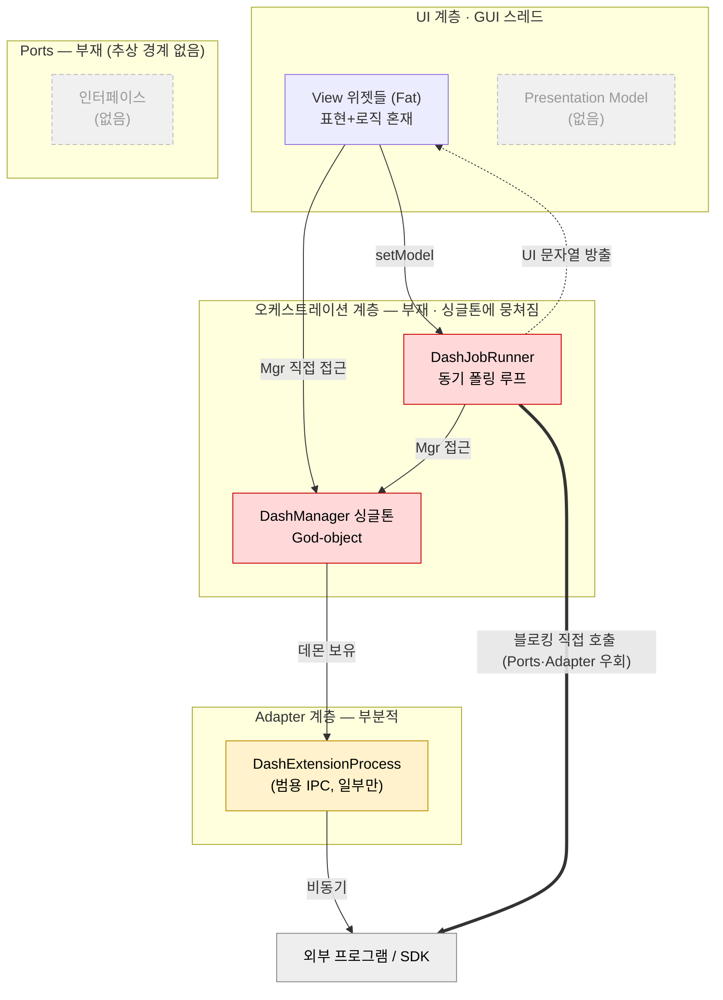
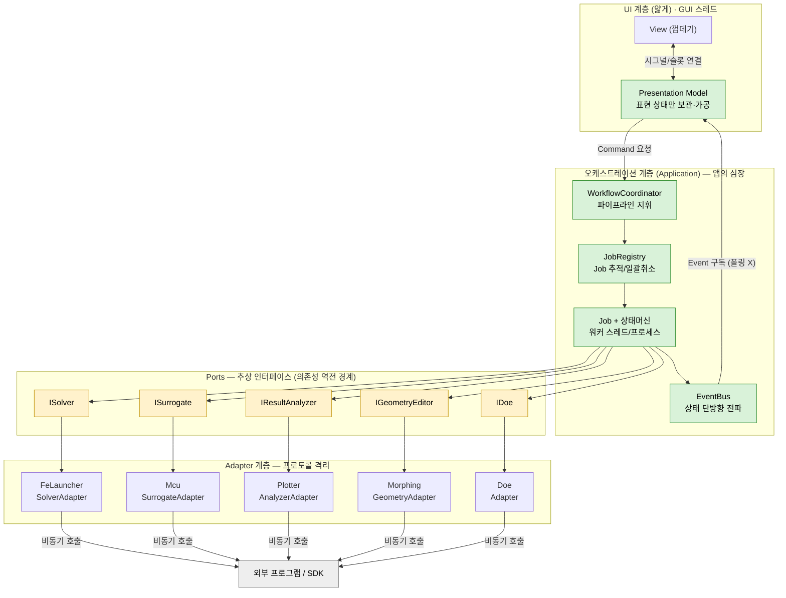
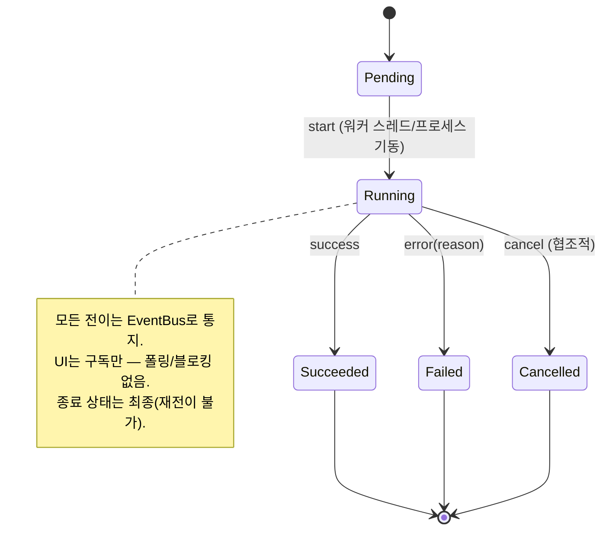
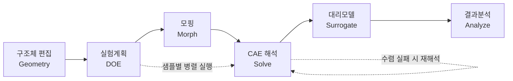
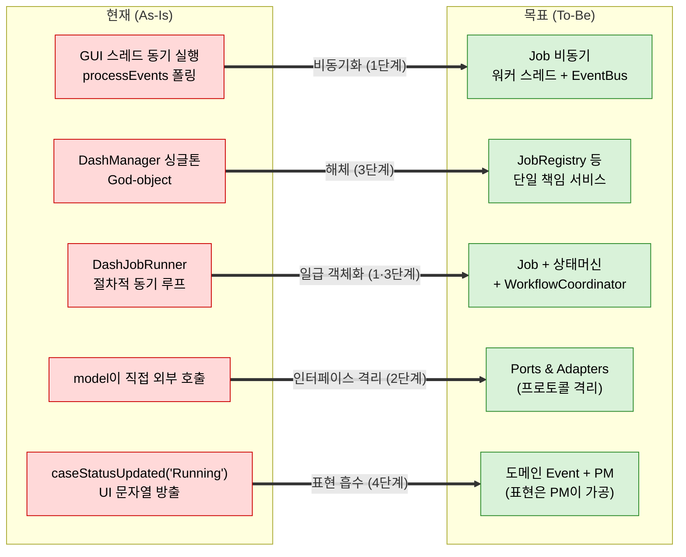

# DashGUI2 아키텍처 분석 — 뷰/로직 분리, 통신·동기·하드코딩·크래시 위험

> 원본: 사전조사 Issue #192 — 본문을 이 페이지로 이관한 뒤 Issue 삭제 (2026-08-24). **본 페이지가 정본**

> 대상: `NohLabWorks/DashGUI2` (분석 시점 브랜치 `dev`)\
> 범위: 전체 약 97k LOC (controller / model / view 3계층)\
> 작성 목적: "MVVM 전면 리팩토링 vs MVC 유지" 논쟁에 대한 근거 기반 판단 + 안정성 리스크 정리\
> 후속 문서: [[198-1-improvement-roadmap]] — 외부 의존성 전체 인벤토리 + 4관점 통합 진단 + 실행 순서 로드맵 (본 문서 1절 "경계 규율 양호" 판정의 보정 — 모델→뷰 역전 — 포함)\
> 후속 문서: [[197-1-gui-restructure-mvvm-qml]] — GUI 재구성 논의 정리 (MVVM 개선점 + QML 전환 찬/반 + 현재 구조 내 대체 수단)\
> 후속 문서: [[Code-Map-Domain-Diagram]] — 사내 6 도메인 구조도 ↔ 코드 파일 대조표. 본 문서 1절 "뷰가 외부 SDK를 직접 호출 = 0건" 판정의 보정 6-1절 포함 (include 기준으로는 유지되나 `DashGizmo*` 타입이 컨트롤러 헤더 전이로 view 에 노출) + 본 문서가 지목한 Presentation Model 계층의 현재 도입 현황 8/12 모듈\
> 개정 1: 2026-07-14 — 부록 C-6 신설 (Presenter vs ViewModel vs Presentation Model 판별 기준·계보·리트머스·도입 목적 8항) + 도입 대상 중간 계층 명칭을 **Presentation Model(바인딩 없는 ViewModel)**로 확정하고 D-4·부록 E·F 표기 반영 — 백로그 W21/R21 용어 통일(v1 개정 18 · v2 개정 1)과 동기화

---

## 0. 한 줄 요약

계층 **경계**는 이미 MVC로 멀쩡하다. 진짜 문제는 패턴이 아니라 **(1) 전 작업이 GUI 스레드에서 동기 실행 + processEvents 펌핑**, **(2) DashManager 싱글톤 God-object**, **(3) 잔존 하드코딩**이다. **전면 MVVM 재작성은 비권장** — 우선순위는 스레딩 안정화다.

---

## 1. 두 저자의 논쟁 — 누가 맞나

**둘 다 부분적으로 맞다. 보는 층위가 다르다.**

```
"MVC 잘 짜였다" — 거시적 경계(boundary) 관점: 맞음
├─ view/ model/ controller/ 물리적 3계층 분리 존재
├─ 뷰→모델 의존성 주입: setModel(model) 패턴 일관 적용
│   (DashModelBuilderWidget, DashOptimizerWidget, DashAnalysisLauncherWidget …)
├─ 뷰↔모델 통신은 Qt signal/slot 으로 디커플링
└─ ★ 뷰가 외부 SDK(DashFL_, DashOptiMorphing, DashRW::)를 직접 호출 = 0건
     → 외부 모듈 통신은 전부 model 계층이 소유. 경계 규율은 진짜로 좋음

"MVVM 리팩토링 필요" — 미시적 구조(internal) 관점: 맞음
├─ DashManager 싱글톤 God-object (2절)
├─ ViewModel(표현 상태) 계층 부재 → 모델이 UI용 시그널 방출
│   (caseStatusUpdated, caseLogUpdated, "Running"/"Failed" 문자열 상태)
├─ 일부 Dialog 가 사실상 Controller+Model
│   (TopOptPostprocessDialog 2208줄: QProcess/파싱/VTK 참조 72곳)
└─ Fat View 다수 (ResultsAnalyzerWidget 3972, MainWindow 3630, GeometryParameterWidget 3267)
```

**판정**: 전면 MVVM 재작성 비권장. 계층 경계는 이미 양호하고, 핵심 리스크(3절 스레딩)는 MVC/MVVM 패턴 선택과 거의 무관하다. MVVM은 신규 화면에 점진 도입하고, 기존 코드는 "God-object 해체 + Fat Dialog 로직 추출"로 충분하다.

### 뷰/로직 분리 근거 (검증 결과)

| 항목 | 관찰 | 판정 |
|---|---|---|
| 뷰→모델 결합 방식 | `setModel(DashXxx* model)` 주입 + 멤버 포인터 보유 | 양호 (DI) |
| 뷰→외부 SDK 직접 호출 | `DashFL_` / `DashOptiMorphing` / `DashRW::` / `#include <DashOpti…>` 를 view/ 에서 검색 → **0건** | 양호 (경계 준수) |
| 뷰↔모델 통신 | signal/slot (`logMessage`, `caseStatusUpdated` 등) | 양호 (디커플링) |
| 모델→뷰 누수 | 모델이 UI 표현용 시그널/상태 문자열 방출 | 개선 필요 (ViewModel 부재) |
| Fat View / Fat Dialog | 다수 위젯 2000\~4000줄, TopOptPostprocessDialog 가 프로세스·파싱·VTK 수행 | 개선 필요 |

---

## 2. DashManager 싱글톤 God-object (최대 구조 부채)

```
DashManager::Mgr()  (controller/DashManager.cpp:212)
├─ 호출 침투: 28개 파일 / 310회 Mgr()-> 호출
├─ 보유 책임(혼재): VTK 렌더링 + 모핑 오퍼레이터 + 솔버 경로 맵
│                  + 데몬 3개(journal/mcu/sensitivity) + DesignVariableModel
└─ thread-safe 아님:
     if (m_instance == nullptr) m_instance = new DashManager();  // 락 없음
     atexit(Destroy);
```

- 뷰·모델 양쪽이 전역 상태로 직접 손을 뻗어 깔끔한 계층화를 **우회**한다. 테스트·격리·재사용을 막는 핵심 안티패턴.
- 현재는 전부 단일 스레드라 락 없는 lazy-init이 우연히 안전하다. 그러나 워커 스레드를 하나라도 도입하는 순간 **데이터 레이스 지뢰**가 된다 (3절 개선과 충돌 주의).

---

## 3. 동기/비동기 — 비동기여야 할 것이 동기 (가장 시급·위험)

**진짜 워커 스레드가 한 개도 없다.** `moveToThread` 사용 0건. `QThread`는 오직 `QThread::msleep()`(GUI 스레드 블로킹 슬립)에만 등장.

```
FE 해석 · 모핑 · DOE · NX CAD STP 생성 = 전부 메인(GUI) 스레드에서 동기 실행
└─ UI를 억지로 살리는 수단: QCoreApplication::processEvents() 펌핑

대표 증거 — DashJobRunner::waitForFile()  (model/DashJobRunner.cpp:2351)
   for (i < maxIterations) {
       QCoreApplication::processEvents();   // 이벤트 펌핑
       if (QFile::exists(path)) return true;
       QThread::msleep(2000);               // ★ GUI 스레드를 2초씩 동결
   }
```

문제점:

- **2초 단위 UI 프리징** + 최대 600초(10분) 폴링. 그동안 창 이동·리사이즈가 끊긴다.
- **processEvents 재진입(re-entrancy) = 최대 크래시 벡터.** 긴 작업 루프가 이벤트를 펌핑하는 도중 사용자가 "취소 / 프로젝트 닫기 / 다른 실행 시작"을 누르면, 진행 중 루프가 아직 참조하는 객체가 그 슬롯에서 해제 → **dangling pointer → 크래시**.
- 타임아웃 없는 블로킹: `proc->waitForFinished()` (DashJobRunner.cpp:459) — 외부 프로세스가 안 끝나면 영구 정지.

### processEvents / 블로킹 wait 분포 (대표)

| 위치 | 패턴 |
|---|---|
| `model/DashJobRunner.cpp:2679, 2686` | `processEvents(AllEvents)` (작업 루프 내) |
| `model/DashJobRunner.cpp:459` | `waitForFinished()` (타임아웃 없음) |
| `model/DashDataProcessor.cpp:315` | `processEvents(ExcludeUserInputEvents)` |
| `view/DashMainWindow.cpp:2111` | `processEvents(ExcludeUserInputEvents)` |
| `view/dialog/TopOptPostprocessDialog.cpp:532` | `processEvents(ExcludeUserInputEvents)` |
| `view/overlay/DashViewOptionsWidget.cpp:175,187` | `processEvents(ExcludeUserInputEvents)` |

---

## 4. 외부 모듈 통신 프로토콜 안정성

`DashExtensionProcess` (데몬/원샷 IPC 추상화)는 **설계 자체는 양호**하다 — 커맨드 큐, 부분 라인 버퍼링(`m_daemonStdoutBuffer`), orphan 프로세스 정리(`killOrphans`), 시그널 기반 완료 통지(`commandCompleted`/`commandFailed`). 다만 와이어 프로토콜에 취약점이 있다.

```
프로토콜: stdout 라인 센티넬   [READY] / [FINISHED] / [ERROR]
          (controller/DashExtensionProcess.cpp:252 handleDaemonLine)

취약점
├─ ① 센티넬 충돌: [ERROR] 를 .contains() 로 판정 (line 280)
│     → 정상 출력에 "[ERROR]" 문자열이 섞이면 멀쩡한 명령이 실패 처리됨
├─ ② 커맨드 상관관계 부재: 완료 매칭이 'FIFO 순서'에만 의존
│     → 데몬이 예상 밖 라인 하나만 뱉어도 큐 전체가 desync
├─ ③ 커맨드 실행 타임아웃 없음: setReadyTimeoutMs 는 '시동(startup)'만 커버
│     → 명령 전송 후 데몬이 [FINISHED] 를 안 주면 영구 pending, 큐가 조용히 멈춤
└─ ④ payload 를 "cmd\n<json>" 로 전달 → JSON 에 개행 들어가면 프레이밍 깨짐
     (MCU/SensitivityEngine 의 test-model-1d, morris/sobol/shap 명령)
```

→ "불안정"이라기보다 **happy-path 의존적**이다. 데몬이 죽거나 비정상 출력을 내면 복구 메커니즘이 약하다.

---

## 5. 하드코딩 (명백한 버그 포함)

```
★ 개발자 개인 PC 경로 (타 머신에서 무조건 깨짐 — 잔존 디버그 코드)
├─ view/dialog/TopOptPostprocessDialog.cpp:2140
│     "C:\Users\MIIIING\Downloads\TO\repaired_surface_7.stl"
└─ view/DashAIGeometryGenerationWidget.cpp:129
      QLineEdit("C:\Users\Program\Documents\trained_model.mdl")

매직 넘버 (설정/상수로 분리 권장)
├─ DashManager.h: m_morphingKernelRadius=10.0, QColor(128,0,0), opacity 0.5
├─ DashExtensionProcess.h: m_readyTimeoutMs=15000, runBlocking timeout=300000
└─ KPI Threshold 기본값 0.08949 (view/dialog/CLAUDE.md 명시)
```

①의 두 경로는 **즉시 수정 권장** — 릴리스 빌드에 포함되면 해당 기능이 사용자 환경에서 그냥 동작하지 않는다.

---

## 6. 크래시 위험 요약

| 위험 | 위치 | 심각도 |
|---|---|---|
| **processEvents 재진입 → dangling pointer** | JobRunner/ModelRunner 동기 루프 전반 | 높음 |
| 타임아웃 없는 `waitForFinished()` → 영구 정지 | `DashJobRunner.cpp:459` | 중 |
| 데몬 무응답 시 커맨드 영구 pending | DashExtensionProcess (4절 ③) | 중 |
| 하드코딩 경로 → 기능 무력화 | 5절 ① | 중 |
| 미가드 싱글톤 반환 역참조 (`GetCurrentActor()->` 등 6곳) | view/model | 낮음 |
| **알려진 lifetime 버그 우회** — KPIConfigDialog `parent=this` 시 소멸자 크래시 → `nullptr` 회피 | `view/dialog/CLAUDE.md:17` | 징후 |

마지막 항목이 의미심장하다: parent 부여 시 소멸자 크래시를 **근본 원인 수정 없이 `dialog(nullptr)`로 회피**한 흔적 → 객체 소유권/생명주기 관리에 잠복 버그 가능성.

---

## 7. 종합 우선순위 (권장)

```
1순위 (안정성) — MVC/MVVM 와 무관, 가장 시급
├─ 긴 작업(FE/모핑/DOE)을 워커 스레드로 이전 → processEvents 펌핑 제거
│   = 최대 크래시 클래스 + UI 프리징 동시 해결
│   ※ 단, 워커 스레드 도입 전 DashManager 싱글톤 thread-safety 선결 (2절)
└─ 하드코딩 dev 경로 2곳 즉시 제거

2순위 (견고성)
├─ 데몬 프로토콜: 커맨드 단위 타임아웃 + 명시적 command-id 상관 + [ERROR] 정확 매칭
└─ 타임아웃 없는 waitForFinished 전수 점검

3순위 (구조) — 점진적, 빅뱅 금지
├─ DashManager God-object 책임 분해 (렌더링/모핑/데몬/경로 분리)
├─ Fat Dialog 로직 추출 (TopOptPostprocessDialog → model 계층으로)
└─ MVVM 은 신규 화면부터 점진 도입 (전면 재작성 X)
```

---

## 부록 A. 분석에 사용한 코드 좌표

| 주제 | 파일:라인 |
|---|---|
| 싱글톤 정의 | `controller/DashManager.cpp:212` (`Mgr()`) |
| God-object 멤버 | `controller/DashManager.h:46-234` |
| 동기 폴링 | `model/DashJobRunner.cpp:2351` (`waitForFile`) |
| 타임아웃 없는 wait | `model/DashJobRunner.cpp:459` |
| 데몬 프로토콜 파싱 | `controller/DashExtensionProcess.cpp:239-293` |
| 데몬 명령 카탈로그 | `controller/DashExtensionProcess.h:15-64` |
| 하드코딩 경로 | `view/dialog/TopOptPostprocessDialog.cpp:2140`, `view/DashAIGeometryGenerationWidget.cpp:129` |
| 뷰 DI 패턴 | `view/DashModelBuilderWidget.h:29,104` 외 다수 |

## 부록 B. 규모 상위 파일 (LOC)

| 파일 | LOC | 계층 |
|---|---|---|
| `model/DashDataProcessor.cpp` | 4667 | model |
| `view/DashResultsAnalyzerWidget.cpp` | 3972 | view |
| `view/DashMainWindow.cpp` | 3630 | view |
| `view/DashGeometryParameterWidget.cpp` | 3267 | view |
| `controller/DashHandlePickingInteraction.cpp` | 2845 | controller |
| `model/DashJobRunner.cpp` | 2843 | model |
| `view/DashOptimizerWidget.cpp` | 2702 | view |
| `model/DashModelRunner.cpp` | 2677 | model |
| `view/dialog/TopOptPostprocessDialog.cpp` | 2208 | view(dialog) |

---

## 부록 C. MVC vs MVVM — 일반 개념 정리

> 1절은 이 프로젝트에 한정한 판정이고, 이 부록은 패턴 자체를 프로젝트 무관하게 일반화한 개념 설명이다.

### C-1. 한 줄 차이

- **MVC**: View ↔ Model 사이를 **Controller**(중개자)가 교통정리. View는 비교적 수동적.
- **MVVM**: View ↔ Model 사이에 **ViewModel**(표현 상태 보관소)을 두고, View가 ViewModel에 **자동 바인딩(binding)** 으로 묶임.

### C-2. 본질 — "표현 상태(presentation state)"를 누가 들고 있나

두 패턴 모두 목표는 같다: **화면(표현)과 로직(도메인)의 분리.** 갈리는 지점은 "화면에 보일 형태로 가공된 상태"를 **어디에 두느냐**다.

예) 화면에 `"실행 중 (Running)"` 을 빨간색으로 표시:

```
MVC — 가공을 Controller가, 표시를 View가
├─ Model       : status = 3            (순수 도메인 데이터)
├─ Controller  : 3 → "Running" + 빨강 으로 변환해 View에 지시
└─ View        : 지시받은 대로 그림

MVVM — 가공을 ViewModel이 미리, View는 비추기만
├─ Model       : status = 3            (순수 도메인 데이터)
├─ ViewModel   : statusText="Running", statusColor=Red 를 미리 계산해 보유
└─ View        : ViewModel.statusText 에 바인딩 → ViewModel만 바뀌면 화면 자동 갱신
```

**MVVM의 핵심은 ViewModel이다.** "표현용으로 가공된 상태"를 ViewModel이 보관하고, View는 그것을 그대로 반영만 하는 "얇은 껍데기"가 목표다.

### C-3. 데이터 흐름

```
MVC — Controller가 갱신을 명령
   사용자 입력 → Controller → Model 수정
                  Controller → View 갱신 '지시' (코드로 명시)

MVVM — 바인딩이 갱신을 대행
   사용자 입력 → View → (바인딩) → ViewModel → Model
   Model 변경  → ViewModel → (바인딩) → View 자동 갱신   (별도 갱신 코드 없음)
```

MVVM에서는 "View를 갱신하라"는 코드를 사람이 거의 쓰지 않는다. 바인딩 프레임워크가 그 일을 대신한다 — 이것이 MVVM 성립의 전제 조건이다 (부록 D 참조).

### C-4. 비교표

| 구분 | MVC | MVVM |
|---|---|---|
| 중간 계층 | Controller (중개자) | ViewModel (표현 상태 보관) |
| View 갱신 | 명시적 코드 작성 | 바인딩으로 자동 |
| View 무게 | 다소 무거워지기 쉬움 | 얇아야 함 (껍데기) |
| 단위 테스트 | View 분리 어려움 | ViewModel만 떼어 테스트 가능 |
| 전제 인프라 | 특별히 없음 | 데이터 바인딩 지원 프레임워크 필요 |
| 대표 스택 | 전통적 GUI, 웹 MVC | WPF, QML, 모던 프런트엔드 |

### C-5. "ViewModel 부재" 냄새를 식별하는 법 (일반 규칙)

특정 코드베이스가 "MVC인데 MVVM이 아쉽다"는 신호는 대개 아래로 드러난다 — 본 프로젝트 1절의 판정도 이 규칙을 적용한 결과다.

```
징후 — 표현 상태가 Model로 새어나옴
├─ Model이 UI용 '문자열 상태'를 직접 생성해 방출
│   (예: 도메인 enum 대신 "Running"/"Failed" 같은 표시용 문자열)
├─ Model이 색상/포맷/라벨 등 표현 결정을 포함
└─ View가 받은 raw 데이터를 매번 표시형으로 재가공
     → 이 '재가공 로직'이 곧 ViewModel이 가져가야 할 책임

처방
└─ 표현 상태(statusText, statusColor, isEnabled …)를 ViewModel로 이관,
   Model은 순수 도메인 데이터만 노출
```

본 프로젝트 매핑: `DashJobRunner`(Model)가 `caseStatusUpdated(key, "Running")` 으로 **표시용 문자열을 직접** 방출하고, `DashModelRunnerWidget`(View)이 슬롯에서 색/텍스트를 칠한다. 전형적인 "ViewModel 부재"이며, 이것이 1절에서 "MVVM 필요" 저자의 정당한 근거다. 다만 이 한 가지 냄새만으로 **전면 재작성**을 정당화하지는 못한다(7절 결론 참조).

### C-6. Presenter vs ViewModel vs Presentation Model — 판별 기준과 명칭 확정 (개정 1)

배경: 백로그 W21/R21("ViewModel 수렴")이 도입하는 중간 계층이 "ViewModel인가 Presenter인가"라는 명칭 논의(2026-07-14)의 결론 기록. **정확한 이름은 Presentation Model(Fowler, 2004) — 실무적으로 "바인딩 없는 ViewModel"**이며, 백로그 v1·v2는 이 명칭으로 통일했다(v1 개정 18 · v2 개정 1).

**계보** — 세 패턴은 "중간 계층이 뷰와 어떻게 결합하는가"로 갈린다:

```
MVP Presenter (뷰 조작형)
└─ Presenter가 뷰(IView 인터페이스)를 참조하고 직접 조작: view->setLabel(...)

Presentation Model (Fowler 2004 — 상태 보관형)
└─ 표현 상태를 별도 객체가 보관하되 뷰를 모름. 동기화 코드는 뷰가 스스로 작성

MVVM (Gossman 2005) = Presentation Model + 자동 바인딩
└─ 그 동기화 코드마저 바인딩 엔진(WPF·QML)이 대행 → View 무코드화
```

**판별 속성**:

| 판별 속성 | MVP Presenter | MVVM ViewModel | Presentation Model |
|---|---|---|---|
| 뷰 참조 방향 | Presenter가 뷰(인터페이스)를 **알고 직접 조작** | 뷰를 **모름** — 뷰가 VM을 구독 | 뷰를 **모름** — 시그널로 상태 방송 |
| 동기화 방식 | 명시적 메서드 호출 (수동) | 자동 바인딩 | 시그널→슬롯 수동 배선 (배선 코드는 뷰 쪽) |
| 본질 | 상호작용 **중재자** (행위 중심) | 표현 상태 **보관소** (상태 중심) | 표현 상태 보관소 |
| 단위 테스트 | mock IView 필요 | 단독 — 속성 관찰 | 단독 — QSignalSpy로 시그널 관찰 |
| 전제 인프라 | 없음 | 바인딩 엔진 (QML·WPF) | 시그널/슬롯이면 충분 |

**리트머스 3문항** — 구현 중 Presenter로 미끄러졌는지 검사. 하나라도 yes면 Presenter화된 것: ① 이 클래스가 위젯(또는 뷰 인터페이스) 포인터를 멤버로 갖는가 ② 단위 테스트에 mock view가 필요한가 ③ "화면을 갱신하라" 코드가 이 클래스 **안**에 있는가.

**본 프로젝트 판정 — 뷰 무참조·시그널 방송형(PM)이 적합한 4근거**:

1. **Qt 시그널/슬롯 = 관찰자 패턴 내장** — Presenter 방식이 요구하는 모듈별 IView 인터페이스 정의·mock 유지비가 통째로 불필요. 테스트는 QSignalSpy로 끝난다.
2. **방향성 게이트와 정합** — PM은 "위젯 헤더 include 0건"으로 기계 검증 가능 (백로그 W9/R6 grep 게이트, model→view 0건과 같은 방식). Presenter는 뷰 인터페이스 의존으로 검증이 흐려진다.
3. **기존 선례 수렴** — `DashSolverNxCad`가 이미 이 형태: 뷰를 모른 채 `nxCadParametersJson`·`loadPrtCompleted` 등을 emit, 위젯 4곳이 구독. 새 발명 없이 확산.
4. **일대다 구독** — 하나의 Job 상태를 진행바·로그 도크·상태바가 동시 구독 (백로그 W11/R15 진행 UX와 정합). Presenter는 뷰 1개 조작 구조라 어색.

**도입 목적 — 무엇을 얻으려는가** (W21/R21 기대 효과의 개조식 요약):

1. **모듈화·캡슐화** — 위젯 곳곳에 흩어진 표현 상태·가공 로직(statusText·색·활성화 여부·행 데이터)을 **뷰 1개당 PM 1개**로 모아 단일 소유자를 지정. 같은 가공 로직의 복붙·드리프트 소멸.
2. **테스트 가능화** — PM은 위젯을 모르므로 GUI(QApplication·화면) 없이 QSignalSpy만으로 단위 테스트. UI 로직을 테스트 가능 영역으로 옮기는 현실적 유일 경로 — 테스트 0건 상태에서 W9/R6 안전망과 결합해 회귀 방어선이 UI 로직까지 확장.
3. **사고 전파 차단 (격벽)** — 뷰와 로직이 시그널 표면으로만 접촉 → 한쪽의 수정·결함이 경계에서 흡수되고 상대 코드에 직접 닿지 않음. 대수술(R14 이벤트 구동·R20 God 해체)의 파급을 PM 경계가 흡수 — "시그널 표면 보존" 원칙의 구조적 실현.
4. **병렬 개발** — 뷰(레이아웃·디자인·.ui 이관)와 로직(PM)을 서로 다른 사람이 동시 작업 가능. R18 .ui 이관과 직교 — 뷰를 .ui로 교체해도 PM은 무변경.
5. **유지보수 지점 명확화** — "어디를 고치나"가 계층으로 결정됨: 표현 변경 = 뷰, 동작·가공 변경 = PM, 도메인 = model. Fat Widget(3,000줄+)은 배선만 남아 churn 축소.
6. **상태 일관성 (일대다 구독)** — 하나의 PM 상태를 진행바·상태바·로그 도크가 동시 구독 → "진행 표시 5방식 혼재" 같은 화면 간 상태 불일치를 원천 차단 (W11/R15 진행 UX와 정합).
7. **모델 순수화** — 모델이 UI 문자열(`"Running"`)을 방출하던 표현 누수(C-5)를 PM이 흡수 → 모델은 도메인 enum만 방출. model→view 방향 규율(W19/R19)과 한 몸.
8. **미래 옵션 보존** — 바인딩 엔진(QML) 도입 시 PM은 무수정으로 MVVM 승격 — 지금의 투자가 스택 전환 때 폐기되지 않음 (재작업 헤지).

**명칭 정리**: 기존 "ViewModel 수렴"은 과장(자동 바인딩 없음), "Presenter"는 부정확(뷰 조작 없음). PM은 바인딩 엔진이 생기면 **무수정으로 MVVM이 되므로**, 훗날 QML 전환 계기가 생겨도 이 계층은 그대로 승격된다 — 재작업 헤지 (D-4·E-1 참조). "상태로 표현되지 않는 일회성 행위"(다이얼로그 요청 등)도 요청 시그널(`confirmationRequested(...)`)로 PM 안에 수용 가능하므로 Presenter 예외를 둘 이유가 약하다.

---

## 부록 D. Qt Widgets vs QML — 개괄

> MVVM의 성립 전제가 "자동 바인딩 인프라"이므로, 본 프로젝트의 UI 스택이 MVVM과 얼마나 궁합이 맞는지 판단하려면 두 스택의 성격을 알아야 한다.

### D-1. 무엇인가

| | Qt Widgets | QML (Qt Quick) |
|---|---|---|
| 정체 | C++ 기반 **명령형(imperative)** 위젯 툴킷 | **선언형(declarative)** UI 언어 (JS식 문법) + Qt Quick 런타임 |
| UI 기술 | `QWidget` 트리, OS 네이티브 룩 | 씬그래프(GPU) 렌더, 커스텀 룩 |
| 작성 방식 | C++ 코드로 위젯 생성·배치·연결 | `.qml` 파일에 UI를 트리로 '기술' |
| 상태 반영 | 슬롯에서 `setText()` 등 **직접 호출** | 프로퍼티 **바인딩**으로 자동 전파 |
| 본 프로젝트 | ★ 사용 중 (DashGUI2 전부) | 미사용 |

### D-2. 결정적 차이 — 바인딩

```
Qt Widgets — 명령형: "언제 무엇을 갱신하라"를 사람이 코드로 지정
   connect(model, &Model::statusChanged, this, [=](int s){
       label->setText(s==3 ? "Running" : "...");   // 변환 + 갱신을 직접 작성
       label->setStyleSheet(s==3 ? "color:red" : "");
   });

QML — 선언형 + 바인딩: "이 값은 저 값에 묶인다"만 선언, 갱신은 런타임이 수행
   Label {
       text:  vm.statusText        // vm.statusText 바뀌면 자동 갱신
       color: vm.statusColor       // 별도 갱신 코드 없음
   }
```

QML의 프로퍼티 바인딩(`property binding`)이 곧 MVVM의 View↔ViewModel 결합을 **언어 차원에서 무료로 제공**한다. Qt Widgets에는 이 자동 바인딩이 기본 제공되지 않아, 사람이 슬롯으로 일일이 갱신을 엮어야 한다(= "View 갱신 지시 코드"가 남는다).

### D-3. 트레이드오프 — 언제 무엇을

```
Qt Widgets 가 유리
├─ 데스크톱 폼/툴/대시보드, 네이티브 룩이 중요
├─ 복잡한 표준 위젯(QTableView, QTreeView, 도킹, 모델/뷰 프레임워크)
├─ VTK/OpenGL 위젯 등 C++ 통합이 핵심 (← 본 프로젝트가 정확히 이 경우)
└─ 팀이 C++ 중심, JS/QML 비숙련

QML 이 유리
├─ 애니메이션·터치·커스텀 디자인이 중요(모바일/임베디드/HMI)
├─ 디자이너-개발자 분업, 빠른 UI 이터레이션
└─ MVVM 을 자연스럽게 가져가고 싶을 때 (바인딩 내장)
```

### D-4. 본 프로젝트 함의

- DashGUI2는 **Qt Widgets 전용**이며, `QVTKOpenGLNativeWidget` 기반 VTK 3D 렌더링과 `QTreeView` 모델/뷰가 UI의 핵심이다. 이는 Qt Widgets의 강점 영역으로, 스택 선택 자체는 타당하다.
- 그러나 Qt Widgets는 자동 바인딩이 약해 **순수 MVVM이 어색**하다. ViewModel을 도입하더라도 결국 슬롯으로 갱신을 엮게 되어 MVVM의 핵심 이점(바인딩 자동 갱신, View 무코드화)을 충분히 살리지 못한다.
- 따라서 1절·7절의 결론과 일관되게: **"전면 MVVM 재작성" 비권장**의 실무적 근거가 여기에도 있다. 지금 스택에서 MVVM의 ROI가 낮다. 대신 표현 상태 누수(부록 C-5)는 **경량 Presentation Model 객체**(부록 C-6 — 바인딩 없는 ViewModel)를 부분 도입해 완화하는 정도가 현실적이다 — 바인딩 없이도 "표현 로직을 한곳에 모으고 단위 테스트 가능하게" 만드는 효과는 얻을 수 있다.
- QML 전환은 VTK 통합·기존 위젯 자산 때문에 비용이 매우 크므로, 신규 독립 화면에 한해 실험적으로만 고려할 사안이다.

---

## 부록 E. 권장 목표 아키텍처 (오케스트레이터형)

> DashGUI2의 본질은 "여러 이질적 외부 프로그램(CAE 해석기·대리모델 해석기·결과 분석기·구조체 편집기·실험계획) + 사용자 입력을 중간에서 조율하는 오케스트레이터"다. 이 정체성에 맞는 목표 아키텍처를 정리한다. **핵심: 이것은 UI 패턴(MVC/MVVM) 문제가 아니라 '장시간·실패·취소 가능한 외부 작업의 조율' 문제다.** MVC/MVVM은 이 구조의 가장 바깥 한 겹일 뿐이다.

### E-1. 결론

**Hexagonal(Ports & Adapters) 코어 + 비동기 Job 오케스트레이션 계층 + 얇은 Presentation Model UI 엣지 (부록 C-6).**

```
서브모듈 1개          = Port(인터페이스) 1개 + Adapter(구현) 1개   ← 외부 도구 격리
모듈 간 조율          = Orchestration 계층 (Workflow + Job 상태머신 + Event Bus)
UI                    = 그 상태를 비추기만 하는 얇은 View + Presentation Model
```

### E-2. 왜 이 구조인가 — 지배 요인(force)에서 도출

아키텍처는 취향이 아니라 요구의 압력(force)에서 도출되어야 한다. 본 도메인의 force와 그것이 강제하는 결정:

| 지배 요인 | 강제되는 설계 결정 | 대응 패턴 |
|---|---|---|
| 외부 도구가 이질적·프로토콜 제각각·불안정 | 각 도구를 인터페이스 뒤로 격리 | Ports & Adapters |
| 작업이 장시간·실패·취소 가능 | 실행을 일급 객체 + 명시적 상태 전이로 | Job 상태머신 |
| DOE→편집→해석→대리모델→결과분석 다단계 의존 | 단계 연결을 별도 조율자가 소유 | Workflow / Pipeline |
| 사용자 주도·인터랙티브·응답성 필수 | UI 스레드 블로킹 금지, 상태는 이벤트로 | Event-driven 비동기 |
| 교체·목 테스트·유지보수 | 경계를 추상 인터페이스로 | 의존성 역전(DIP) |

> 본 문서 3절(동기 실행)·6절(크래시)·4절(프로토콜 취약)의 문제들이 전부 위 force에 정면으로 어긋난 결과라는 점에 주목. 목표 아키텍처는 그 어긋남을 구조적으로 제거한다.

### E-3. 전체 계층 구조

```
UI 계층 (얇게) — Qt Widgets, 서브모듈당 View 1개
   │   Presentation Model (C-6): 표현 상태(statusText, progress, isEnabled, rows)만 보관·가공
   │   View→오케스트레이터: Command(요청) 전송 / 오케스트레이터→View: Event(상태) 구독
   ↓↑
오케스트레이션(Application) 계층  ★ 이 앱의 심장 — 도메인 흐름을 소유
   ├─ WorkflowCoordinator : 파이프라인 지휘 (단계 순서·의존·분기·재시도)
   ├─ JobRegistry         : 실행 중/완료 Job 추적, 조회, 일괄 취소
   ├─ Job(+StateMachine)  : 외부 실행 1건 = 상태머신을 가진 일급 객체
   └─ EventBus            : Job/Workflow 상태 변화를 UI로 단방향 전파
   ↓↑ (Port = 추상 인터페이스, 의존성 역전 경계)
   ├─ ISolver         (CAE 해석기)
   ├─ ISurrogate      (대리모델 해석기)
   ├─ IResultAnalyzer (결과 분석기)
   ├─ IGeometryEditor (구조체 편집기)
   └─ IDoe            (실험계획)
Adapter 계층 — 포트당 구현 1개. 외부 프로토콜의 '지저분함'을 여기서 전량 흡수
   ├─ FeLauncherSolverAdapter   → DashOptiFELauncher / ANSYS / Abaqus
   ├─ McuSurrogateAdapter       → DashOptiMCU / DeepOpt 데몬 (stdout 프로토콜)
   ├─ PlotterAnalyzerAdapter    → 파서 / VTK 플로터
   ├─ MorphingGeometryAdapter   → DashOptiMorphing / NX CAD
   └─ DoeAdapter                → DashOptiDOE
외부 프로그램 / SDK (out-of-process exe, DLL)
```

세 가지 경계의 의미:
- **UI ↔ 오케스트레이션**: Command(아래로) / Event(위로). UI는 도메인 로직을 모른다.
- **오케스트레이션 ↔ Adapter**: Port 인터페이스. 오케스트레이터는 "어떤 외부 프로그램인지" 모른다 (`ISolver`만 안다).
- **Adapter ↔ 외부**: 프로세스/SDK 호출. 프로토콜의 모든 특이사항이 이 안에 갇힌다.

### E-4. 가장 중요한 결정 ① — 서브모듈 = 포트 뒤의 어댑터 (Hexagonal)

단일 최우선 결정. 외부 도구의 불안정성(4절: 센티넬 충돌·타임아웃 부재·desync)을 **어댑터 내부에 가두고**, 오케스트레이터·UI는 안정적 인터페이스만 본다.

포트 인터페이스 예 (개념 스케치):

```cpp
// Port: 오케스트레이터가 의존하는 추상. "어떤 솔버인지" 모른다.
class ISolver {
public:
    virtual ~ISolver() = default;
    // 비동기 시작. 즉시 JobHandle 반환 (블로킹 없음).
    virtual JobHandle solveAsync(const SolveRequest& req) = 0;
    virtual void      cancel(const JobHandle& h) = 0;
    // 진행/완료는 콜백/시그널/EventBus 로 통지 (반환값으로 결과를 기다리지 않음)
};
```

어댑터의 책임 (지저분함을 흡수):

```
FeLauncherSolverAdapter : ISolver
├─ SolveRequest → FELauncher C-API 호출 인자로 변환
├─ 외부 프로세스 수명/타임아웃/재시도/orphan 정리 관리
├─ stdout/RST 파일 폴링을 '어댑터 내부'에서 비동기로 (UI는 모름)
├─ 실패/이상 출력을 표준 JobFailed(reason) 로 정규화
└─ 프로토콜 변경·버전업 시 '이 파일만' 수정
```

효과: 외부 도구 교체·버전업·**목(mock) 테스트**가 전부 어댑터 교체로 끝난다. 솔버 없이 `FakeSolverAdapter`로 워크플로 전체를 단위 테스트할 수 있다.

### E-5. 가장 중요한 결정 ② — Job을 일급 객체 + 상태머신으로

현행 `waitForFile()` + `processEvents` 폴링(3절)을 폐기하고, 실행을 **상태를 가진 객체**로 모델링한다.

```
Job 상태 전이
   Pending ──start──> Running ──success──> Succeeded
                         │
                         ├──error────────> Failed(reason)
                         └──cancel───────> Cancelled

불변식(invariant)
├─ 종료 상태(Succeeded/Failed/Cancelled)는 최종 — 재전이 불가
├─ 모든 전이는 EventBus 로 통지 (UI 폴링 불필요)
├─ Job 은 자기 워커 스레드/프로세스에서 실행 — 오케스트레이터/UI 스레드 절대 블로킹 안 함
└─ 취소는 협조적(cooperative): cancel 플래그 + 외부 프로세스 kill 을 어댑터가 처리
```

이 한 가지로 **재진입 크래시(6절 최상위 위험)와 UI 프리징(3절)이 동시에 구조적으로 사라진다** — 더 이상 작업 루프가 이벤트를 펌핑하지 않으므로 "루프 도중 사용자 입력으로 객체 해제 → dangling pointer" 시나리오 자체가 성립하지 않는다.

현행 `caseStatusUpdated(key, "Running")`(문자열 상태 방출)은 다음으로 대체:

```
Job → EventBus.emit( JobStateChanged{ jobId, JobState::Running } )   // 도메인 enum
   ↓
Presentation Model: JobState::Running → statusText="Running", color=Red 로 '표현 가공'  (부록 C-5 처방)
   ↓
View: PM 시그널에 슬롯 연결 (수동 배선 — 부록 C-6)
```

### E-6. 가장 중요한 결정 ③ — Workflow Coordinator (다단계 조율)

이 앱의 도메인은 본질적으로 파이프라인이다. 단계 연결 로직이 위젯·모델 곳곳에 흩어지지 않도록 **조율자 하나가 소유**한다.

```
대표 파이프라인 (예)
   구조체 편집(Geometry) → 실험계획(DOE) → 모핑(Morph) → CAE 해석(Solve)
                                                          → 대리모델(Surrogate) → 결과분석(Analyze)

WorkflowCoordinator 의 책임
├─ 단계 순서·의존성 정의 (DAG)
├─ 단계 산출물 → 다음 단계 입력으로 연결
├─ 분기/조건 (예: 수렴 실패 시 재해석, 샘플별 병렬 실행)
├─ 부분 실패 정책 (한 샘플 실패가 전체를 죽이지 않게)
└─ 전체 진행률 집계 → EventBus
```

조율자는 **각 단계를 포트로만 호출**한다(`ISolver`, `IDoe` …). 즉 "무엇을 어떤 순서로"는 알지만 "그 도구가 ANSYS인지 Abaqus인지"는 모른다.

### E-7. 비동기 실행 모델 (구체)

```
원칙: 오케스트레이터/UI 스레드는 '절대' 블로킹하지 않는다.

선택지
├─ out-of-process 도구 (exe): QProcess 비동기 + 시그널 (현 DashExtensionProcess 방향이 맞음)
│     → 어댑터가 프로세스 수명·타임아웃·재시도 관리, 완료를 Event 로 통지
└─ in-process SDK (DLL, 장시간 CPU 작업): 워커 스레드(QThread + worker QObject moveToThread)
      → 결과를 queued signal 로 UI 스레드에 안전 전달

★ 선결 조건: 워커 스레드 도입 전 DashManager 싱글톤의 thread-safety 확보 (2절).
   God-object 를 단일 책임 서비스로 분해하면서 공유 상태 접근 경계를 명확히 할 것.
```

### E-8. 현행 자산 → 목표 역할 매핑 (점진 이행 가능)

다행히 현 코드에 이 구조의 **씨앗**이 이미 있다. 빅뱅 없이 재배치로 도달 가능하다.

| 현행 | 목표 역할 | 이행 작업 |
|---|---|---|
| `model` 계층이 외부 통신 독점 (뷰 SDK 직접호출 0건) | Port 경계 (이미 사실상 존재) | 인터페이스로 형식화 |
| `DashExtensionProcess` (범용 IPC 추상화) | Adapter 베이스 | 포트별 어댑터로 특화 |
| `setModel()` 의존성 주입 | Port 주입 | 구상클래스→인터페이스로 |
| `DashJobRunner` (절차적 동기 루프) | Job + 상태머신 + Coordinator | 비동기 일급 객체로 분해 |
| `DashManager` 싱글톤 God-object | JobRegistry / 서비스들 | 단일 책임으로 해체 |
| `caseStatusUpdated("Running")` | 도메인 Event + Presentation Model 가공 | 문자열→enum, 표현은 PM으로 |

### E-9. 대안 기각 사유

| 대안 | 기각 사유 |
|---|---|
| 순수 MVC/MVVM 만 | UI 끝단만 다룸. 진짜 난제(외부 작업 조율)를 비워둠 — 필요조건이지 충분조건 아님 |
| 마이크로서비스 / 외부 메시지 브로커 | 데스크톱 단일 앱에 배포·운영 복잡도 과잉. EventBus는 in-process로 충분 |
| 플러그인 아키텍처 | 서브모듈이 3rd-party로 동적 로딩될 때만 가치. 지금은 어댑터로 족함. 필요해지면 어댑터 계층을 플러그인으로 진화 |
| Big-bang 재작성 | 회귀 위험·중단 비용 과다. E-8의 점진 이행이 안전 |

### E-10. 단계적 이행 로드맵

```
1단계 (안정성 즉효) — Job 비동기화
├─ 한 서브모듈(예: CAE 해석)부터 Job+상태머신+워커 스레드로 전환
├─ 해당 경로의 processEvents/waitForFile 제거
└─ 효과: 최대 크래시 클래스 + UI 프리징 해소 (3·6절)

2단계 (경계 정리) — Ports & Adapters 형식화
├─ 서브모듈별 Port 인터페이스 정의, 기존 model 을 Adapter 로 재배치
└─ setModel 주입을 인터페이스 주입으로

3단계 (조율 분리) — Orchestration 계층 추출
├─ WorkflowCoordinator + JobRegistry + EventBus 도입
└─ DashManager God-object 책임 분해 (싱글톤 해체)

4단계 (UI 엣지) — 표현 상태 흡수
└─ Presentation Model 도입으로 모델→UI 문자열 누수 제거 (Qt Widgets라 바인딩 없이 시그널 배선 — 부록 C-6)
```

### E-11. 한 줄 정리

**"오케스트레이터 = Hexagonal 코어 + 비동기 Job 워크플로, UI는 얇은 엣지."** MVC/MVVM 논쟁은 이 구조의 4단계(UI 엣지)에 속한 작은 일부이며, 그 자체로는 본 앱의 핵심 난제(외부 작업 조율)를 해결하지 못한다.

---

## 부록 F. 아키텍처 다이어그램 (현재 vs 목표)

> 부록 E를 시각화하고, 현재 구조와 나란히 놓아 **무엇이 어떻게 바뀌는지** 한눈에 보이게 한다.
> 다이어그램은 **Mermaid** 로 작성 — GitHub / GitHub Wiki / Mermaid 지원 뷰어(VS Code: Markdown Preview Mermaid Support 확장)에서 도형으로 렌더링된다. 렌더링이 안 되는 순수 텍스트 뷰어에서는 부록 E의 ASCII 트리를 참조.

### F-1. 현재 구조 (As-Is) — 문제 가시화



> **F-2와 동일한 5개 밴드로 그렸다 — 위에서부터 1:1 대응.** 🔴빨강 = 핵심 부채, ⬜회색 점선 = As-Is에 **없는** 계층(Presentation Model·Ports), 🟡노랑 = **부분만** 존재(Adapter). 굵은 화살표 = Ports·Adapter를 **우회**한 블로킹 직접 호출. 외부 = FELauncher·MCU·Morphing·DOE·NX. 싱글톤 보유 책임 = 렌더링+모핑+데몬+경로+모델 (28파일/310회 접근).

붉은 노드 = 핵심 부채. 짚이는 문제:
- 🔴 **GUI 스레드 단일 실행** — FE/모핑/DOE 전부 동기, `processEvents`로 버팀 → 재진입 크래시·UI 프리징 (3·6절)
- 🔴 **God-object 싱글톤** — 뷰·러너가 전역 상태로 직접 손 뻗음 (310회) → 결합·테스트 불가 (2절)
- 🔴 **블로킹 외부 호출** — 타임아웃 없는 `waitForFinished` (6절)
- 🔴 **표현 상태 누수** — 모델이 `"Running"` UI 문자열 직접 방출 (부록 C-5)

### F-2. 목표 구조 (To-Be) — 계층 분리 + 비동기



초록 = 새로 도입되는 핵심, 노랑 = 포트 경계. 달라지는 점:
- ✅ Job이 **워커 스레드/프로세스에서 비동기 실행** → GUI 스레드 블로킹·폴링 소멸
- ✅ **EventBus 구독**으로 상태 수신 (waitForFile 폴링 폐기)
- ✅ **Ports**가 외부 도구를 격리 → 프로토콜 취약성(4절)이 어댑터 안에 갇힘
- ✅ **Presentation Model**이 표현 상태를 흡수 → 모델은 도메인 enum만 방출
- ✅ 싱글톤 God-object → **JobRegistry 등 단일 책임 서비스**로 해체

### F-3. Job 비동기 상태머신 (To-Be 핵심)

현행 `waitForFile()` 동기 폴링을, 상태를 가진 일급 객체로 대체:



### F-4. 워크플로 파이프라인 (WorkflowCoordinator가 소유)



각 단계는 **포트로만 호출**(`IGeometryEditor`, `IDoe`, `ISolver` …). 조율자는 "무엇을 어떤 순서로"만 알고, "그 도구가 ANSYS인지 Abaqus인지"는 모른다.

### F-5. 무엇이 어떻게 바뀌나 (As-Is → To-Be 대응)



대응표 (해소되는 문제 + 이행 단계):

| 영역 | 현재 (As-Is) | 목표 (To-Be) | 해소 문제 | 단계 |
|---|---|---|---|---|
| 실행 모델 | GUI 스레드 동기 + processEvents | Job 비동기 (워커 스레드/프로세스) | 재진입 크래시·UI 프리징 (3·6절) | 1 |
| 외부 경계 | model이 SDK 직접 호출 | Ports & Adapters | 프로토콜 취약성 (4절) | 2 |
| 조율 | 싱글톤 + 절차적 루프 | WorkflowCoordinator + JobRegistry | God-object 결합 (2절) | 3 |
| 상태 전파 | 동기 폴링(waitForFile) | EventBus 구독 | 폴링/블로킹 (3절) | 1·3 |
| 표현 상태 | model이 UI 문자열 방출 | Presentation Model이 가공 | 표현 누수 (부록 C-5) | 4 |

> 색상 규약: 🔴 빨강 = 제거 대상 부채, 🟢 초록 = 도입되는 목표 구조, 🟡 노랑 = 포트 경계.
